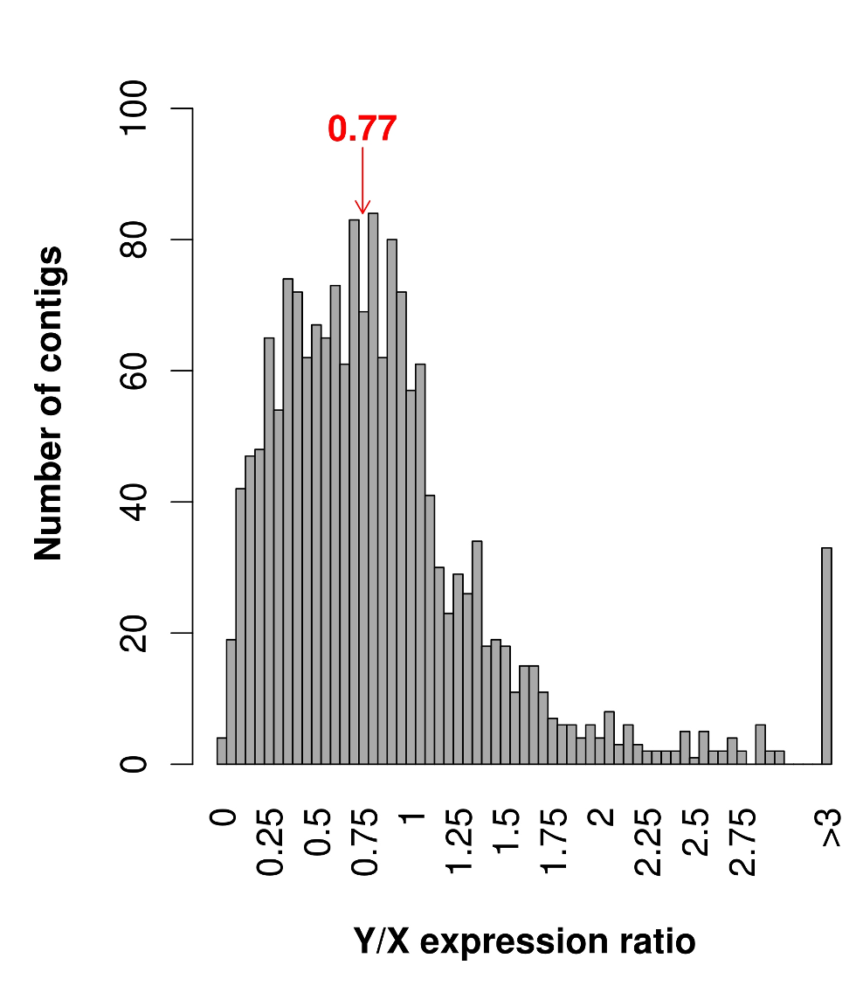
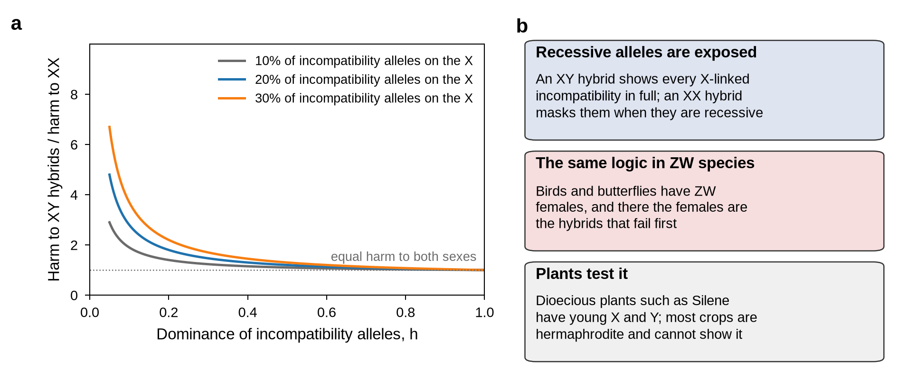

# Chapter 26. Sex chromosomes, Y degeneration and Haldane’s rule

**Status: Y degeneration after recombination arrest, Verified; its population genetic causes, Partly verified; sexual antagonism as the cause of recombination arrest, Contested. Haldane’s rule as a pattern, Verified (animals; extended to plants with sex chromosomes); its dominance explanation, Partly verified.** X and Y (or Z and W) chromosomes begin as an ordinary pair of autosomes. Once a region around the sex-determining locus stops recombining, the Y copy loses genes and function, while the X copy may evolve dosage compensation. Haldane noticed that when one sex of a species hybrid is absent, rare or sterile, it is the heterogametic sex. The same feature of sex chromosomes, hemizygosity, links the two ideas: recessive mutations on a single X are exposed, both in normal males and in hybrids.

Related notes in this repository: [y-chromosome-degeneration](../../theories/y-chromosome-degeneration/THEORY.md), [muller-ratchet](../../theories/muller-ratchet/THEORY.md), [hill-robertson-interference](../../theories/hill-robertson-interference/THEORY.md), [haldane-rule](../../theories/haldane-rule/THEORY.md), [turelli-orr-dominance-haldane](../../theories/turelli-orr-dominance-haldane/THEORY.md).

## 26.1 Statement and history

Haldane stated in 1922 that when one sex is absent, rare or sterile in the F1 of a cross between two animal species or races, it is the heterozygous sex [1]. Coyne and Orr gathered data on 119 pairs of *Drosophila* species and found that recently diverged taxa usually produce sterile or inviable male but not female hybrids, with a long gap before female hybrids are affected [2]. Turelli and Orr showed that most of the phenomena associated with Haldane’s rule follow if alleles that lower hybrid fitness are partly recessive: X-linked alleles have larger cumulative effects when hemizygous than when heterozygous, even though XX hybrids carry twice as many [3]. A later two-locus model separated interactions between heterozygous loci from those involving homozygous or hemizygous loci [4].

For sex chromosomes, Charlesworth reviewed how X and Y come to stop recombining over much of their length, why much of the Y is genetically inert, and how dosage compensation evolves [5]. Rice argued that sexually antagonistic genes accumulate near the sex-determining locus and favour reduced recombination between primitive sex chromosomes; the available summary states that very tight linkage is not required for this accumulation [6]. Once a region stops recombining, four processes can weaken selection on it: Muller’s ratchet, background selection, Hill–Robertson interference with weak selection, and hitchhiking of deleterious alleles with favourable mutations [7]. Lahn and Page found that the ages of human X–Y gene pairs place them in at least four evolutionary strata, each probably produced by an event that suppressed X–Y recombination, the first about 240–320 million years ago [8].

## 26.2 What the theory predicts

- **Strata.** X–Y divergence should increase in steps along the X, one step per recombination-suppression event [8].
- **Gene loss and its slowing.** Y-linked genes should be lost or silenced, fastest soon after recombination stops, then more slowly [9, 10].
- **Reduced efficacy of selection.** Y-linked genes should accumulate amino acid replacements and unpreferred codons, and lose expression [7, 11].
- **Dosage compensation.** X-linked expression in males should rise as Y-linked expression falls [12].
- **Haldane’s rule.** In species crosses, the heterogametic sex should be affected first, in XY and in ZW taxa (Figure 26.2) [3, 13].
- **Large X effect.** The X should have a disproportionate effect on hybrid sterility and inviability [3, 14].

## 26.3 Evidence for

- **The human Y.** The male-specific region of the human Y is a mosaic of X-transposed, X-degenerate and ampliconic sequences, with 78 protein-coding genes encoding 27 distinct proteins; the X-degenerate sequences are remnants of the ancestral autosomes [15]. Only 3% of ancestral genes survive [9].
- **Rapid loss, then conservation.** Comparing human and rhesus macaque, gene loss in the last 25 million years was limited to the youngest stratum; each stratum moved from rapid, exponential loss of ancestral genes to strict conservation by purifying selection [9]. Surviving Y genes across eight mammals are dosage-sensitive, broadly expressed regulators [16], and across 15 mammals Y gene repertoires were defined soon after stratification and have remained stable, probably because of dosage constraints [17].
- **Older Y chromosomes are renovated.** The chimpanzee and human MSYs differ radically in structure and gene content after 6 million years [18].
- **Plants degenerate too.** In *Silene latifolia*, whose sex chromosomes evolved about 10 million years ago, genomic sequencing showed that 45% of Y-linked genes are not expressed and 23% carry premature stop codons, compared with 4.3% and 1.3% for X-linked genes; degeneration is as fast as in animals [19]. Y/X expression in *S. latifolia* males is reduced overall, and X-linked expression rises as Y expression falls (Figure 26.1) [12]. In *Rumex hastatulus*, Y-linked gene loss already causes about 28% and 8% hemizygosity of the X in the ancestral XY and derived XY1Y2 systems, and remaining Y genes show more replacements, more unpreferred codons and lower expression [11].
- **Haldane’s rule.** Recently diverged *Drosophila* species produce sterile or inviable males first [2], and Orr concluded that dominance can explain Haldane’s rule for inviability and likely contributes to it for sterility, together with faster evolution of hybrid male steriles [20]. In crosses between three dioecious *Silene* species with XY chromosomes, hybrid males are rarer and more sterile than females, extending the rule to plants [13]. In *Drosophila* the X is a hotspot for hybrid male sterility factors [14].

## 26.4 Evidence against, and difficulties

- **Haploid selection slows plant Y decay.** In *S. latifolia*, degeneration is weaker in constrained genes and in genes likely to be expressed in the haploid pollen, which may explain why plants keep hundreds of expressed Y-linked genes [21].
- **Why recombination stops is unclear.** Experimental and observational evidence for sexual antagonism as the cause of recombination arrest is rare or equivocal; meiotic drive, heterozygote advantage and drift are alternatives [22, 23]. A model with coevolving cis and trans regulators produces recombination arrest and degeneration without any selection related to sexual dimorphism [24].
- **Many exceptions.** Sex chromosome pairs are not always derived from homologous autosomes, recombination suppression may spread gradually, dosage compensation varies in efficacy, and frequent turnover breaks the assumption of a linear path to heteromorphism [25, 26].
- **Causes of degeneration.** The effective population size of evolving Y chromosomes is severely reduced, but which of the ratchet, background selection, interference or hitchhiking matters most is unclear [7].
- **Haldane’s rule has several causes.** Dominance, faster-male evolution and faster-X evolution may all contribute [20, 27]. The number of independent examples and the genetic causes are still debated [28]. Explaining the large X effect needs more than dominance [4, 14].

## 26.5 Status and reasoning

**Y degeneration after recombination arrest: verified.** Gene loss, silencing and reduced selection efficacy on non-recombining Y chromosomes are documented in mammals [9, 15, 17] and in plants [11, 19]. **Its causes: partly verified,** because reduced effective population size is shown but the contribution of each process is not [7]. **Sexual antagonism as the cause of recombination arrest: contested** [22, 24]. **Haldane’s rule as a pattern: verified** in animals [2, 20] and extended to *Silene* [13]. **The dominance explanation: partly verified,** because it accounts for inviability but is one of several causes of hybrid sterility [20, 27].

## 26.6 Plants, crops and grapevine

- **Plant sex chromosomes.** Sex chromosomes are known in at least 48 land plant species from 20 families, and the XY system is found in 44 of them [29]. Many plants have young sex-linked regions that show repeat accumulation and genetic degeneration [30].
- **Two-gene sex determination.** In asparagus, deletion of a Y-specific region converts males to females, loss of a single suppressor of female development gives hermaphrodites, and an anther-specific gene in the region supports a two-gene model [31]. Kiwifruit has two Y-encoded sex determinants, *SyGI* and *FrBy*, in a male-specific region of less than 1 Mb [32]. In persimmon, a Y-encoded small RNA, *OGI*, represses the autosomal feminizing gene *MeGI* [33]; *MeGI* arose after a lineage-specific whole-genome duplication [34]. In papaya, the X itself has expanded and gained and lost genes since recombination stopped [35].
- **Grapevine.** Wild *Vitis vinifera* ssp. *sylvestris* has an XY system and the cultivated vine a modified Y haplotype; candidate male-sterility genes lie on the X haplotype and a Y allele of a cytokinin regulator may cause female sterility [36]. Phased assemblies of 20 *Vitis* sex-determining region haplotypes identified *VviINP1* as a candidate male-sterility mutation and *VviYABBY3* as a possible female-sterility factor, and suggest that dioecy was lost by a rare recombination between male and female haplotypes [37]. Resequencing of 556 accessions shows that the region is conserved across the genus, and at least two independent recombination events, H1 and H2, led to hermaphroditism [38].
- **Clonal propagation.** Grapevine’s sex-determining region is small, and the cultivated vine is hermaphrodite and propagated by cuttings [36, 38]. Y degeneration and Haldane’s rule need sexual generations and hybrids between dioecious species, so they are studied in wild *Vitis* rather than in cultivars.

## 26.7 How to test it with public data

- **Data.** Male and female genome assemblies and resequencing data [19, 37]; RNA-seq from males and females for allele-specific expression [12]; crossing data between species with sex chromosomes [2, 13].
- **Tools.** Methods that find sex-linked SNPs from family RNA-seq [12]; X–Y divergence and synonymous-site dating of strata [8]; phased assembly of sex-determining regions [37].
- **Analysis.** (1) Compute Y/X expression ratios and the ratio of male X to female X expression [12]. (2) Count stop codons and silenced genes on Y and X copies [19]. (3) Compare hybrid sex ratios and fertility between the sexes in species crosses [13]. The script [`scripts/ch26_sex_chromosome_figures.py`](../scripts/ch26_sex_chromosome_figures.py) computes how much more an XY than an XX hybrid suffers under the dominance theory (Figure 26.2).
- **What would refute it.** Old non-recombining Y chromosomes with no loss of genes or expression, or species crosses in which the homogametic sex regularly fails first.

## 26.8 Open questions

- What stops recombination between proto-sex chromosomes [22, 24]?
- Which process dominates Y degeneration [7, 10]?
- How far does haploid selection protect plant Y genes [21]?
- How general is Haldane’s rule in plants [13, 28]?

## 26.9 Common mistakes

- Assuming that Y chromosomes keep losing genes at the same rate; loss slows and stops in old strata [9].
- Missing degenerate Y genes by studying only expressed transcripts [19].
- Treating dominance as the only cause of Haldane’s rule [20, 27].
- Calling any sex-linked region a degenerating Y; grapevine’s region is small and conserved [38].

## Figures

**Figure 26.1.** Distribution of Y/X expression ratios in *S. latifolia* males for the 1,736 sex-linked contigs. Total Y and X read numbers were summed at sex-linked SNP locations for each contig and normalized for each male separately, then averaged across males to obtain the Y/X ratio. The median is shown in red. Reproduced unchanged from Muyle A, Zemp N, Deschamps C, et al. (2012) Rapid de novo evolution of X chromosome dosage compensation in *Silene latifolia*, a plant with young sex chromosomes. *PLoS Biology* 10:e1001308, Figure 1. https://doi.org/10.1371/journal.pbio.1001308. Licence: CC BY 4.0 (https://creativecommons.org/licenses/by/4.0/).

**Figure 26.2.** (a) Expected harm to XY hybrids divided by harm to XX hybrids, (1 − x) + x/h, when a fraction x of hybrid incompatibility alleles are X-linked and each harms a heterozygote with weight h and a hemizygote with weight 1. Interactions between loci, faster-X and faster-male evolution are left out, so the values are illustrative. (b) What the model shows. Made with [`scripts/ch26_sex_chromosome_figures.py`](../scripts/ch26_sex_chromosome_figures.py); the calculation is deterministic.

## References

1. Haldane JBS (1922) Sex ratio and unisexual sterility in hybrid animals. *Journal of Genetics* 12:101-109. https://doi.org/10.1007/BF02983075
2. Coyne JA, Orr HA (1989) Patterns of speciation in Drosophila. *Evolution* 43:362-381. https://doi.org/10.1111/j.1558-5646.1989.tb04233.x
3. Turelli M, Orr HA (1995) The dominance theory of Haldane's rule. *Genetics* 140:389-402. https://doi.org/10.1093/genetics/140.1.389
4. Turelli M, Orr HA (2000) Dominance, Epistasis and the Genetics of Postzygotic Isolation. *Genetics* 154:1663-1679. https://doi.org/10.1093/genetics/154.4.1663
5. Charlesworth B (1991) The Evolution of Sex Chromosomes. *Science* 251:1030-1033. https://doi.org/10.1126/science.1998119
6. Rice WR (1987) The accumulation of sexually antagonistic genes as a selective agent promoting the evolution of reduced recombination between primitive sex chromosomes. *Evolution* 41:911-914. https://doi.org/10.1111/j.1558-5646.1987.tb05864.x
7. Charlesworth B, Charlesworth D (2000) The degeneration of Y chromosomes. *Philosophical Transactions of the Royal Society of London. Series B: Biological Sciences* 355:1563-1572. https://doi.org/10.1098/rstb.2000.0717
8. Lahn BT, Page DC (1999) Four Evolutionary Strata on the Human X Chromosome. *Science* 286:964-967. https://doi.org/10.1126/science.286.5441.964
9. Hughes JF, Skaletsky H, Brown LG, et al. (2012) Strict evolutionary conservation followed rapid gene loss on human and rhesus Y chromosomes. *Nature* 483:82-86. https://doi.org/10.1038/nature10843
10. Bachtrog D (2013) Y-chromosome evolution: emerging insights into processes of Y-chromosome degeneration. *Nature Reviews Genetics* 14:113-124. https://doi.org/10.1038/nrg3366
11. Hough J, Hollister JD, Wang W, et al. (2014) Genetic degeneration of old and young Y chromosomes in the flowering plant Rumex hastatulus. *Proceedings of the National Academy of Sciences* 111:7713-7718. https://doi.org/10.1073/pnas.1319227111
12. Muyle A, Zemp N, Deschamps C, et al. (2012) Rapid De Novo Evolution of X Chromosome Dosage Compensation in Silene latifolia, a Plant with Young Sex Chromosomes. *PLoS Biology* 10:e1001308. https://doi.org/10.1371/journal.pbio.1001308
13. Brothers AN, Delph LF (2010) Haldane’s rule is extended to plants with sex chromosomes. *Evolution* 64:3643-3648. https://doi.org/10.1111/j.1558-5646.2010.01095.x
14. Presgraves DC (2008) Sex chromosomes and speciation in Drosophila. *Trends in Genetics* 24:336-343. https://doi.org/10.1016/j.tig.2008.04.007
15. Skaletsky H, Kuroda-Kawaguchi T, Minx PJ, et al. (2003) The male-specific region of the human Y chromosome is a mosaic of discrete sequence classes. *Nature* 423:825-837. https://doi.org/10.1038/nature01722
16. Bellott DW, Hughes JF, Skaletsky H, et al. (2014) Mammalian Y chromosomes retain widely expressed dosage-sensitive regulators. *Nature* 508:494-499. https://doi.org/10.1038/nature13206
17. Cortez D, Marin R, Toledo-Flores D, et al. (2014) Origins and functional evolution of Y chromosomes across mammals. *Nature* 508:488-493. https://doi.org/10.1038/nature13151
18. Hughes JF, Skaletsky H, Pyntikova T, et al. (2010) Chimpanzee and human Y chromosomes are remarkably divergent in structure and gene content. *Nature* 463:536-539. https://doi.org/10.1038/nature08700
19. Papadopulos AST, Chester M, Ridout K, et al. (2015) Rapid Y degeneration and dosage compensation in plant sex chromosomes. *Proceedings of the National Academy of Sciences* 112:13021-13026. https://doi.org/10.1073/pnas.1508454112
20. Orr HA (1997) Haldane's Rule. *Annual Review of Ecology and Systematics* 28:195-218. https://doi.org/10.1146/annurev.ecolsys.28.1.195
21. Chibalina M, Filatov D (2011) Plant Y Chromosome Degeneration Is Retarded by Haploid Purifying Selection. *Current Biology* 21:1475-1479. https://doi.org/10.1016/j.cub.2011.07.045
22. Ponnikas S, Sigeman H, Abbott JK, et al. (2018) Why Do Sex Chromosomes Stop Recombining? *Trends in Genetics* 34:492-503. https://doi.org/10.1016/j.tig.2018.04.001
23. Wright AE, Dean R, Zimmer F, et al. (2016) How to make a sex chromosome. *Nature Communications* 7:12087. https://doi.org/10.1038/ncomms12087
24. Lenormand T, Roze D (2022) Y recombination arrest and degeneration in the absence of sexual dimorphism. *Science* 375:663-666. https://doi.org/10.1126/science.abj1813
25. Furman BLS, Metzger DCH, Darolti I, et al. (2020) Sex Chromosome Evolution: So Many Exceptions to the Rules. *Genome Biology and Evolution* 12:750-763. https://doi.org/10.1093/gbe/evaa081
26. Bachtrog D, Mank JE, Peichel CL, et al. (2014) Sex Determination: Why So Many Ways of Doing It? *PLoS Biology* 12:e1001899. https://doi.org/10.1371/journal.pbio.1001899
27. Cowell F (2023) 100 years of Haldane's rule. *Journal of Evolutionary Biology* 36:337-346. https://doi.org/10.1111/jeb.14112
28. Delph LF, Demuth JP (2016) Haldane’s Rule: Genetic Bases and Their Empirical Support. *Journal of Heredity* 107:383-391. https://doi.org/10.1093/jhered/esw026
29. Ming R, Bendahmane A, Renner SS (2011) Sex Chromosomes in Land Plants. *Annual Review of Plant Biology* 62:485-514. https://doi.org/10.1146/annurev-arplant-042110-103914
30. Charlesworth D (2016) Plant Sex Chromosomes. *Annual Review of Plant Biology* 67:397-420. https://doi.org/10.1146/annurev-arplant-043015-111911
31. Harkess A, Zhou J, Xu C, et al. (2017) The asparagus genome sheds light on the origin and evolution of a young Y chromosome. *Nature Communications* 8:1279. https://doi.org/10.1038/s41467-017-01064-8
32. Akagi T, Pilkington SM, Varkonyi-Gasic E, et al. (2019) Two Y-chromosome-encoded genes determine sex in kiwifruit. *Nature Plants* 5:801-809. https://doi.org/10.1038/s41477-019-0489-6
33. Akagi T, Henry IM, Tao R, et al. (2014) A Y-chromosome–encoded small RNA acts as a sex determinant in persimmons. *Science* 346:646-650. https://doi.org/10.1126/science.1257225
34. Akagi T, Shirasawa K, Nagasaki H, et al. (2020) The persimmon genome reveals clues to the evolution of a lineage-specific sex determination system in plants. *PLOS Genetics* 16:e1008566. https://doi.org/10.1371/journal.pgen.1008566
35. Gschwend AR, Yu Q, Tong EJ, et al. (2012) Rapid divergence and expansion of the X chromosome in papaya. *Proceedings of the National Academy of Sciences* 109:13716-13721. https://doi.org/10.1073/pnas.1121096109
36. Badouin H, Velt A, Gindraud F, et al. (2020) The wild grape genome sequence provides insights into the transition from dioecy to hermaphroditism during grape domestication. *Genome Biology* 21:223. https://doi.org/10.1186/s13059-020-02131-y
37. Massonnet M, Cochetel N, Minio A, et al. (2020) The genetic basis of sex determination in grapes. *Nature Communications* 11:2902. https://doi.org/10.1038/s41467-020-16700-z
38. Zou C, Massonnet M, Minio A, et al. (2021) Multiple independent recombinations led to hermaphroditism in grapevine. *Proceedings of the National Academy of Sciences* 118:e2023548118. https://doi.org/10.1073/pnas.2023548118
