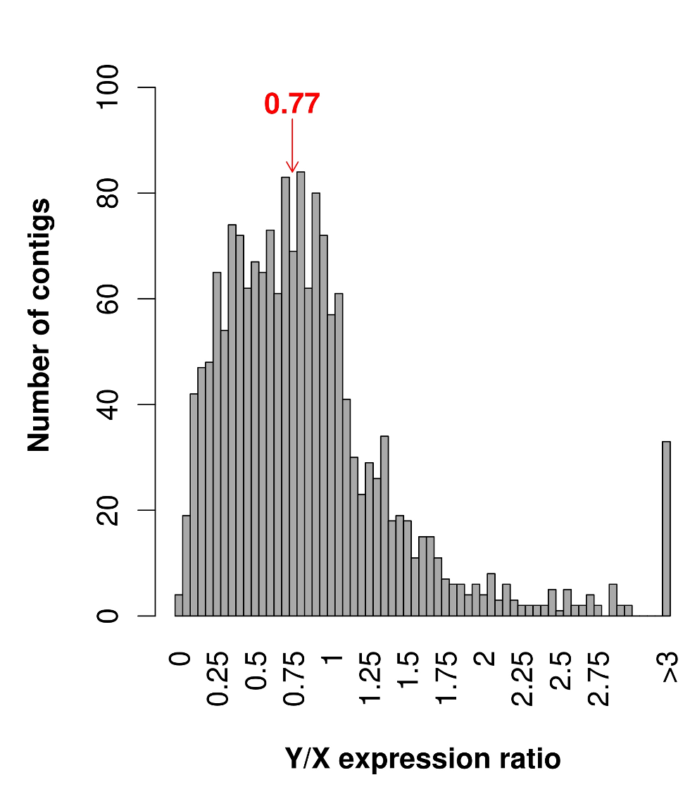
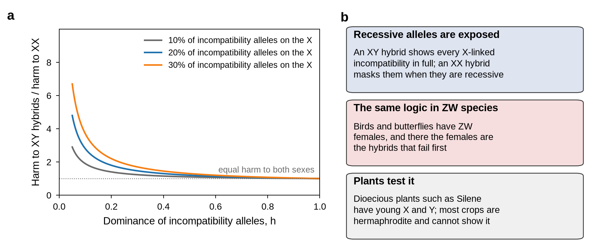

# 第 26 章 性染色体、Y 退化与 Haldane 法则

**地位：重组停止后的 Y 退化，已验证；其群体遗传成因，部分验证；性拮抗作为重组停止的原因，有争议。Haldane 法则作为一种格局，已验证（动物；已推广到有性染色体的植物）；其显性解释，部分验证。** X 和 Y（或 Z 和 W）染色体起源于一对普通常染色体。一旦性别决定位点周围的区域停止重组，Y 上的拷贝就会丢失基因和功能，而 X 上的拷贝可能进化出剂量补偿。Haldane 注意到，当物种杂种的某一性别缺失、稀少或不育时，受影响的是异配性别。两种观点由性染色体的同一特征联系在一起，即半合性：单条 X 上的隐性突变会暴露出来，在正常雄性和杂种中都是如此。

本仓库相关条目：[y-chromosome-degeneration](../../theories/y-chromosome-degeneration/THEORY.md)、[muller-ratchet](../../theories/muller-ratchet/THEORY.md)、[hill-robertson-interference](../../theories/hill-robertson-interference/THEORY.md)、[haldane-rule](../../theories/haldane-rule/THEORY.md)、[turelli-orr-dominance-haldane](../../theories/turelli-orr-dominance-haldane/THEORY.md)。

## 26.1 内容与历史

Haldane 在 1922 年指出，在两个动物物种或种族杂交的 F1 中，如果一个性别缺失、稀少或不育，那就是杂合性别 [1]。Coyne 和 Orr 收集了 119 对果蝇物种的数据，发现新近分化的类群通常产生不育或不能存活的雄性杂种，而雌性杂种正常，此后要经过很长时间雌性杂种才受影响 [2]。Turelli 和 Orr 证明，只要降低杂种适合度的等位基因是部分隐性的，与 Haldane 法则有关的大部分现象就都能得到解释：X 连锁等位基因在半合状态下的累积效应大于杂合状态，即使 XX 杂种携带的此类等位基因是 XY 的两倍 [3]。后来的双位点模型区分了杂合位点之间的相互作用与涉及纯合或半合位点的相互作用 [4]。

关于性染色体，Charlesworth 综述了 X 和 Y 如何在大部分长度上停止重组、为什么 Y 的大部分在遗传上是惰性的，以及剂量补偿如何进化 [5]。Rice 认为性拮抗基因在性别决定位点附近积累，并有利于原始性染色体之间重组的减少；现有的摘要说明，这种积累并不需要非常紧密的连锁 [6]。一个区域停止重组后，有四个过程可以削弱作用于它的选择：Muller 棘轮、背景选择、弱选择下的 Hill–Robertson 干扰，以及有害等位基因随有利突变的搭车 [7]。Lahn 和 Page 发现，人类 X–Y 基因对的年龄把它们划分为至少四个进化层，每一层大概都由一次抑制 X–Y 重组的事件造成，第一次发生在约 2.4 亿至 3.2 亿年前 [8]。

## 26.2 预测

- **进化层。** X–Y 分化应当沿 X 呈阶梯式增加，每一次重组抑制事件对应一级 [8]。
- **基因丢失及其放缓。** Y 连锁基因应当丢失或沉默，在重组刚停止时最快，之后变慢 [9, 10]。
- **选择效率下降。** Y 连锁基因应当积累氨基酸替换和非偏好密码子，并丧失表达 [7, 11]。
- **剂量补偿。** 随着 Y 连锁表达下降，雄性中 X 连锁表达应当上升 [12]。
- **Haldane 法则。** 在物种杂交中，异配性别应当先受影响，在 XY 和 ZW 类群中都是如此（图 26.2）[3, 13]。
- **大 X 效应。** X 对杂种不育和不能存活应有不成比例的影响 [3, 14]。

## 26.3 支持证据

- **人类 Y。** 人类 Y 的雄性特异区是 X 转座序列、X 退化序列和扩增序列的镶嵌体，含 78 个蛋白编码基因，编码 27 种不同蛋白；X 退化序列是祖先常染色体的残余 [15]。祖先基因只剩下 3% [9]。
- **先快速丢失，后保持保守。** 比较人和恒河猴发现，人类谱系过去 2500 万年的基因丢失只限于最年轻的进化层；每一层都从祖先基因的快速指数丢失转为在纯化选择下严格保守 [9]。八种哺乳动物中保留下来的 Y 基因是对剂量敏感、广泛表达的调控因子 [16]；在 15 种哺乳动物中，Y 基因集合在分层后很快确定，此后保持稳定，大概是因为剂量约束 [17]。
- **较老的 Y 会被改造。** 黑猩猩和人类的雄性特异区在 600 万年后结构和基因组成已截然不同 [18]。
- **植物也会退化。** 白麦瓶草（*Silene latifolia*）的性染色体约在 1000 万年前形成；基因组测序显示 45% 的 Y 连锁基因不表达、23% 带有提前终止密码子，而 X 连锁基因分别只有 4.3% 和 1.3%；退化速度与动物一样快 [19]。白麦瓶草雄性中 Y/X 表达比总体降低，而且 Y 表达下降时 X 连锁表达上升（图 26.1）[12]。在 *Rumex hastatulus* 中，Y 连锁基因的丢失已经使祖先型 XY 系统和衍生型 XY1Y2 系统中的 X 分别约有 28% 和 8% 呈半合状态；保留下来的 Y 基因有更多氨基酸替换、更多非偏好密码子，表达也更低 [11]。
- **Haldane 法则。** 新近分化的果蝇物种先产生不育或不能存活的雄性 [2]。一篇综述认为，显性可以解释不能存活方面的 Haldane 法则，并且很可能也促成了不育方面的法则，杂种雄性不育因子的较快进化也起重要作用 [20]。在三个具 XY 性染色体的雌雄异株麦瓶草物种之间的杂交中，杂种雄性比雌性更少、更不育，从而把这一法则推广到植物 [13]。在果蝇中，X 是杂种雄性不育因子的热点 [14]。

## 26.4 反面证据与难点

- **单倍体选择减缓植物 Y 的衰退。** 在白麦瓶草中，受约束较强的基因和可能在单倍体花粉中表达的基因退化较弱，这可能解释为什么植物保留了数百个表达的 Y 连锁基因 [21]。
- **重组为什么停止并不清楚。** 支持性拮抗是重组停止原因的实验和观察证据很少或模棱两可；减数分裂驱动、杂合子优势和漂变是其他可能 [22, 23]。一个包含共同进化的顺式和反式调控因子的模型，在没有任何与两性差异有关的选择的情况下，就产生了重组停止和退化 [24]。
- **例外很多。** 性染色体对并不总是来自同源常染色体，重组抑制可能是逐渐扩展的，剂量补偿的效果各不相同，频繁的更替也打破了走向异形的线性路径这一假设 [25, 26]。
- **退化的成因。** 正在进化的 Y 染色体的有效群体大小严重下降，但棘轮、背景选择、干扰和搭车中哪一个最重要尚不清楚 [7]。
- **Haldane 法则有多种成因。** 显性、雄性较快进化和 X 较快进化可能都有贡献 [20, 27]。独立实例的数量和遗传原因仍有争论 [28]。解释大 X 效应需要的不只是显性 [4, 14]。

## 26.5 地位与理由

**重组停止后的 Y 退化：已验证。** 不重组 Y 染色体上的基因丢失、沉默和选择效率下降，在哺乳动物 [9, 15, 17] 和植物 [11, 19] 中都有记录。**其成因：部分验证**，因为有效群体大小的下降已被证明，但各过程的贡献没有 [7]。**性拮抗作为重组停止的原因：有争议** [22, 24]。**Haldane 法则作为一种格局：已验证**，在动物中 [2, 20]，并已推广到麦瓶草属 [13]。**显性解释：部分验证**，因为它能说明不能存活，但只是杂种不育的若干原因之一 [20, 27]。

## 26.6 植物、作物与葡萄

- **植物性染色体。** 已知至少 20 个科 48 种陆生植物有性染色体，其中 44 种为 XY 系统 [29]。许多植物的性连锁区很年轻，表现出重复序列积累和遗传退化 [30]。
- **双基因性别决定。** 在石刁柏中，删除一个 Y 特异区会使雄株变为雌株，失去一个抑制雌性发育的基因则产生两性株，而该区域中一个花药特异基因支持双基因模型 [31]。猕猴桃有两个 Y 编码的性别决定基因 *SyGI* 和 *FrBy*，位于不到 1 Mb 的雄性特异区内 [32]。在柿属中，一个 Y 编码的小 RNA *OGI* 抑制常染色体上的雌性化基因 *MeGI* [33]；*MeGI* 起源于一次谱系特有的全基因组加倍之后 [34]。在番木瓜中，重组停止以来 X 本身已经扩张，并获得和丢失了基因 [35]。
- **葡萄。** 野生葡萄 *Vitis vinifera* ssp. *sylvestris* 为 XY 系统，栽培葡萄带有一个改变了的 Y 单倍型；候选雄性不育基因位于 X 单倍型上，而一个细胞分裂素调控基因的 Y 等位基因可能造成雌性不育 [36]。对 20 个葡萄属性别决定区单倍型的定相组装，鉴定出 *VviINP1* 为候选雄性不育突变、*VviYABBY3* 为可能的雌性不育因子，并提示雌雄异株是通过雄性与雌性单倍型之间一次罕见的重组而丧失的 [37]。556 份材料的重测序显示该区域在全属中保守，至少两次独立的重组事件 H1 和 H2 导致了两性花 [38]。
- **无性繁殖。** 葡萄的性别决定区很小，栽培葡萄是两性花，并用插条繁殖 [36, 38]。Y 退化和 Haldane 法则需要有性世代以及雌雄异株物种之间的杂种，因此要在野生葡萄属物种中研究，而不是在栽培品种中。

## 26.7 用公开数据检验

- **数据。** 雄性和雌性的基因组组装与重测序数据 [19, 37]；用于等位基因特异表达的雌雄 RNA-seq [12]；有性染色体物种之间的杂交数据 [2, 13]。
- **工具。** 从家系 RNA-seq 中寻找性连锁 SNP 的方法 [12]；X–Y 分化与基于同义位点的进化层定年 [8]；性别决定区的定相组装 [37]。
- **分析。** (1) 计算 Y/X 表达比，以及雄性 X 与雌性 X 的表达比 [12]。(2) 统计 Y 和 X 拷贝上的终止密码子和沉默基因 [19]。(3) 在物种杂交中比较两性杂种的性比和育性 [13]。脚本 [`scripts/ch26_sex_chromosome_figures.py`](../scripts/ch26_sex_chromosome_figures.py) 计算在显性理论下 XY 杂种比 XX 杂种多受多少损害（图 26.2）。
- **什么结果会推翻理论。** 古老的不重组 Y 染色体没有丢失基因或表达；或者在物种杂交中，同配性别经常先出问题。

## 26.8 未解决的问题

- 是什么使原始性染色体之间的重组停止 [22, 24]？
- 哪个过程主导 Y 退化 [7, 10]？
- 单倍体选择在多大程度上保护植物 Y 基因 [21]？
- Haldane 法则在植物中有多普遍 [13, 28]？

## 26.9 常见错误

- 以为 Y 染色体会一直以相同速度丢失基因；在古老的进化层中，丢失会放缓并停止 [9]。
- 只研究表达的转录本，从而漏掉退化的 Y 基因 [19]。
- 把显性当作 Haldane 法则的唯一原因 [20, 27]。
- 把任何性连锁区都称为正在退化的 Y；葡萄的这一区域很小而且保守 [38]。

## 图

**图 26.1.** 白麦瓶草（*S. latifolia*）雄性中 1,736 个性连锁重叠群的 Y/X 表达比分布。在每个重叠群的性连锁 SNP 位置汇总 Y 和 X 的读段数，对每个雄性分别标准化，再在雄性之间取平均得到 Y/X 比。中位数用红色标出。原样转载自 Muyle A, Zemp N, Deschamps C, et al. (2012) Rapid de novo evolution of X chromosome dosage compensation in *Silene latifolia*, a plant with young sex chromosomes. *PLoS Biology* 10:e1001308, Figure 1. https://doi.org/10.1371/journal.pbio.1001308。许可：CC BY 4.0（https://creativecommons.org/licenses/by/4.0/）。

**图 26.2.** (a) XY 杂种所受损害与 XX 杂种所受损害之比 (1 − x) + x/h；其中比例 x 的杂种不亲和等位基因位于 X 上，每个等位基因对杂合子的损害权重为 h，对半合子为 1。图中略去了位点间相互作用以及 X 较快进化和雄性较快进化，数值仅作示意。(b) 模型说明了什么。用 [`scripts/ch26_sex_chromosome_figures.py`](../scripts/ch26_sex_chromosome_figures.py) 生成；计算是确定性的。

## 参考文献

1. Haldane JBS (1922) Sex ratio and unisexual sterility in hybrid animals. *Journal of Genetics* 12:101-109. https://doi.org/10.1007/BF02983075
2. Coyne JA, Orr HA (1989) Patterns of speciation in Drosophila. *Evolution* 43:362-381. https://doi.org/10.1111/j.1558-5646.1989.tb04233.x
3. Turelli M, Orr HA (1995) The dominance theory of Haldane's rule. *Genetics* 140:389-402. https://doi.org/10.1093/genetics/140.1.389
4. Turelli M, Orr HA (2000) Dominance, Epistasis and the Genetics of Postzygotic Isolation. *Genetics* 154:1663-1679. https://doi.org/10.1093/genetics/154.4.1663
5. Charlesworth B (1991) The Evolution of Sex Chromosomes. *Science* 251:1030-1033. https://doi.org/10.1126/science.1998119
6. Rice WR (1987) The accumulation of sexually antagonistic genes as a selective agent promoting the evolution of reduced recombination between primitive sex chromosomes. *Evolution* 41:911-914. https://doi.org/10.1111/j.1558-5646.1987.tb05864.x
7. Charlesworth B, Charlesworth D (2000) The degeneration of Y chromosomes. *Philosophical Transactions of the Royal Society of London. Series B: Biological Sciences* 355:1563-1572. https://doi.org/10.1098/rstb.2000.0717
8. Lahn BT, Page DC (1999) Four Evolutionary Strata on the Human X Chromosome. *Science* 286:964-967. https://doi.org/10.1126/science.286.5441.964
9. Hughes JF, Skaletsky H, Brown LG, et al. (2012) Strict evolutionary conservation followed rapid gene loss on human and rhesus Y chromosomes. *Nature* 483:82-86. https://doi.org/10.1038/nature10843
10. Bachtrog D (2013) Y-chromosome evolution: emerging insights into processes of Y-chromosome degeneration. *Nature Reviews Genetics* 14:113-124. https://doi.org/10.1038/nrg3366
11. Hough J, Hollister JD, Wang W, et al. (2014) Genetic degeneration of old and young Y chromosomes in the flowering plant Rumex hastatulus. *Proceedings of the National Academy of Sciences* 111:7713-7718. https://doi.org/10.1073/pnas.1319227111
12. Muyle A, Zemp N, Deschamps C, et al. (2012) Rapid De Novo Evolution of X Chromosome Dosage Compensation in Silene latifolia, a Plant with Young Sex Chromosomes. *PLoS Biology* 10:e1001308. https://doi.org/10.1371/journal.pbio.1001308
13. Brothers AN, Delph LF (2010) Haldane’s rule is extended to plants with sex chromosomes. *Evolution* 64:3643-3648. https://doi.org/10.1111/j.1558-5646.2010.01095.x
14. Presgraves DC (2008) Sex chromosomes and speciation in Drosophila. *Trends in Genetics* 24:336-343. https://doi.org/10.1016/j.tig.2008.04.007
15. Skaletsky H, Kuroda-Kawaguchi T, Minx PJ, et al. (2003) The male-specific region of the human Y chromosome is a mosaic of discrete sequence classes. *Nature* 423:825-837. https://doi.org/10.1038/nature01722
16. Bellott DW, Hughes JF, Skaletsky H, et al. (2014) Mammalian Y chromosomes retain widely expressed dosage-sensitive regulators. *Nature* 508:494-499. https://doi.org/10.1038/nature13206
17. Cortez D, Marin R, Toledo-Flores D, et al. (2014) Origins and functional evolution of Y chromosomes across mammals. *Nature* 508:488-493. https://doi.org/10.1038/nature13151
18. Hughes JF, Skaletsky H, Pyntikova T, et al. (2010) Chimpanzee and human Y chromosomes are remarkably divergent in structure and gene content. *Nature* 463:536-539. https://doi.org/10.1038/nature08700
19. Papadopulos AST, Chester M, Ridout K, et al. (2015) Rapid Y degeneration and dosage compensation in plant sex chromosomes. *Proceedings of the National Academy of Sciences* 112:13021-13026. https://doi.org/10.1073/pnas.1508454112
20. Orr HA (1997) Haldane's Rule. *Annual Review of Ecology and Systematics* 28:195-218. https://doi.org/10.1146/annurev.ecolsys.28.1.195
21. Chibalina M, Filatov D (2011) Plant Y Chromosome Degeneration Is Retarded by Haploid Purifying Selection. *Current Biology* 21:1475-1479. https://doi.org/10.1016/j.cub.2011.07.045
22. Ponnikas S, Sigeman H, Abbott JK, et al. (2018) Why Do Sex Chromosomes Stop Recombining? *Trends in Genetics* 34:492-503. https://doi.org/10.1016/j.tig.2018.04.001
23. Wright AE, Dean R, Zimmer F, et al. (2016) How to make a sex chromosome. *Nature Communications* 7:12087. https://doi.org/10.1038/ncomms12087
24. Lenormand T, Roze D (2022) Y recombination arrest and degeneration in the absence of sexual dimorphism. *Science* 375:663-666. https://doi.org/10.1126/science.abj1813
25. Furman BLS, Metzger DCH, Darolti I, et al. (2020) Sex Chromosome Evolution: So Many Exceptions to the Rules. *Genome Biology and Evolution* 12:750-763. https://doi.org/10.1093/gbe/evaa081
26. Bachtrog D, Mank JE, Peichel CL, et al. (2014) Sex Determination: Why So Many Ways of Doing It? *PLoS Biology* 12:e1001899. https://doi.org/10.1371/journal.pbio.1001899
27. Cowell F (2023) 100 years of Haldane's rule. *Journal of Evolutionary Biology* 36:337-346. https://doi.org/10.1111/jeb.14112
28. Delph LF, Demuth JP (2016) Haldane’s Rule: Genetic Bases and Their Empirical Support. *Journal of Heredity* 107:383-391. https://doi.org/10.1093/jhered/esw026
29. Ming R, Bendahmane A, Renner SS (2011) Sex Chromosomes in Land Plants. *Annual Review of Plant Biology* 62:485-514. https://doi.org/10.1146/annurev-arplant-042110-103914
30. Charlesworth D (2016) Plant Sex Chromosomes. *Annual Review of Plant Biology* 67:397-420. https://doi.org/10.1146/annurev-arplant-043015-111911
31. Harkess A, Zhou J, Xu C, et al. (2017) The asparagus genome sheds light on the origin and evolution of a young Y chromosome. *Nature Communications* 8:1279. https://doi.org/10.1038/s41467-017-01064-8
32. Akagi T, Pilkington SM, Varkonyi-Gasic E, et al. (2019) Two Y-chromosome-encoded genes determine sex in kiwifruit. *Nature Plants* 5:801-809. https://doi.org/10.1038/s41477-019-0489-6
33. Akagi T, Henry IM, Tao R, et al. (2014) A Y-chromosome–encoded small RNA acts as a sex determinant in persimmons. *Science* 346:646-650. https://doi.org/10.1126/science.1257225
34. Akagi T, Shirasawa K, Nagasaki H, et al. (2020) The persimmon genome reveals clues to the evolution of a lineage-specific sex determination system in plants. *PLOS Genetics* 16:e1008566. https://doi.org/10.1371/journal.pgen.1008566
35. Gschwend AR, Yu Q, Tong EJ, et al. (2012) Rapid divergence and expansion of the X chromosome in papaya. *Proceedings of the National Academy of Sciences* 109:13716-13721. https://doi.org/10.1073/pnas.1121096109
36. Badouin H, Velt A, Gindraud F, et al. (2020) The wild grape genome sequence provides insights into the transition from dioecy to hermaphroditism during grape domestication. *Genome Biology* 21:223. https://doi.org/10.1186/s13059-020-02131-y
37. Massonnet M, Cochetel N, Minio A, et al. (2020) The genetic basis of sex determination in grapes. *Nature Communications* 11:2902. https://doi.org/10.1038/s41467-020-16700-z
38. Zou C, Massonnet M, Minio A, et al. (2021) Multiple independent recombinations led to hermaphroditism in grapevine. *Proceedings of the National Academy of Sciences* 118:e2023548118. https://doi.org/10.1073/pnas.2023548118
