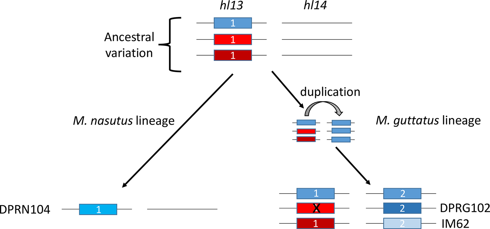
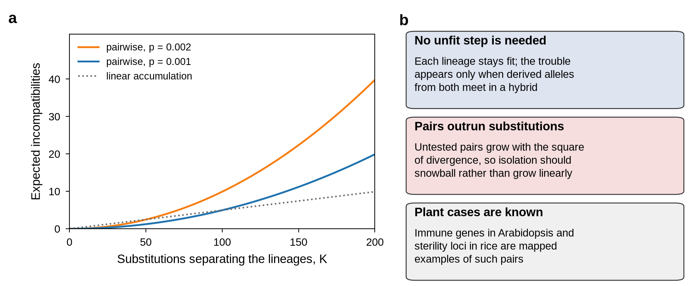

# Chapter 27. Dobzhansky–Muller incompatibilities

**Status: Dobzhansky–Muller incompatibilities as a cause of hybrid sterility and inviability, Verified; faster-than-linear accumulation (the snowball), Partly verified; the evolutionary forces that drive the diverging alleles, Contested.** Two populations that are separated can each fix new alleles that work well on their own genetic background. When the populations meet, the derived alleles from both sides are combined for the first time in hybrids, and some pairs do not work together. No intermediate genotype has to be unfit, so incompatibility can evolve without crossing a fitness valley. Since the 1990s the model has gained population genetic theory, quantitative tests and many cloned incompatibility genes in animals and plants.

Related notes in this repository: [bateson-dobzhansky-muller-incompatibilities](../../skills/genomics-theory-mining/theories/bateson-dobzhansky-muller-incompatibilities/THEORY.md), [orr-snowball-incompatibilities](../../skills/genomics-theory-mining/theories/orr-snowball-incompatibilities/THEORY.md), [orr-turelli-2001-dmi-waiting-time](../../skills/genomics-theory-mining/theories/orr-turelli-2001-dmi-waiting-time/THEORY.md), [coyne-orr-time-course-of-isolation](../../skills/genomics-theory-mining/theories/coyne-orr-time-course-of-isolation/THEORY.md), [haldane-rule](../../skills/genomics-theory-mining/theories/haldane-rule/THEORY.md), [rieseberg-complementary-gene-hybrid-speciation](../../skills/genomics-theory-mining/theories/rieseberg-complementary-gene-hybrid-speciation/THEORY.md).

## 27.1 Statement and history

The model is named after Dobzhansky and Muller. Speciation often results from the accumulation of “complementary genes”, genes that have no deleterious effect within a species but cause inviability or sterility when brought together with genes from another species [1]. Orr modelled this process and found that the number of incompatibilities rises much faster than linearly with time, so that the probability of speciation increases at least as fast as the square of the time since separation. He also showed that all hybrid incompatibilities must initially be asymmetric, that derived alleles cause hybrid problems far more often than ancestral alleles, and that complex incompatibilities among three or more loci are easier to evolve than pairwise ones [1].

Orr and Turelli then described the stochastic accumulation of incompatibilities over time, including the variable number of substitutions and of their effects, and derived waiting times to speciation; their analysis of *Drosophila* and *Bombina* data suggested that the probability that two diverged sites contribute to hybrid sterility or inviability is very small, of the order of 10⁻⁶ or less [2]. A two-locus model distinguished interactions between heterozygous loci, between heterozygous and homozygous or hemizygous loci, and between homozygous loci, which links the model to Haldane’s rule and the large X effect [3]. Coyne and Orr’s comparative data from 119, then 171, *Drosophila* hybridizations showed that postzygotic isolation increases with divergence time and appears first in hybrid males [4, 5].

## 27.2 What the theory predicts

- **Snowball.** The number of incompatibilities should increase at least with the square of divergence (Figure 27.2) [1, 2].
- **Derived alleles are involved.** Incompatibilities should involve alleles that are derived in each lineage, and should be asymmetric at first [1].
- **Two or more loci.** Hybrid failure should map to interacting loci, not to single genes [6, 7].
- **Rare per pair.** Any one pair of diverged sites should rarely be incompatible [2].
- **Gene flow erodes them.** With migration, neutral incompatibilities cannot be maintained; selection is needed to keep them [8].

## 27.3 Evidence for

- **The snowball in flies and tomatoes.** In two pairs of *Drosophila* species, the number of genes involved in postzygotic isolation increases at least as fast as the square of the number of substitutions [9]. Between *Solanum* species, hybrid seed sterility QTL accumulate faster than linearly, while QTL for traits unrelated to sterility do not [10].
- **Interacting genes in *Drosophila*.** *Lethal hybrid rescue* diverged in *D. simulans* and interacts with *Hybrid male rescue*, which diverged in *D. melanogaster*, to kill F1 hybrid males [6]. A nuclear pore protein gene that causes hybrid inviability evolved by positive selection in both lineages [11]. The *Odysseus* homeobox at a hybrid male sterility locus evolved faster in the past half million years than in the preceding 700 million [12]. *Overdrive* causes both male sterility and segregation distortion in hybrids between subspecies of *D. pseudoobscura* [13].
- **Gene duplication and loss.** Movement of the male fertility gene *JYAlpha* to another chromosome in the *D. simulans* lineage leaves some hybrids with no copy, giving reproductive isolation without sequence evolution [14]. In Arabidopsis, divergent fates of duplicate genes cause recessive embryo lethality between strains [15]; in rice, reciprocal loss of the duplicated *DOPPELGANGER* genes in indica and japonica makes pollen nonfunctional [16]; in *Mimulus*, hybrids die when they lack a functional copy of the duplicated photosynthetic gene *pTAC14* (Figure 27.1) [17].
- **Immune genes in plants.** About 2% of intraspecific crosses in *A. thaliana* give hybrid necrosis, caused by epistatic interactions that trigger autoimmune responses, in one case involving an NB-LRR gene [7]. Testing thousands of F1 hybrids found a few incompatibility hotspots, often in NLR gene clusters, such as *DANGEROUS MIX2* [18].
- **Rice sterility loci.** At *S5*, indica and japonica alleles differ by two nucleotides, and a wide-compatibility allele allows fertile hybrids [19]; the locus is a killer–protector system of three linked genes [20]. Hybrid male sterility at *Sa* results from interaction between divergent alleles of two adjacent genes [21].
- **Genome scans of hybrid zones.** In naturally hybridizing swordtail fish, hundreds of pairs of unlinked regions are in linkage disequilibrium and probably contribute to reproductive isolation [22].

## 27.4 Evidence against, and difficulties

- **Incompatibilities segregate within species.** In *D. melanogaster* recombinant inbred lines, any two haploid genomes are expected to carry 1.15 pairs of epistatically interacting alleles, so the raw material for isolation need not arise in allopatry [23]. Hybrid necrosis within *A. thaliana* points the same way [7, 18].
- **What drives the divergence?** Many speciation genes show positive selection [11, 12], but reviews conclude that the first steps of hybrid dysfunction are not necessarily adaptive [24] and that much of the divergence may come from mutational mechanisms or genetic conflict rather than ecological adaptation [25]. Duplication and drift play important roles in plants [17, 26].
- **Not all isolation is genic.** In plants, translocations cause severe F1 sterility by disrupting meiosis, and inversions contribute by suppressing recombination [26].
- **Gene flow.** In a continent–island model, neutral incompatibilities cannot be maintained with gene flow, and the maximum migration rate depends on selection [8].
- **Plant speciation genes are often polymorphic.** Most candidate speciation genes in plants show polymorphism within species, unlike in animals [27].

## 27.5 Status and reasoning

**Incompatibilities as a cause of hybrid sterility and inviability: verified.** Interacting loci have been cloned in *Drosophila* [6, 11, 14], *Arabidopsis* [7, 15], rice [16, 20, 21] and *Mimulus* [17], as the model requires. **The snowball: partly verified,** because the two explicit tests support it [9, 10] but are few. **The forces behind divergence: contested,** with evidence for adaptation, conflict, duplication and drift [24, 25, 26].

## 27.6 Plants, crops and grapevine

- **Plant speciation genes.** Of 41 candidate plant speciation genes, 8 contribute to hybrid inviability and 25 to hybrid sterility; disease resistance genes underlie hybrid necrosis and chimeric mitochondrial and pentatricopeptide repeat genes underlie cytoplasmic male sterility [27]. Conflict and coevolution, duplication and drift all contribute to plant genic incompatibilities [26].
- **Rice breeding.** The indica–japonica barrier involves *S5* [19, 20], *Sa* [21] and *DPL1/DPL2* [16]. The wide-compatibility allele of *S5* lets breeders make fertile inter-subspecific hybrids [19].
- **Grapevine.** American wild grapes include hybrid species such as *V.* × *champinii* and *V.* × *doaniana*, and genome-wide SNPs show gene flow even between distantly related species; glacial cycles may have brought interfertile taxa into contact [28]. American grapes are an important resource for biotic and abiotic resistance [28]. Interfertility among *Vitis* species suggests that few strong incompatibilities have accumulated between them, or that they are rarely expressed; this has not been tested directly.
- **Sterile clonal crops.** Cultivated bananas are sterile, parthenocarpic and mostly triploid hybrids propagated from clones, with multiple origins from wild hybrids between two ancestral species [29]. In clonal crops, sterility does not stop propagation, so hybrid incompatibility is a barrier to breeding rather than to the crop.

## 27.7 How to test it with public data

- **Data.** Segregation data from F2 and recombinant inbred populations [16, 23]; hybrid zone genomes [22]; QTL maps from introgression lines of species pairs at different divergence [9, 10]; genome-wide SNPs for admixture in *Vitis* [28].
- **Tools.** Tests of independence between unlinked markers to find interacting loci [16, 23]; linkage disequilibrium scans in hybrid populations [22]; admixture graphs and f-statistics [28].
- **Analysis.** (1) Look for two-locus genotype ratio distortion in mapping populations [23]. (2) Count incompatibility QTL in species pairs of increasing divergence and fit linear and quadratic models [10]. (3) For cloned loci, determine which alleles are derived [1]. The script [`scripts/ch27_dmi_figures.py`](../scripts/ch27_dmi_figures.py) computes the expected number of pairwise incompatibilities as divergence grows (Figure 27.2).
- **What would refute it.** Hybrid failure mapping to single loci with ancestral alleles, or a linear rise of incompatibilities with divergence in many independent tests.

## 27.8 Open questions

- How common is the snowball beyond the few tested pairs [9, 10]?
- Are most incompatibilities by-products of adaptation, conflict or drift [24, 25]?
- Why do plant speciation genes often remain polymorphic within species [27]?
- How are incompatibilities kept in the face of gene flow [8, 22]?

## 27.9 Common mistakes

- Thinking that a hybrid incompatibility must start as a fitness valley; the model needs none [1].
- Assuming incompatibilities arise only between species; they segregate within species too [18, 23].
- Treating every hybrid sterility as genic; chromosomal rearrangements also cause it [26].
- Reading positive selection at a speciation gene as proof that adaptation caused isolation [24].

## Figures

**Figure 27.1.** Hypothetical model for the evolution of pTAC14. Prior to gene duplication the ancestral M. guttatus-like population harbored genetic variation for pTAC14 at hl13 (different colored boxes represent genetic variation at pTAC14). During speciation, M. nasutus acquired a copy of pTAC14 harboring ‘blue’ variation (left). Similarly, the M. guttatus-specific duplication involved a closely related ‘blue’ pTAC14 variant. Contemporary variation within M. nasutus and pTAC14 variants located at hl14 resemble one another genetically due to common ancestry, while pTAC14 variants at hl13 in M. guttatus likely continue to harbor considerable genetic variation, including variants that contain functional (IM62) and non-functional (DPR102-gutt) variants. Reproduced unchanged from Zuellig MP, Sweigart AL (2018) Gene duplicates cause hybrid lethality between sympatric species of *Mimulus*. *PLoS Genetics* 14:e1007130, Figure 7. https://doi.org/10.1371/journal.pgen.1007130. Licence: CC BY 4.0 (https://creativecommons.org/licenses/by/4.0/).

**Figure 27.2.** (a) Expected number of pairwise incompatibilities, p·K(K − 1)/2, after K substitutions, for per-pair probabilities p = 0.002 and 0.001, compared with linear accumulation scaled to the same count at K = 100. The values of p are far larger than the estimates of Orr and Turelli [2], to make the curvature visible, and are illustrative. (b) What the model shows. Made with [`scripts/ch27_dmi_figures.py`](../scripts/ch27_dmi_figures.py); the calculation is deterministic.

## References

1. Orr HA (1995) The population genetics of speciation: the evolution of hybrid incompatibilities. *Genetics* 139:1805-1813. https://doi.org/10.1093/genetics/139.4.1805
2. Orr HA, Turelli M (2001) The evolution of postzygotic isolation: accumulating Dobzhansky-Muller incompatibilities. *Evolution* 55:1085-1094. https://doi.org/10.1111/j.0014-3820.2001.tb00628.x
3. Turelli M, Orr HA (2000) Dominance, Epistasis and the Genetics of Postzygotic Isolation. *Genetics* 154:1663-1679. https://doi.org/10.1093/genetics/154.4.1663
4. Coyne JA, Orr HA (1989) Patterns of speciation in Drosophila. *Evolution* 43:362-381. https://doi.org/10.1111/j.1558-5646.1989.tb04233.x
5. Coyne JA, Orr HA (1997) “Patterns of speciation in Drosophila” revisited. *Evolution* 51:295-303. https://doi.org/10.1111/j.1558-5646.1997.tb02412.x
6. Brideau NJ, Flores HA, Wang J, et al. (2006) Two Dobzhansky-Muller Genes Interact to Cause Hybrid Lethality in Drosophila. *Science* 314:1292-1295. https://doi.org/10.1126/science.1133953
7. Bomblies K, Lempe J, Epple P, et al. (2007) Autoimmune Response as a Mechanism for a Dobzhansky-Muller-Type Incompatibility Syndrome in Plants. *PLoS Biology* 5:e236. https://doi.org/10.1371/journal.pbio.0050236
8. Bank C, Bürger R, Hermisson J (2012) The Limits to Parapatric Speciation: Dobzhansky–Muller Incompatibilities in a Continent–Island Model. *Genetics* 191:845-863. https://doi.org/10.1534/genetics.111.137513
9. Matute DR, Butler IA, Turissini DA, et al. (2010) A Test of the Snowball Theory for the Rate of Evolution of Hybrid Incompatibilities. *Science* 329:1518-1521. https://doi.org/10.1126/science.1193440
10. Moyle LC, Nakazato T (2010) Hybrid Incompatibility “Snowballs” Between Solanum Species. *Science* 329:1521-1523. https://doi.org/10.1126/science.1193063
11. Presgraves DC, Balagopalan L, Abmayr SM, et al. (2003) Adaptive evolution drives divergence of a hybrid inviability gene between two species of Drosophila. *Nature* 423:715-719. https://doi.org/10.1038/nature01679
12. Ting CT, Tsaur SC, Wu ML, et al. (1998) A Rapidly Evolving Homeobox at the Site of a Hybrid Sterility Gene. *Science* 282:1501-1504. https://doi.org/10.1126/science.282.5393.1501
13. Phadnis N, Orr HA (2009) A Single Gene Causes Both Male Sterility and Segregation Distortion in Drosophila Hybrids. *Science* 323:376-379. https://doi.org/10.1126/science.1163934
14. Masly JP, Jones CD, Noor MAF, et al. (2006) Gene Transposition as a Cause of Hybrid Sterility in Drosophila. *Science* 313:1448-1450. https://doi.org/10.1126/science.1128721
15. Bikard D, Patel D, Le Metté C, et al. (2009) Divergent Evolution of Duplicate Genes Leads to Genetic Incompatibilities Within A. thaliana. *Science* 323:623-626. https://doi.org/10.1126/science.1165917
16. Mizuta Y, Harushima Y, Kurata N (2010) Rice pollen hybrid incompatibility caused by reciprocal gene loss of duplicated genes. *Proceedings of the National Academy of Sciences* 107:20417-20422. https://doi.org/10.1073/pnas.1003124107
17. Zuellig MP, Sweigart AL (2018) Gene duplicates cause hybrid lethality between sympatric species of Mimulus. *PLOS Genetics* 14:e1007130. https://doi.org/10.1371/journal.pgen.1007130
18. Chae E, Bomblies K, Kim ST, et al. (2014) Species-wide Genetic Incompatibility Analysis Identifies Immune Genes as Hot Spots of Deleterious Epistasis. *Cell* 159:1341-1351. https://doi.org/10.1016/j.cell.2014.10.049
19. Chen J, Ding J, Ouyang Y, et al. (2008) A triallelic system of S5 is a major regulator of the reproductive barrier and compatibility of indica–japonica hybrids in rice. *Proceedings of the National Academy of Sciences* 105:11436-11441. https://doi.org/10.1073/pnas.0804761105
20. Yang J, Zhao X, Cheng K, et al. (2012) A Killer-Protector System Regulates Both Hybrid Sterility and Segregation Distortion in Rice. *Science* 337:1336-1340. https://doi.org/10.1126/science.1223702
21. Long Y, Zhao L, Niu B, et al. (2008) Hybrid male sterility in rice controlled by interaction between divergent alleles of two adjacent genes. *Proceedings of the National Academy of Sciences* 105:18871-18876. https://doi.org/10.1073/pnas.0810108105
22. Schumer M, Cui R, Powell DL, et al. (2014) High-resolution mapping reveals hundreds of genetic incompatibilities in hybridizing fish species. *eLife* 3:e02535. https://doi.org/10.7554/elife.02535
23. Corbett-Detig RB, Zhou J, Clark AG, et al. (2013) Genetic incompatibilities are widespread within species. *Nature* 504:135-137. https://doi.org/10.1038/nature12678
24. Presgraves DC (2010) The molecular evolutionary basis of species formation. *Nature Reviews Genetics* 11:175-180. https://doi.org/10.1038/nrg2718
25. Maheshwari S, Barbash DA (2011) The Genetics of Hybrid Incompatibilities. *Annual Review of Genetics* 45:331-355. https://doi.org/10.1146/annurev-genet-110410-132514
26. Fishman L, Sweigart AL (2018) When Two Rights Make a Wrong: The Evolutionary Genetics of Plant Hybrid Incompatibilities. *Annual Review of Plant Biology* 69:707-731. https://doi.org/10.1146/annurev-arplant-042817-040113
27. Rieseberg LH, Blackman BK (2010) Speciation genes in plants. *Annals of Botany* 106:439-455. https://doi.org/10.1093/aob/mcq126
28. Zecca G, Labra M, Grassi F (2020) Untangling the Evolution of American Wild Grapes: Admixed Species and How to Find Them. *Frontiers in Plant Science* 10:1814. https://doi.org/10.3389/fpls.2019.01814
29. Heslop-Harrison JS, Schwarzacher T (2007) Domestication, Genomics and the Future for Banana. *Annals of Botany* 100:1073-1084. https://doi.org/10.1093/aob/mcm191
