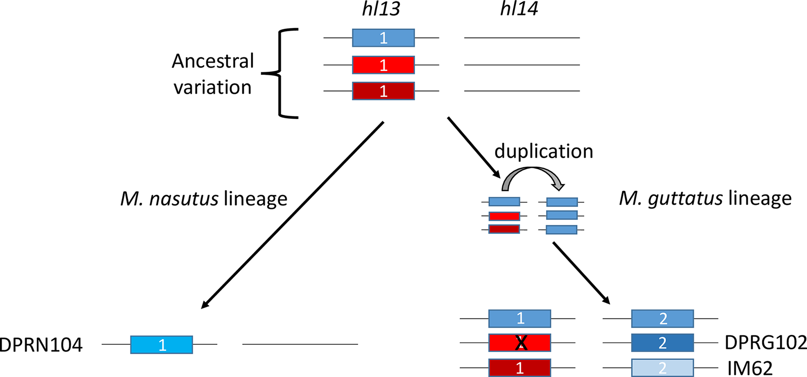
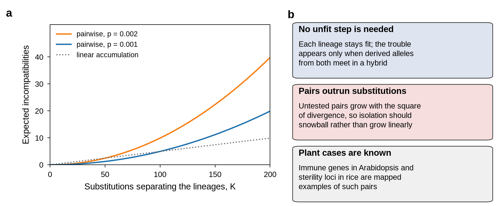

# 第 27 章 Dobzhansky–Muller 不亲和

**地位：Dobzhansky–Muller 不亲和作为杂种不育和不能存活的原因，已验证；快于线性的积累（雪球效应），部分验证；推动等位基因分化的进化力量，有争议。** 两个相互隔离的群体可以各自固定在自身遗传背景中运作良好的新等位基因。当两个群体相遇时，双方的衍生等位基因第一次在杂种中组合，其中一些组合不能协同工作。任何中间基因型都不必适合度低下，因此不亲和可以在不跨越适合度低谷的情况下进化。自 1990 年代以来，这一模型有了群体遗传理论、定量检验，以及在动物和植物中克隆的许多不亲和基因。

本仓库相关条目：[bateson-dobzhansky-muller-incompatibilities](../../theories/bateson-dobzhansky-muller-incompatibilities/THEORY.md)、[orr-snowball-incompatibilities](../../theories/orr-snowball-incompatibilities/THEORY.md)、[orr-turelli-2001-dmi-waiting-time](../../theories/orr-turelli-2001-dmi-waiting-time/THEORY.md)、[coyne-orr-time-course-of-isolation](../../theories/coyne-orr-time-course-of-isolation/THEORY.md)、[haldane-rule](../../theories/haldane-rule/THEORY.md)、[rieseberg-complementary-gene-hybrid-speciation](../../theories/rieseberg-complementary-gene-hybrid-speciation/THEORY.md)。

## 27.1 内容与历史

这一模型以 Dobzhansky 和 Muller 命名。物种形成常常源于“互补基因”的积累，这些基因在种内没有有害效应，但与另一物种的基因组合在一起时会造成不能存活或不育 [1]。Orr 为这一过程建立了模型，发现不亲和的数目随时间的增加远快于线性，因此物种形成的概率至少随分离时间的平方增加。他还证明，所有杂种不亲和最初都必然是不对称的；衍生等位基因比祖先等位基因更常造成杂种问题；而需要三个或更多位点共同作用的复杂不亲和比两位点不亲和更容易进化 [1]。

Orr 和 Turelli 随后描述了不亲和随时间的随机积累，包括替换数目及其效应的变异，并推导了物种形成的等待时间；他们对果蝇和铃蟾（*Bombina*）数据的分析表明，两个分化位点导致杂种不育或不能存活的概率非常小，约为 10⁻⁶ 或更低 [2]。一个双位点模型区分了杂合位点之间、杂合位点与纯合或半合位点之间、以及纯合位点之间的相互作用，从而把这一模型与 Haldane 法则和大 X 效应联系起来 [3]。Coyne 和 Orr 基于 119 次、后来 171 次果蝇杂交的比较数据显示，合子后隔离随分化时间增强，并且首先出现在杂种雄性中 [4, 5]。

## 27.2 预测

- **雪球效应。** 不亲和的数目应当至少随分化程度的平方增加（图 27.2）[1, 2]。
- **涉及衍生等位基因。** 不亲和应当涉及各谱系中的衍生等位基因，并且最初是不对称的 [1]。
- **两个或更多位点。** 杂种失败应当定位到相互作用的位点，而不是单个基因 [6, 7]。
- **单对位点很少不亲和。** 任何一对分化位点不亲和的概率都应很小 [2]。
- **基因流会侵蚀它们。** 有迁移时，中性的不亲和无法维持，需要选择才能保留 [8]。

## 27.3 支持证据

- **果蝇和番茄中的雪球效应。** 在两对果蝇物种中，参与合子后隔离的基因数目至少随替换数目的平方增加 [9]。在茄属物种之间，杂种种子不育的 QTL 以快于线性的速度积累，而与不育无关的性状的 QTL 则没有 [10]。
- **果蝇中相互作用的基因。** *Lethal hybrid rescue* 在 *D. simulans* 中发生了功能分化，它与在 *D. melanogaster* 中分化的 *Hybrid male rescue* 相互作用，使 F1 杂种雄性死亡 [6]。一个造成杂种不能存活的核孔蛋白基因在两个谱系中都经历了正选择 [11]。位于一个杂种雄性不育位点的 *Odysseus* 同源框，在过去 50 万年中的进化快于此前的 7 亿年 [12]。*Overdrive* 在 *D. pseudoobscura* 两个亚种之间的杂种中同时造成雄性不育和分离偏离 [13]。
- **基因重复与丢失。** 雄性育性基因 *JYAlpha* 在 *D. simulans* 谱系中迁移到另一条染色体上，使部分杂种完全没有这个基因，从而在没有序列进化的情况下产生生殖隔离 [14]。在拟南芥中，重复基因的不同命运在株系之间造成隐性胚胎致死 [15]；在水稻中，籼稻和粳稻分别丢失重复基因 *DOPPELGANGER* 的不同拷贝，使花粉失去功能 [16]；在沟酸浆中，缺少重复的光合基因 *pTAC14* 的功能拷贝的杂种会死亡（图 27.1）[17]。
- **植物中的免疫基因。** 拟南芥约 2% 的种内杂交产生杂种坏死，原因是触发类自身免疫反应的上位相互作用，其中一例涉及一个 NB-LRR 基因 [7]。对数千个 F1 杂种的检测发现少数不亲和热点，常位于 NLR 基因簇中，例如 *DANGEROUS MIX2* [18]。
- **水稻不育位点。** 在 *S5* 位点，籼稻和粳稻的等位基因只差两个核苷酸，而一个广亲和等位基因使杂种可育 [19]；该位点是由三个连锁基因组成的杀手–保护者系统 [20]。*Sa* 位点的杂种雄性不育源于两个相邻基因的分化等位基因之间的相互作用 [21]。
- **杂交区的基因组扫描。** 在自然杂交的剑尾鱼中，数百对不连锁的区域处于连锁不平衡，可能促成生殖隔离 [22]。

## 27.4 反面证据与难点

- **不亲和在种内分离。** 在黑腹果蝇的重组近交系中，任意两个单倍体基因组预期带有 1.15 对上位相互作用的等位基因，因此隔离的原材料不一定在异域中产生 [23]。拟南芥种内的杂种坏死指向同一结论 [7, 18]。
- **是什么推动分化？** 许多物种形成基因显示正选择 [11, 12]，但综述认为杂种功能障碍的最初几步不一定是适应性的 [24]，大部分分化可能来自突变机制或遗传冲突，而不是生态适应 [25]。在植物中，基因重复和漂变起重要作用 [17, 26]。
- **并非所有隔离都是基因性的。** 在植物中，易位因破坏杂合子的减数分裂而造成严重的 F1 不育，倒位则通过抑制重组促进物种形成 [26]。
- **基因流。** 在大陆–岛屿模型中，有基因流时中性不亲和无法维持，可承受的最大迁移率取决于选择 [8]。
- **植物物种形成基因常常是多态的。** 与动物不同，植物中大多数候选物种形成基因在种内表现出多态性 [27]。

## 27.5 地位与理由

**不亲和作为杂种不育和不能存活的原因：已验证。** 正如模型所要求的，相互作用的位点已在果蝇 [6, 11, 14]、拟南芥 [7, 15]、水稻 [16, 20, 21] 和沟酸浆 [17] 中克隆。**雪球效应：部分验证**，因为两项明确的检验支持它 [9, 10]，但检验太少。**分化背后的力量：有争议**，适应、冲突、重复和漂变都有证据 [24, 25, 26]。

## 27.6 植物、作物与葡萄

- **植物物种形成基因。** 在 41 个候选植物物种形成基因中，8 个促成杂种不能存活，25 个促成杂种不育；抗病基因是杂种坏死的基础，嵌合线粒体基因和三角状五肽重复基因是细胞质雄性不育的基础 [27]。冲突与共同进化、重复与漂变都促成了植物的基因性不亲和 [26]。
- **水稻育种。** 籼粳屏障涉及 *S5* [19, 20]、*Sa* [21] 和 *DPL1/DPL2* [16]。*S5* 的广亲和等位基因使育种者能够得到可育的亚种间杂种 [19]。
- **葡萄。** 美洲野生葡萄包括 *V.* × *champinii* 和 *V.* × *doaniana* 等杂种起源的物种，全基因组 SNP 显示甚至在亲缘较远的物种之间也有基因流；冰期循环可能使相互可育的类群发生接触 [28]。美洲葡萄是抗生物和非生物胁迫的重要资源 [28]。葡萄属物种之间的相互可育提示它们之间积累的强不亲和很少，或者很少表现出来；这一点还没有被直接检验。
- **不育的无性繁殖作物。** 栽培香蕉不育、单性结实，大多是三倍体杂种，由克隆繁殖，来源于两个祖先物种之间野生杂种的多次起源 [29]。在无性繁殖作物中，不育并不妨碍繁殖，因此杂种不亲和是育种的障碍，而不是作物本身的障碍。

## 27.7 用公开数据检验

- **数据。** F2 和重组近交群体的分离数据 [16, 23]；杂交区基因组 [22]；不同分化程度物种对的渐渗系 QTL 图谱 [9, 10]；用于分析葡萄属混合的全基因组 SNP [28]。
- **工具。** 在不连锁标记之间做独立性检验以寻找相互作用的位点 [16, 23]；杂种群体中的连锁不平衡扫描 [22]；混合图和 f 统计量 [28]。
- **分析。** (1) 在作图群体中寻找两位点基因型比例的偏离 [23]。(2) 在分化程度递增的物种对中统计不亲和 QTL，并拟合线性和二次模型 [10]。(3) 对已克隆的位点，确定哪些等位基因是衍生的 [1]。脚本 [`scripts/ch27_dmi_figures.py`](../scripts/ch27_dmi_figures.py) 计算两两不亲和的期望数目如何随分化增加（图 27.2）。
- **什么结果会推翻理论。** 杂种失败定位到带有祖先等位基因的单个位点；或者在许多独立检验中，不亲和随分化呈线性增加。

## 27.8 未解决的问题

- 在少数已检验的物种对之外，雪球效应有多普遍 [9, 10]？
- 大多数不亲和是适应、冲突还是漂变的副产物 [24, 25]？
- 为什么植物物种形成基因常在种内保持多态 [27]？
- 面对基因流，不亲和如何得以保持 [8, 22]？

## 27.9 常见错误

- 以为杂种不亲和必须从一个适合度低谷开始；模型并不需要 [1]。
- 以为不亲和只在物种之间产生；它们在种内也会分离 [18, 23]。
- 把所有杂种不育都当作基因性的；染色体重排也会造成不育 [26]。
- 把物种形成基因上的正选择当作适应造成隔离的证据 [24]。

## 图

**图 27.1.** *pTAC14* 进化的假设模型。在基因重复之前，祖先的类 *M. guttatus* 群体在 hl13 处带有 *pTAC14* 的遗传变异（不同颜色的方框代表 *pTAC14* 的遗传变异）。在物种形成过程中，*M. nasutus* 获得了一个带有“蓝色”变异的 *pTAC14* 拷贝（左）。同样，*M. guttatus* 特有的重复也涉及一个亲缘很近的“蓝色” *pTAC14* 变体。由于共同祖先，*M. nasutus* 内部的现存变异与位于 hl14 的 *pTAC14* 变体在遗传上彼此相似；而 *M. guttatus* 中位于 hl13 的 *pTAC14* 变体可能仍带有相当多的遗传变异，包括有功能的（IM62）和无功能的（DPR102-gutt）变体。原样转载自 Zuellig MP, Sweigart AL (2018) Gene duplicates cause hybrid lethality between sympatric species of *Mimulus*. *PLoS Genetics* 14:e1007130, Figure 7. https://doi.org/10.1371/journal.pgen.1007130。许可：CC BY 4.0（https://creativecommons.org/licenses/by/4.0/）。

**图 27.2.** (a) K 次替换后两两不亲和的期望数目 p·K(K − 1)/2，单对概率 p 为 0.002 和 0.001，并与按 K = 100 时相同数目标定的线性积累比较。p 的取值远大于 Orr 和 Turelli 的估计 [2]，是为了让曲线的弯曲看得清楚，数值仅作示意。(b) 模型说明了什么。用 [`scripts/ch27_dmi_figures.py`](../scripts/ch27_dmi_figures.py) 生成；计算是确定性的。

## 参考文献

1. Orr HA (1995) The population genetics of speciation: the evolution of hybrid incompatibilities. *Genetics* 139:1805-1813. https://doi.org/10.1093/genetics/139.4.1805
2. Orr HA, Turelli M (2001) The evolution of postzygotic isolation: accumulating Dobzhansky-Muller incompatibilities. *Evolution* 55:1085-1094. https://doi.org/10.1111/j.0014-3820.2001.tb00628.x
3. Turelli M, Orr HA (2000) Dominance, Epistasis and the Genetics of Postzygotic Isolation. *Genetics* 154:1663-1679. https://doi.org/10.1093/genetics/154.4.1663
4. Coyne JA, Orr HA (1989) Patterns of speciation in Drosophila. *Evolution* 43:362-381. https://doi.org/10.1111/j.1558-5646.1989.tb04233.x
5. Coyne JA, Orr HA (1997) “Patterns of speciation in Drosophila” revisited. *Evolution* 51:295-303. https://doi.org/10.1111/j.1558-5646.1997.tb02412.x
6. Brideau NJ, Flores HA, Wang J, et al. (2006) Two Dobzhansky-Muller Genes Interact to Cause Hybrid Lethality in Drosophila. *Science* 314:1292-1295. https://doi.org/10.1126/science.1133953
7. Bomblies K, Lempe J, Epple P, et al. (2007) Autoimmune Response as a Mechanism for a Dobzhansky-Muller-Type Incompatibility Syndrome in Plants. *PLoS Biology* 5:e236. https://doi.org/10.1371/journal.pbio.0050236
8. Bank C, Bürger R, Hermisson J (2012) The Limits to Parapatric Speciation: Dobzhansky–Muller Incompatibilities in a Continent–Island Model. *Genetics* 191:845-863. https://doi.org/10.1534/genetics.111.137513
9. Matute DR, Butler IA, Turissini DA, et al. (2010) A Test of the Snowball Theory for the Rate of Evolution of Hybrid Incompatibilities. *Science* 329:1518-1521. https://doi.org/10.1126/science.1193440
10. Moyle LC, Nakazato T (2010) Hybrid Incompatibility “Snowballs” Between Solanum Species. *Science* 329:1521-1523. https://doi.org/10.1126/science.1193063
11. Presgraves DC, Balagopalan L, Abmayr SM, et al. (2003) Adaptive evolution drives divergence of a hybrid inviability gene between two species of Drosophila. *Nature* 423:715-719. https://doi.org/10.1038/nature01679
12. Ting CT, Tsaur SC, Wu ML, et al. (1998) A Rapidly Evolving Homeobox at the Site of a Hybrid Sterility Gene. *Science* 282:1501-1504. https://doi.org/10.1126/science.282.5393.1501
13. Phadnis N, Orr HA (2009) A Single Gene Causes Both Male Sterility and Segregation Distortion in Drosophila Hybrids. *Science* 323:376-379. https://doi.org/10.1126/science.1163934
14. Masly JP, Jones CD, Noor MAF, et al. (2006) Gene Transposition as a Cause of Hybrid Sterility in Drosophila. *Science* 313:1448-1450. https://doi.org/10.1126/science.1128721
15. Bikard D, Patel D, Le Metté C, et al. (2009) Divergent Evolution of Duplicate Genes Leads to Genetic Incompatibilities Within A. thaliana. *Science* 323:623-626. https://doi.org/10.1126/science.1165917
16. Mizuta Y, Harushima Y, Kurata N (2010) Rice pollen hybrid incompatibility caused by reciprocal gene loss of duplicated genes. *Proceedings of the National Academy of Sciences* 107:20417-20422. https://doi.org/10.1073/pnas.1003124107
17. Zuellig MP, Sweigart AL (2018) Gene duplicates cause hybrid lethality between sympatric species of Mimulus. *PLOS Genetics* 14:e1007130. https://doi.org/10.1371/journal.pgen.1007130
18. Chae E, Bomblies K, Kim ST, et al. (2014) Species-wide Genetic Incompatibility Analysis Identifies Immune Genes as Hot Spots of Deleterious Epistasis. *Cell* 159:1341-1351. https://doi.org/10.1016/j.cell.2014.10.049
19. Chen J, Ding J, Ouyang Y, et al. (2008) A triallelic system of S5 is a major regulator of the reproductive barrier and compatibility of indica–japonica hybrids in rice. *Proceedings of the National Academy of Sciences* 105:11436-11441. https://doi.org/10.1073/pnas.0804761105
20. Yang J, Zhao X, Cheng K, et al. (2012) A Killer-Protector System Regulates Both Hybrid Sterility and Segregation Distortion in Rice. *Science* 337:1336-1340. https://doi.org/10.1126/science.1223702
21. Long Y, Zhao L, Niu B, et al. (2008) Hybrid male sterility in rice controlled by interaction between divergent alleles of two adjacent genes. *Proceedings of the National Academy of Sciences* 105:18871-18876. https://doi.org/10.1073/pnas.0810108105
22. Schumer M, Cui R, Powell DL, et al. (2014) High-resolution mapping reveals hundreds of genetic incompatibilities in hybridizing fish species. *eLife* 3:e02535. https://doi.org/10.7554/elife.02535
23. Corbett-Detig RB, Zhou J, Clark AG, et al. (2013) Genetic incompatibilities are widespread within species. *Nature* 504:135-137. https://doi.org/10.1038/nature12678
24. Presgraves DC (2010) The molecular evolutionary basis of species formation. *Nature Reviews Genetics* 11:175-180. https://doi.org/10.1038/nrg2718
25. Maheshwari S, Barbash DA (2011) The Genetics of Hybrid Incompatibilities. *Annual Review of Genetics* 45:331-355. https://doi.org/10.1146/annurev-genet-110410-132514
26. Fishman L, Sweigart AL (2018) When Two Rights Make a Wrong: The Evolutionary Genetics of Plant Hybrid Incompatibilities. *Annual Review of Plant Biology* 69:707-731. https://doi.org/10.1146/annurev-arplant-042817-040113
27. Rieseberg LH, Blackman BK (2010) Speciation genes in plants. *Annals of Botany* 106:439-455. https://doi.org/10.1093/aob/mcq126
28. Zecca G, Labra M, Grassi F (2020) Untangling the Evolution of American Wild Grapes: Admixed Species and How to Find Them. *Frontiers in Plant Science* 10:1814. https://doi.org/10.3389/fpls.2019.01814
29. Heslop-Harrison JS, Schwarzacher T (2007) Domestication, Genomics and the Future for Banana. *Annals of Botany* 100:1073-1084. https://doi.org/10.1093/aob/mcm191
