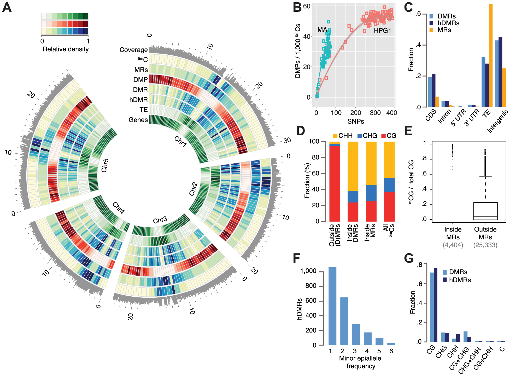
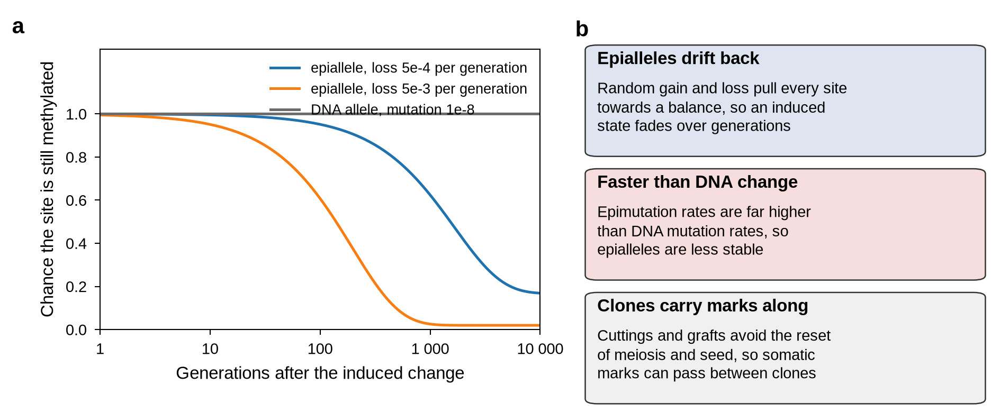

# Chapter 28. Transgenerational epigenetic inheritance

**Status: Inheritance of spontaneous and induced epialleles in plants, Verified; inheritance of small RNA responses in nematodes, Verified (over a few generations); environmentally induced inheritance that lasts many generations in plants, Contested; transgenerational epigenetic inheritance in mammals and humans, Contested.** Epigenetic marks such as cytosine methylation, histone modifications and small RNAs can change gene expression without a change in DNA sequence. Transgenerational epigenetic inheritance means that such a state passes through the germline to generations that were never exposed to the cause. Plants are prone to it, because they reset DNA methylation less thoroughly between generations than mammals. The strong claim, that environments routinely write lasting adaptive memories into the germline, is much weaker in the evidence.

Related notes in this repository: [rodin-riggs-2003-epigenetic-complementation](../../theories/rodin-riggs-2003-epigenetic-complementation/THEORY.md), [selfish-dna](../../theories/selfish-dna/THEORY.md), [transgenerational-epigenetic-inheritance](../../theories/transgenerational-epigenetic-inheritance/THEORY.md).

## 28.1 Statement and history

Jablonka and Raz reviewed transgenerational epigenetic inheritance across taxa and concluded that it is ubiquitous, with consequences for the study of heredity and evolution [1]. One of the first natural morphological mutants to be characterized molecularly turned out to be an epimutation: the radially symmetric *Linaria vulgaris* flower described by Linnaeus carries a heavily methylated, silent *Lcyc* gene, and the modification is heritable and cosegregates with the phenotype [2]. Paramutation, the epigenetic transfer of information from one allele to another that is heritable for generations, is known from maize and from mice, and RNA has emerged as a mediator in both [3]. In mice, a modified *Kit* phenotype was inherited by wild-type offspring of heterozygotes, and injection of RNA into fertilized eggs induced it [4].

Population-level work came with methylomes. Lines of *A. thaliana* propagated by single-seed descent for 30 generations accumulated 114,287 CG single methylation polymorphisms and 2485 CG differentially methylated regions [5]. Ten lines derived 30 generations earlier from one ancestor differed at about 30,000 cytosines each, but larger methylated regions were much more stable, with change rates in the range of DNA mutation [6]. Van der Graaf and colleagues estimated forward and backward epimutation rates at individual cytosines and argued that these rates are high enough to uncouple epigenetic from genetic variation quickly but low enough for epialleles to sustain long-term selection responses [7]. Shea, Pen and Uller separated selection-based epigenetic inheritance, which carries adaptive information through reliable transmission over many generations, from detection-based effects, which are a transgenerational form of plasticity [8].

## 28.2 What the theory predicts

- **Stable epialleles.** Methylation states should be transmitted through meiosis and cosegregate with phenotypes [2, 9].
- **Heritable variation without sequence change.** Isogenic populations with induced methylation differences should show heritable variation in complex traits [9, 10].
- **Reversion.** Epialleles should revert at measurable rates, faster than DNA mutations (Figure 28.2) [6, 7].
- **Induced memory.** If the strong claim holds, an environmental exposure should leave a germline mark that affects unexposed descendants [11, 12].
- **Resetting mechanisms.** Organisms should have mechanisms that erase induced states between generations [13, 14].

## 28.3 Evidence for

- **Natural epialleles in plants.** In the *Linaria* peloric mutant, the epiallele is heritable and occasional somatic reversion of the phenotype correlates with demethylation and restored expression of *Lcyc* [2].
- **EpiRILs and epiQTL.** Epigenetic recombinant inbred lines of *A. thaliana*, made from two parents with little sequence difference but contrasting methylation, show heritability of about 30% for flowering time and plant height and stable inheritance of parental epialleles for at least eight generations [9]. Several differentially methylated regions act as epigenetic QTL that account for 60 to 90% of the heritability of flowering time and primary root length, and can be selected [10].
- **Natural methylome variation.** In 1,107 methylomes of the 1001 Genomes collection, geographic origin predicts genome-wide methylation and epiallele effects on expression, though the genetic basis is complex [15]. Plants seem prone to transgenerational epigenetics because methylation defects reflect a failure to reinforce rather than a reset during sexual reproduction [16].
- **Somaclonal variation in a crop.** The mantled abnormality of oil palm clones, which drastically reduces yield, is caused by loss of methylation at a *Karma* retrotransposon in the *DEFICIENS* gene; restoration in revertants accounts for non-Mendelian inheritance [17].
- **Nematodes.** In *C. elegans*, an antiviral small RNA response is inherited for many generations [18], starvation induces small RNAs that are inherited for at least three generations [19], and deficiency in H3K4me3 modifiers in parents extends lifespan of descendants up to the third generation [20].
- **Mammals.** Exposure of pregnant rats to vinclozolin or methoxychlor reduced male fertility in the F1 to F4 generations, with altered germline methylation [11]. Odour fear conditioning of F0 mice increased sensitivity to that odour in F1 and F2, with hypomethylation of the receptor gene in sperm, and transmission through gametes [21].

## 28.4 Evidence against, and difficulties

- **Methylation change is mostly clock-like.** In a near-isogenic *A. thaliana* lineage dispersed across North America for at least a century, methylome variation largely reflected genetic distance and accumulated in a clock-like manner, in spite of very varied natural environments (Figure 28.1) [22].
- **Induced states are reset.** Heat-induced release of silencing at repetitive elements is restored after recovery [23]. DDM1 and MOM1 act redundantly to erase stress-induced states; only in the double mutant are they found in the progeny [13]. Hyperosmotic stress memory is passed mainly through the female lineage, restricted in the male germline by DNA glycosylase activity, and largely reset in the absence of stress [12].
- **Few examples of lasting stress memory.** There are relatively few examples of environmental stress memories in plants and no clear understanding of their duration [24, 25].
- **Mammals and humans.** Whether epigenetic marks are inherited in mammals is debated; in humans the study of transgenerational inheritance is confounded by genetic, ecological and cultural inheritance [14, 26]. Persistent IGF2 methylation differences after prenatal famine exposure were found in exposed individuals six decades later [27], which is a lifelong effect within a generation, not a transgenerational one.
- **Genetic confounding.** Epialleles often depend on nearby transposable elements and structural variants [15, 16], so a methylation difference can be a consequence of sequence variation.

## 28.5 Status and reasoning

**Inheritance of epialleles in plants: verified.** Natural epialleles cosegregate with phenotypes [2], epialleles in epiRILs are stable for at least eight generations [9] and explain heritable trait variation [10], and epimutation rates are measured [7]. **Small RNA inheritance in *C. elegans*: verified for a few generations** [18, 19]. **Lasting environmental memory in plants: contested,** because induced states are actively reset [12, 13] and natural methylome change is clock-like [22]. **Mammals and humans: contested** [14, 26].

## 28.6 Plants, crops and grapevine

- **Stress memory in crops.** Chromatin changes may provide a basis for stress memory, but most evidence concerns somatic and intergenerational memory [25]. Grapevine, which is asexually propagated and grown in contrasting terroirs, has been proposed as a model for epigenetic studies in perennial woody crops [28].
- **Tissue culture.** Grapevine somaclones from somatic embryos of ‘Chardonnay’ and ‘Syrah’ show DNA methylation polymorphisms not found in the mother clones [29]. After in vitro culture and thermotherapy, 40% of induced methylation changes disappeared within a year, while 60% remained and probably represent mitotically inherited epimutations [30]. Oil palm mantling shows how a tissue-culture epiallele can cost a crop much of its yield [17].
- **Terroir.** Across 22 Shiraz vineyards in the Barossa, methylation profiles grouped vineyards by sub-region despite low genetic differentiation, and pruning system had a smaller effect [31].
- **Clonal inheritance in grapevine.** In phased genomes of Cabernet Sauvignon and its parents, methylation marks are remarkably inherited across clones, though less conserved than genetic polymorphisms [32]. Among 23 Pinot noir clones, methylation variation is abundant, and CG and CHG methylation alone reconstructs clonal relationships that mirror SNP-based lineages, whereas CHH methylation does not [33].
- **Why clones matter.** Cuttings and grafts bypass meiosis and seed development, where much resetting happens, so clonal crops are the setting in which somatic epigenetic states are most likely to persist [28, 33]. The persistence seen in grapevine clones is mitotic inheritance; it is not transgenerational inheritance through the germline.

## 28.7 How to test it with public data

- **Data.** Whole-genome bisulfite or long-read methylation data for mutation accumulation lines [5, 6], natural accessions [15, 22], epiRILs [9, 10] and grapevine clones [32, 33].
- **Tools.** Calling of differentially methylated positions and regions; epimutation rate models for pedigrees [7]; graph-based allele-specific methylation [32]; methylation-sensitive markers for low-cost surveys [29, 31].
- **Analysis.** (1) Estimate gain and loss rates of methylation per site and generation from pedigrees [7]. (2) Test whether methylation differences track genetic distance or environment [22, 31]. (3) Follow an induced state across several unexposed generations, through male and female lines separately [12]. The script [`scripts/ch28_epigenetic_inheritance_figures.py`](../scripts/ch28_epigenetic_inheritance_figures.py) shows how an induced epiallele decays under random gain and loss (Figure 28.2).
- **What would refute it.** No transmission of methylation states beyond the exposed generation in many species, or epialleles that always depend on linked DNA variants.

## 28.8 Open questions

- How often do environmentally induced marks pass through more than one or two generations [12, 24]?
- How much heritable trait variation in natural populations is epigenetic and independent of sequence [10, 15]?
- Does transgenerational inheritance occur in humans at all [26]?
- Can clonal methylation variation in grapevine be used in clone selection [32, 33]?

## 28.9 Common mistakes

- Calling within-generation or mitotic persistence “transgenerational” [27, 30].
- Ignoring genetic differences linked to methylation [15].
- Studying only one parental line when transmission can differ between male and female lines [12].
- Treating all methylation contexts as equally stable; in grapevine clones CHH methylation does not track lineage [33].

## Figures

**Figure 28.1.** Epigenetic variation in a nearly isogenic population. (A) Genome-wide features: average coverage in 100 kb windows, the remainder in 500 kb windows. Outside coordinates in Mb. (B) Number of DMPs in relation to number of SNPs in pairwise comparisons. Data of mutation accumulation (MA) lines are based on single individuals, haplogroup1 (HPG1) data on pools of 8–10 individuals; each data point represents an independent comparison of two lines. DMPs in each pairwise contrast were scaled to the number of methylated sites compared. (C) Annotation of cytosines in MRs and hDMRs. (hD)MR sequences were assigned to only one annotation in the following order: CDS> intron. UTR> transposon> intergenic. (D) Sequence context of methylated positions relative to MRs and DMRs. (E) Fraction of 5mCGs among all CG sites for each gene and transposable element, with at least 5 CGs. (F) Minor epiallele frequencies of 2,304 hDMRs that could be split into only two groups and for which at least four strains showed statistically significant differential methylation. Strains not tested statistically significant for a particular hDMR were not considered for this plot. (G) DMRs and hDMRs according to sequence contexts in which significant methylation differences were found. ‘C’ denotes (h)DMRs in all three contexts. Abbreviations: 5mC: methylated position, CDS: coding sequence, DMP: differentially methylated position, DMR: differentially methylated region, hDMR: highly differentially methylated region, HPG1: haplogroup-1 lines, MA: mutation accumulation lines, MRs: methylated regions, SNP: single nucleotide polymorphism, TE: transposable element, UTR: untranslated region. Reproduced unchanged from Hagmann J, Becker C, Müller J, et al. (2015) Century-scale methylome stability in a recently diverged *Arabidopsis thaliana* lineage. *PLoS Genetics* 11:e1004920, Figure 2. https://doi.org/10.1371/journal.pgen.1004920. Licence: CC BY 4.0 (https://creativecommons.org/licenses/by/4.0/).

**Figure 28.2.** (a) Chance that a site fully methylated by an induced change is still methylated after t generations, when methylation is gained with probability a = 10⁻⁴ and lost with probability b = 5 × 10⁻⁴ or 5 × 10⁻³ per generation, compared with a DNA allele mutating at 10⁻⁸. The site approaches a/(a + b). The values are illustrative. (b) What the model shows. Made with [`scripts/ch28_epigenetic_inheritance_figures.py`](../scripts/ch28_epigenetic_inheritance_figures.py); the calculation is deterministic.

## References

1. Jablonka E, Raz G (2009) Transgenerational Epigenetic Inheritance: Prevalence, Mechanisms, and Implications for the Study of Heredity and Evolution. *The Quarterly Review of Biology* 84:131-176. https://doi.org/10.1086/598822
2. Cubas P, Vincent C, Coen E (1999) An epigenetic mutation responsible for natural variation in floral symmetry. *Nature* 401:157-161. https://doi.org/10.1038/43657
3. Chandler VL (2007) Paramutation: From Maize to Mice. *Cell* 128:641-645. https://doi.org/10.1016/j.cell.2007.02.007
4. Rassoulzadegan M, Grandjean V, Gounon P, et al. (2006) RNA-mediated non-mendelian inheritance of an epigenetic change in the mouse. *Nature* 441:469-474. https://doi.org/10.1038/nature04674
5. Schmitz RJ, Schultz MD, Lewsey MG, et al. (2011) Transgenerational Epigenetic Instability Is a Source of Novel Methylation Variants. *Science* 334:369-373. https://doi.org/10.1126/science.1212959
6. Becker C, Hagmann J, Müller J, et al. (2011) Spontaneous epigenetic variation in the Arabidopsis thaliana methylome. *Nature* 480:245-249. https://doi.org/10.1038/nature10555
7. van der Graaf A, Wardenaar R, Neumann DA, et al. (2015) Rate, spectrum, and evolutionary dynamics of spontaneous epimutations. *Proceedings of the National Academy of Sciences* 112:6676-6681. https://doi.org/10.1073/pnas.1424254112
8. Shea N, Pen I, Uller T (2011) Three epigenetic information channels and their different roles in evolution. *Journal of Evolutionary Biology* 24:1178-1187. https://doi.org/10.1111/j.1420-9101.2011.02235.x
9. Johannes F, Porcher E, Teixeira FK, et al. (2009) Assessing the Impact of Transgenerational Epigenetic Variation on Complex Traits. *PLoS Genetics* 5:e1000530. https://doi.org/10.1371/journal.pgen.1000530
10. Cortijo S, Wardenaar R, Colomé-Tatché M, et al. (2014) Mapping the Epigenetic Basis of Complex Traits. *Science* 343:1145-1148. https://doi.org/10.1126/science.1248127
11. Anway MD, Cupp AS, Uzumcu M, et al. (2005) Epigenetic Transgenerational Actions of Endocrine Disruptors and Male Fertility. *Science* 308:1466-1469. https://doi.org/10.1126/science.1108190
12. Wibowo A, Becker C, Marconi G, et al. (2016) Hyperosmotic stress memory in Arabidopsis is mediated by distinct epigenetically labile sites in the genome and is restricted in the male germline by DNA glycosylase activity. *eLife* 5:e13546. https://doi.org/10.7554/eLife.13546
13. Iwasaki M, Paszkowski J (2014) Identification of genes preventing transgenerational transmission of stress-induced epigenetic states. *Proceedings of the National Academy of Sciences* 111:8547-8552. https://doi.org/10.1073/pnas.1402275111
14. Heard E, Martienssen R (2014) Transgenerational Epigenetic Inheritance: Myths and Mechanisms. *Cell* 157:95-109. https://doi.org/10.1016/j.cell.2014.02.045
15. Kawakatsu T, Huang SC, Jupe F, et al. (2016) Epigenomic Diversity in a Global Collection of Arabidopsis thaliana Accessions. *Cell* 166:492-505. https://doi.org/10.1016/j.cell.2016.06.044
16. Quadrana L, Colot V (2016) Plant Transgenerational Epigenetics. *Annual Review of Genetics* 50:467-491. https://doi.org/10.1146/annurev-genet-120215-035254
17. Ong-Abdullah M, Ordway JM, Jiang N, et al. (2015) Loss of Karma transposon methylation underlies the mantled somaclonal variant of oil palm. *Nature* 525:533-537. https://doi.org/10.1038/nature15365
18. Rechavi O, Minevich G, Hobert O (2011) Transgenerational Inheritance of an Acquired Small RNA-Based Antiviral Response in C. elegans. *Cell* 147:1248-1256. https://doi.org/10.1016/j.cell.2011.10.042
19. Rechavi O, Houri-Ze’evi L, Anava S, et al. (2014) Starvation-Induced Transgenerational Inheritance of Small RNAs in C. elegans. *Cell* 158:277-287. https://doi.org/10.1016/j.cell.2014.06.020
20. Greer EL, Maures TJ, Ucar D, et al. (2011) Transgenerational epigenetic inheritance of longevity in Caenorhabditis elegans. *Nature* 479:365-371. https://doi.org/10.1038/nature10572
21. Dias BG, Ressler KJ (2014) Parental olfactory experience influences behavior and neural structure in subsequent generations. *Nature Neuroscience* 17:89-96. https://doi.org/10.1038/nn.3594
22. Hagmann J, Becker C, Müller J, et al. (2015) Century-scale Methylome Stability in a Recently Diverged Arabidopsis thaliana Lineage. *PLoS Genetics* 11:e1004920. https://doi.org/10.1371/journal.pgen.1004920
23. Pecinka A, Dinh HQ, Baubec T, et al. (2010) Epigenetic Regulation of Repetitive Elements Is Attenuated by Prolonged Heat Stress in Arabidopsis. *The Plant Cell* 22:3118-3129. https://doi.org/10.1105/tpc.110.078493
24. Crisp PA, Ganguly D, Eichten SR, et al. (2016) Reconsidering plant memory: Intersections between stress recovery, RNA turnover, and epigenetics. *Science Advances* 2:e1501340. https://doi.org/10.1126/sciadv.1501340
25. Lämke J, Bäurle I (2017) Epigenetic and chromatin-based mechanisms in environmental stress adaptation and stress memory in plants. *Genome Biology* 18:124. https://doi.org/10.1186/s13059-017-1263-6
26. Horsthemke B (2018) A critical view on transgenerational epigenetic inheritance in humans. *Nature Communications* 9:2973. https://doi.org/10.1038/s41467-018-05445-5
27. Heijmans BT, Tobi EW, Stein AD, et al. (2008) Persistent epigenetic differences associated with prenatal exposure to famine in humans. *Proceedings of the National Academy of Sciences* 105:17046-17049. https://doi.org/10.1073/pnas.0806560105
28. Fortes AM, Gallusci P (2017) Plant Stress Responses and Phenotypic Plasticity in the Epigenomics Era: Perspectives on the Grapevine Scenario, a Model for Perennial Crop Plants. *Frontiers in Plant Science* 8:82. https://doi.org/10.3389/fpls.2017.00082
29. Schellenbaum P, Mohler V, Wenzel G, et al. (2008) Variation in DNA methylation patterns of grapevine somaclones (Vitis vinifera L.). *BMC Plant Biology* 8:78. https://doi.org/10.1186/1471-2229-8-78
30. Baránek M, Čechová J, Raddová J, et al. (2015) Dynamics and Reversibility of the DNA Methylation Landscape of Grapevine Plants (Vitis vinifera) Stressed by In Vitro Cultivation and Thermotherapy. *PLOS ONE* 10:e0126638. https://doi.org/10.1371/journal.pone.0126638
31. Xie H, Konate M, Sai N, et al. (2017) Global DNA Methylation Patterns Can Play a Role in Defining Terroir in Grapevine (Vitis vinifera cv. Shiraz). *Frontiers in Plant Science* 8:1860. https://doi.org/10.3389/fpls.2017.01860
32. Cochetel N, Vondras AM, Figueroa-Balderas R, et al. (2025) Phased epigenomics and methylation inheritance in a historical Vitis vinifera hybrid. *Genome Biology* 26:392. https://doi.org/10.1186/s13059-025-03858-2
33. Callipo P, Robinson H, Schmidt M, et al. (2026) A dual genome-methylome map of clonal evolution in grapevine. *Genome Biology* 27:221. https://doi.org/10.1186/s13059-026-04184-x
