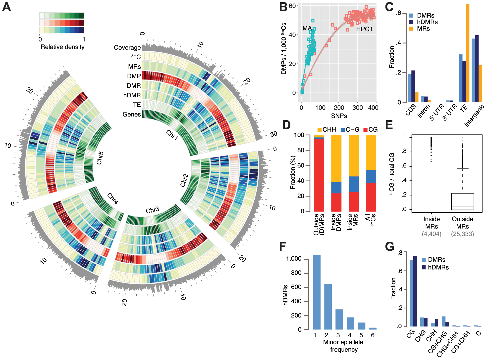
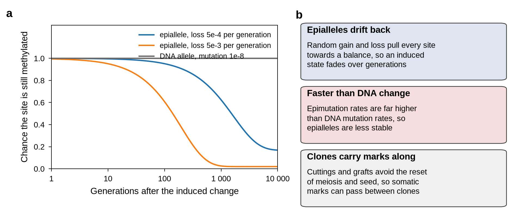

# 第 28 章 跨代表观遗传

**地位：植物中自发和诱导表观等位基因的遗传，已验证；线虫中小 RNA 反应的遗传，已验证（持续若干代）；植物中持续许多代的环境诱导遗传，有争议；哺乳动物和人类的跨代表观遗传，有争议。** 胞嘧啶甲基化、组蛋白修饰和小 RNA 等表观遗传标记可以在 DNA 序列不变的情况下改变基因表达。跨代表观遗传是指这样一种状态经由种系传给从未接触过诱因的世代。植物容易出现这种遗传，因为它们在世代之间对 DNA 甲基化的重置不如哺乳动物彻底。而更强的说法，即环境经常把持久的适应性记忆写入种系，证据要弱得多。

本仓库相关条目：[rodin-riggs-2003-epigenetic-complementation](../../skills/genomics-theory-mining/theories/rodin-riggs-2003-epigenetic-complementation/THEORY.md)、[selfish-dna](../../skills/genomics-theory-mining/theories/selfish-dna/THEORY.md)。

## 28.1 内容与历史

Jablonka 和 Raz 综述了各类群中的跨代表观遗传，认为它普遍存在，并对遗传和进化研究有重要影响 [1]。最早在分子水平上得到鉴定的自然形态突变体之一，结果是一个表观突变：林奈描述过的柳穿鱼（*Linaria vulgaris*）辐射对称花，带有高度甲基化而沉默的 *Lcyc* 基因，这一修饰可以遗传，并与表型共分离 [2]。副突变是指信息从一个等位基因表观地转移到另一个等位基因，并建立可遗传许多代的表达状态；它见于玉米和小鼠，RNA 在两者中都是介导者 [3]。在小鼠中，杂合子的野生型后代遗传了改变了的 *Kit* 表型，而向受精卵注射 RNA 也能诱导这一表型 [4]。

群体水平的研究随甲基化组而来。经单粒传代繁殖 30 代的拟南芥株系积累了 114,287 个 CG 单甲基化多态和 2485 个 CG 差异甲基化区域 [5]。由同一祖先在 30 代前衍生的 10 个株系，每个株系约有 30,000 个胞嘧啶甲基化不同，但较大的甲基化区域稳定得多，其变化频率与 DNA 突变处于同一低水平 [6]。van der Graaf 等估计了单个胞嘧啶的正向和反向表观突变速率，并认为这些速率高到足以使表观变异很快与遗传变异脱钩，又低到足以让表观等位基因维持长期的选择响应 [7]。Shea、Pen 和 Uller 区分了基于选择的表观遗传，它通过多代可靠传递携带适应性信息；以及基于检测的效应，它是一种跨代的表型可塑性 [8]。

## 28.2 预测

- **稳定的表观等位基因。** 甲基化状态应当经减数分裂传递，并与表型共分离 [2, 9]。
- **无序列变化的可遗传变异。** 具有诱导甲基化差异的同基因群体，应当在复杂性状上表现出可遗传变异 [9, 10]。
- **回复。** 表观等位基因应当以可测的速率回复，而且快于 DNA 突变（图 28.2）[6, 7]。
- **诱导记忆。** 如果强的说法成立，一次环境暴露应当留下影响未暴露后代的种系标记 [11, 12]。
- **重置机制。** 生物应当有在世代之间抹去诱导状态的机制 [13, 14]。

## 28.3 支持证据

- **植物中的自然表观等位基因。** 在柳穿鱼的整齐花突变体中，表观等位基因可以遗传，偶尔的体细胞表型回复与 *Lcyc* 去甲基化和表达恢复相关 [2]。
- **表观重组近交系与表观 QTL。** 拟南芥表观重组近交系由两个序列差异很小但甲基化谱截然不同的亲本构建，开花时间和株高的遗传力约为 30%，亲本表观等位基因至少稳定遗传了八代 [9]。若干差异甲基化区域作为表观 QTL，解释了开花时间和主根长度遗传力的 60% 至 90%，并且可以被选择 [10]。
- **自然甲基化组变异。** 在 1001 基因组计划的 1,107 个甲基化组中，地理来源能够预测全基因组甲基化水平以及表观等位基因对表达的影响，尽管其遗传基础很复杂 [15]。植物似乎容易发生跨代表观遗传，因为甲基化缺陷的遗传源于有性生殖中未能加强这一修饰，而不是被重置 [16]。
- **作物中的体细胞无性系变异。** 油棕克隆的“包被”（mantled）异常会大幅降低产量，它由 *DEFICIENS* 基因中一个 *Karma* 反转录转座子的甲基化丢失造成；回复体中甲基化的恢复解释了其非孟德尔遗传 [17]。
- **线虫。** 在秀丽隐杆线虫中，抗病毒的小 RNA 反应可遗传许多代 [18]；饥饿诱导的小 RNA 至少遗传三代 [19]；亲代缺少 H3K4me3 修饰因子会使后代寿命延长，直到第三代 [20]。
- **哺乳动物。** 让怀孕大鼠接触乙烯菌核利或甲氧滴滴涕，F1 到 F4 代的雄性育性下降，并伴有种系甲基化改变 [11]。对 F0 小鼠进行气味恐惧条件化后，F1 和 F2 对该气味的敏感性增加，精子中相应受体基因低甲基化，而且这一效应经配子传递 [21]。

## 28.4 反面证据与难点

- **甲基化变化大多像时钟一样。** 在一个分散于各地、分化至少一个世纪的近同基因拟南芥谱系中，尽管自然环境差异很大，甲基化组变异主要反映遗传距离，并以类似时钟的方式积累（图 28.1）[22]。
- **诱导状态会被重置。** 热胁迫引起的重复元件沉默解除，在恢复后重新建立 [23]。DDM1 和 MOM1 以冗余方式抹去胁迫诱导的状态，只有在双突变体中这些状态才出现在后代中 [13]。高渗胁迫记忆主要经母系传递，在雄性种系中受 DNA 糖基化酶活性限制，没有胁迫时大多被重置 [12]。
- **持久胁迫记忆的例子很少。** 植物环境胁迫记忆的例子相对较少，对其持续时间也没有清楚的认识 [24, 25]。
- **哺乳动物和人类。** 表观标记能否在哺乳动物中遗传存在争论；在人类中，跨代遗传的研究受遗传、生态和文化传承的混杂 [14, 26]。产前经历饥荒的个体在六十年后仍有 IGF2 甲基化的持续差异 [27]，这是一代之内的终生效应，不是跨代效应。
- **遗传混杂。** 表观等位基因常依赖附近的转座子和结构变异 [15, 16]，因此甲基化差异可能是序列变异的结果。

## 28.5 地位与理由

**植物中表观等位基因的遗传：已验证。** 自然表观等位基因与表型共分离 [2]，表观重组近交系中的表观等位基因至少稳定八代 [9]，并能解释可遗传的性状变异 [10]，表观突变速率也已测得 [7]。**秀丽隐杆线虫中的小 RNA 遗传：在若干代内已验证** [18, 19]。**植物中持久的环境记忆：有争议**，因为诱导状态会被主动重置 [12, 13]，而自然甲基化组变化像时钟一样 [22]。**哺乳动物和人类：有争议** [14, 26]。

## 28.6 植物、作物与葡萄

- **作物中的胁迫记忆。** 染色质变化可能为胁迫记忆提供基础，但大多数证据涉及体细胞记忆和代际记忆 [25]。葡萄是无性繁殖的，并在差异很大的风土中种植，因此被提议作为多年生木本作物表观遗传研究的模式 [28]。
- **组织培养。** 由‘霞多丽’和‘西拉’体细胞胚得到的葡萄体细胞无性系，带有母本克隆中没有的 DNA 甲基化多态 [29]。离体培养和热处理之后，40% 的诱导甲基化变化在一年内消失，60% 保留下来，可能代表经有丝分裂遗传的表观突变 [30]。油棕的包被异常说明，组织培养产生的一个表观等位基因可以让作物损失大部分产量 [17]。
- **风土。** 在巴罗萨 22 个西拉葡萄园中，尽管遗传分化很低，甲基化谱仍按子产区把葡萄园分组，修剪方式的影响较小 [31]。
- **葡萄中的克隆遗传。** 在赤霞珠及其双亲的定相基因组中，甲基化标记在克隆之间显著地得到遗传，但保守程度低于遗传多态 [32]。在 23 个黑比诺克隆中，甲基化变异很丰富；仅凭 CG 和 CHG 甲基化就能重建与基于 SNP 的谱系一致的克隆关系，而 CHH 甲基化不能 [33]。
- **克隆为什么重要。** 插条和嫁接绕过了减数分裂和种子发育，而大量重置发生在这些阶段，因此无性繁殖作物是体细胞表观状态最可能持续的场合 [28, 33]。葡萄克隆中看到的持续性是有丝分裂遗传，而不是经由种系的跨代遗传。

## 28.7 用公开数据检验

- **数据。** 突变积累系 [5, 6]、自然材料 [15, 22]、表观重组近交系 [9, 10] 和葡萄克隆 [32, 33] 的全基因组亚硫酸氢盐测序或长读长甲基化数据。
- **工具。** 差异甲基化位点和区域的识别；用于家系的表观突变速率模型 [7]；基于序列图的等位基因特异甲基化分析 [32]；用于低成本调查的甲基化敏感标记 [29, 31]。
- **分析。** (1) 从家系中估计每个位点每代的甲基化获得率和丢失率 [7]。(2) 检验甲基化差异是追随遗传距离还是环境 [22, 31]。(3) 跟踪一个诱导状态在若干未暴露世代中的去向，并分别经父系和母系检验 [12]。脚本 [`scripts/ch28_epigenetic_inheritance_figures.py`](../scripts/ch28_epigenetic_inheritance_figures.py) 展示诱导的表观等位基因在随机获得和丢失下如何衰减（图 28.2）。
- **什么结果会推翻理论。** 在许多物种中，甲基化状态都不能传到暴露世代之外；或者表观等位基因总是依赖连锁的 DNA 变异。

## 28.8 未解决的问题

- 环境诱导的标记有多常传过一两代以上 [12, 24]？
- 自然群体中有多少可遗传的性状变异是表观的、并且独立于序列 [10, 15]？
- 跨代遗传在人类中究竟是否存在 [26]？
- 葡萄克隆的甲基化变异能否用于选择克隆 [32, 33]？

## 28.9 常见错误

- 把一代之内或有丝分裂中的持续称为“跨代” [27, 30]。
- 忽略与甲基化连锁的遗传差异 [15]。
- 只研究一条亲本传递路线，而父系和母系的传递可能不同 [12]。
- 认为所有甲基化序列背景同样稳定；在葡萄克隆中，CHH 甲基化并不追随谱系 [33]。

## 图

**图 28.1.** 近同基因群体中的表观变异。(A) 全基因组特征：覆盖度为 100 kb 窗口的平均值，其余为 500 kb 窗口。外圈坐标单位为 Mb。(B) 两两比较中 DMP 数与 SNP 数的关系。突变积累（MA）系的数据来自单个个体，单倍群 1（HPG1）的数据来自 8–10 个个体的混合样本；每个点代表两个株系的一次独立比较。每次两两比较中的 DMP 数按所比较的甲基化位点数标准化。(C) MR 和 hDMR 中胞嘧啶的注释。(hD)MR 序列按以下顺序只归入一种注释：CDS > 内含子、UTR > 转座子 > 基因间区。(D) 甲基化位点相对于 MR 和 DMR 的序列背景。(E) 每个至少含 5 个 CG 的基因和转座子中，5mCG 占全部 CG 位点的比例。(F) 2,304 个 hDMR 的次要表观等位基因频率；这些 hDMR 只能分为两组，并且至少有四个株系表现出统计显著的甲基化差异。对某一 hDMR 未经统计检验达到显著的株系不纳入此图。(G) 按出现显著甲基化差异的序列背景划分的 DMR 和 hDMR。“C”表示三种背景中都有差异的 (h)DMR。缩写：5mC：甲基化位点；CDS：编码序列；DMP：差异甲基化位点；DMR：差异甲基化区域；hDMR：高度差异甲基化区域；HPG1：单倍群 1 株系；MA：突变积累系；MR：甲基化区域；SNP：单核苷酸多态；TE：转座子；UTR：非翻译区。原样转载自 Hagmann J, Becker C, Müller J, et al. (2015) Century-scale methylome stability in a recently diverged *Arabidopsis thaliana* lineage. *PLoS Genetics* 11:e1004920, Figure 2. https://doi.org/10.1371/journal.pgen.1004920。许可：CC BY 4.0（https://creativecommons.org/licenses/by/4.0/）。

**图 28.2.** (a) 一个因诱导变化而完全甲基化的位点，在 t 代后仍处于甲基化状态的概率；每代甲基化获得概率 a = 10⁻⁴，丢失概率 b = 5 × 10⁻⁴ 或 5 × 10⁻³，并与突变率为 10⁻⁸ 的 DNA 等位基因比较。该位点趋近 a/(a + b)。数值仅作示意。(b) 模型说明了什么。用 [`scripts/ch28_epigenetic_inheritance_figures.py`](../scripts/ch28_epigenetic_inheritance_figures.py) 生成；计算是确定性的。

## 参考文献

1. Jablonka E, Raz G (2009) Transgenerational Epigenetic Inheritance: Prevalence, Mechanisms, and Implications for the Study of Heredity and Evolution. *The Quarterly Review of Biology* 84:131-176. https://doi.org/10.1086/598822
2. Cubas P, Vincent C, Coen E (1999) An epigenetic mutation responsible for natural variation in floral symmetry. *Nature* 401:157-161. https://doi.org/10.1038/43657
3. Chandler VL (2007) Paramutation: From Maize to Mice. *Cell* 128:641-645. https://doi.org/10.1016/j.cell.2007.02.007
4. Rassoulzadegan M, Grandjean V, Gounon P, et al. (2006) RNA-mediated non-mendelian inheritance of an epigenetic change in the mouse. *Nature* 441:469-474. https://doi.org/10.1038/nature04674
5. Schmitz RJ, Schultz MD, Lewsey MG, et al. (2011) Transgenerational Epigenetic Instability Is a Source of Novel Methylation Variants. *Science* 334:369-373. https://doi.org/10.1126/science.1212959
6. Becker C, Hagmann J, Müller J, et al. (2011) Spontaneous epigenetic variation in the Arabidopsis thaliana methylome. *Nature* 480:245-249. https://doi.org/10.1038/nature10555
7. van der Graaf A, Wardenaar R, Neumann DA, et al. (2015) Rate, spectrum, and evolutionary dynamics of spontaneous epimutations. *Proceedings of the National Academy of Sciences* 112:6676-6681. https://doi.org/10.1073/pnas.1424254112
8. Shea N, Pen I, Uller T (2011) Three epigenetic information channels and their different roles in evolution. *Journal of Evolutionary Biology* 24:1178-1187. https://doi.org/10.1111/j.1420-9101.2011.02235.x
9. Johannes F, Porcher E, Teixeira FK, et al. (2009) Assessing the Impact of Transgenerational Epigenetic Variation on Complex Traits. *PLoS Genetics* 5:e1000530. https://doi.org/10.1371/journal.pgen.1000530
10. Cortijo S, Wardenaar R, Colomé-Tatché M, et al. (2014) Mapping the Epigenetic Basis of Complex Traits. *Science* 343:1145-1148. https://doi.org/10.1126/science.1248127
11. Anway MD, Cupp AS, Uzumcu M, et al. (2005) Epigenetic Transgenerational Actions of Endocrine Disruptors and Male Fertility. *Science* 308:1466-1469. https://doi.org/10.1126/science.1108190
12. Wibowo A, Becker C, Marconi G, et al. (2016) Hyperosmotic stress memory in Arabidopsis is mediated by distinct epigenetically labile sites in the genome and is restricted in the male germline by DNA glycosylase activity. *eLife* 5:e13546. https://doi.org/10.7554/eLife.13546
13. Iwasaki M, Paszkowski J (2014) Identification of genes preventing transgenerational transmission of stress-induced epigenetic states. *Proceedings of the National Academy of Sciences* 111:8547-8552. https://doi.org/10.1073/pnas.1402275111
14. Heard E, Martienssen R (2014) Transgenerational Epigenetic Inheritance: Myths and Mechanisms. *Cell* 157:95-109. https://doi.org/10.1016/j.cell.2014.02.045
15. Kawakatsu T, Huang SC, Jupe F, et al. (2016) Epigenomic Diversity in a Global Collection of Arabidopsis thaliana Accessions. *Cell* 166:492-505. https://doi.org/10.1016/j.cell.2016.06.044
16. Quadrana L, Colot V (2016) Plant Transgenerational Epigenetics. *Annual Review of Genetics* 50:467-491. https://doi.org/10.1146/annurev-genet-120215-035254
17. Ong-Abdullah M, Ordway JM, Jiang N, et al. (2015) Loss of Karma transposon methylation underlies the mantled somaclonal variant of oil palm. *Nature* 525:533-537. https://doi.org/10.1038/nature15365
18. Rechavi O, Minevich G, Hobert O (2011) Transgenerational Inheritance of an Acquired Small RNA-Based Antiviral Response in C. elegans. *Cell* 147:1248-1256. https://doi.org/10.1016/j.cell.2011.10.042
19. Rechavi O, Houri-Ze’evi L, Anava S, et al. (2014) Starvation-Induced Transgenerational Inheritance of Small RNAs in C. elegans. *Cell* 158:277-287. https://doi.org/10.1016/j.cell.2014.06.020
20. Greer EL, Maures TJ, Ucar D, et al. (2011) Transgenerational epigenetic inheritance of longevity in Caenorhabditis elegans. *Nature* 479:365-371. https://doi.org/10.1038/nature10572
21. Dias BG, Ressler KJ (2014) Parental olfactory experience influences behavior and neural structure in subsequent generations. *Nature Neuroscience* 17:89-96. https://doi.org/10.1038/nn.3594
22. Hagmann J, Becker C, Müller J, et al. (2015) Century-scale Methylome Stability in a Recently Diverged Arabidopsis thaliana Lineage. *PLoS Genetics* 11:e1004920. https://doi.org/10.1371/journal.pgen.1004920
23. Pecinka A, Dinh HQ, Baubec T, et al. (2010) Epigenetic Regulation of Repetitive Elements Is Attenuated by Prolonged Heat Stress in Arabidopsis. *The Plant Cell* 22:3118-3129. https://doi.org/10.1105/tpc.110.078493
24. Crisp PA, Ganguly D, Eichten SR, et al. (2016) Reconsidering plant memory: Intersections between stress recovery, RNA turnover, and epigenetics. *Science Advances* 2:e1501340. https://doi.org/10.1126/sciadv.1501340
25. Lämke J, Bäurle I (2017) Epigenetic and chromatin-based mechanisms in environmental stress adaptation and stress memory in plants. *Genome Biology* 18:124. https://doi.org/10.1186/s13059-017-1263-6
26. Horsthemke B (2018) A critical view on transgenerational epigenetic inheritance in humans. *Nature Communications* 9:2973. https://doi.org/10.1038/s41467-018-05445-5
27. Heijmans BT, Tobi EW, Stein AD, et al. (2008) Persistent epigenetic differences associated with prenatal exposure to famine in humans. *Proceedings of the National Academy of Sciences* 105:17046-17049. https://doi.org/10.1073/pnas.0806560105
28. Fortes AM, Gallusci P (2017) Plant Stress Responses and Phenotypic Plasticity in the Epigenomics Era: Perspectives on the Grapevine Scenario, a Model for Perennial Crop Plants. *Frontiers in Plant Science* 8:82. https://doi.org/10.3389/fpls.2017.00082
29. Schellenbaum P, Mohler V, Wenzel G, et al. (2008) Variation in DNA methylation patterns of grapevine somaclones (Vitis vinifera L.). *BMC Plant Biology* 8:78. https://doi.org/10.1186/1471-2229-8-78
30. Baránek M, Čechová J, Raddová J, et al. (2015) Dynamics and Reversibility of the DNA Methylation Landscape of Grapevine Plants (Vitis vinifera) Stressed by In Vitro Cultivation and Thermotherapy. *PLOS ONE* 10:e0126638. https://doi.org/10.1371/journal.pone.0126638
31. Xie H, Konate M, Sai N, et al. (2017) Global DNA Methylation Patterns Can Play a Role in Defining Terroir in Grapevine (Vitis vinifera cv. Shiraz). *Frontiers in Plant Science* 8:1860. https://doi.org/10.3389/fpls.2017.01860
32. Cochetel N, Vondras AM, Figueroa-Balderas R, et al. (2025) Phased epigenomics and methylation inheritance in a historical Vitis vinifera hybrid. *Genome Biology* 26:392. https://doi.org/10.1186/s13059-025-03858-2
33. Callipo P, Robinson H, Schmidt M, et al. (2026) A dual genome-methylome map of clonal evolution in grapevine. *Genome Biology* 27:221. https://doi.org/10.1186/s13059-026-04184-x
