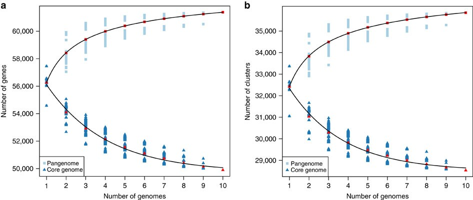
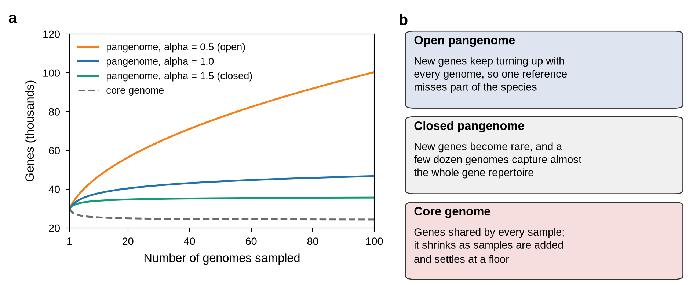

# Chapter 29. Pangenomes, organelle-to-nucleus transfer and horizontal gene transfer

**Status: Gene content variation within species (pangenomes), Verified; ongoing transfer of organelle DNA to the nucleus, Verified; horizontal gene transfer in prokaryotes, Verified; horizontal gene transfer as a source of genes in plants and animals, Partly verified; whether accessory genes are mostly adaptive or neutral, Contested; claims of extensive horizontal transfer into the human and tardigrade genomes, Rejected.** A single genome does not hold all the genes of a species. Genes vary in presence among individuals, move from organelles into the nucleus, and sometimes cross species boundaries. This chapter treats three related claims: that a species is better described by a pangenome than by one reference genome, that organelle genomes keep sending DNA to the nucleus, and that genes cross species boundaries often enough to matter.

Related notes in this repository: [endosymbiosis-organelle-origin](../../skills/genomics-theory-mining/theories/endosymbiosis-organelle-origin/THEORY.md), [organelle-plastid-muller-ratchet](../../skills/genomics-theory-mining/theories/organelle-plastid-muller-ratchet/THEORY.md), [c-value-junk-dna](../../skills/genomics-theory-mining/theories/c-value-junk-dna/THEORY.md).

## 29.1 Statement and history

**Pangenomes.** Tettelin and colleagues sequenced six strains of *Streptococcus agalactiae* and described the species by a pan-genome: a core genome shared by all isolates, about 80% of any single genome, plus a dispensable genome of partially shared and strain-specific genes. Extrapolation suggested that new genes would keep appearing even after hundreds of genomes [1]. Baumdicker, Hess and Pfaffelhuber formalized gene gain from an unbounded reservoir and gene loss along a genealogy as the infinitely many genes model, which can separate neutral from adaptive diversity in gene content [2]. The concept then spread to plants, where single reference genomes were found not to represent the diversity within a species [3].

**Organelle-to-nucleus transfer.** Chloroplasts descend from cyanobacteria. Comparison of the *Arabidopsis* genome with cyanobacterial genomes suggested that about 4,500 nuclear genes, about 18% of the total, were acquired from the cyanobacterial ancestor of plastids [4]. Endosymbiotic theory predicts that bacterial genes entered the eukaryotic lineage through the ancestors of organelles, in episodes tied to the endosymbioses [5].

**Horizontal gene transfer.** Bacteria have obtained a significant share of their genetic diversity from distantly related organisms [6]. Doolittle argued that if lateral transfer is not trivial in extent, the history of life cannot properly be represented as a tree [7]. Horizontal transfer is a recognized mechanism of adaptation in bacteria and archaea, and cases between prokaryotes and eukaryotes and between multicellular eukaryotes are also known [8].

## 29.2 What the theory predicts

- **Pangenomes larger than one genome.** Assemblies of several individuals of a species should reveal genes absent from the reference, and the number of genes should rise with each genome added (Figures 29.1 and 29.2) [1, 9].
- **Accessory genes with different properties.** If accessory genes are partly adaptive, they should be enriched for conditionally useful functions such as defence [3, 10]; if they are mostly neutral, their turnover should scale with effective population size [11].
- **Ongoing organelle transfer.** Transfer of organelle DNA into the nucleus should be measurable in the laboratory and should leave young insertions that vary within species [12, 13, 14].
- **Horizontal transfer with a signature.** A transferred gene should be nested within the donor lineage in phylogenies, physically linked to host DNA and absent from close relatives of the recipient [15, 16].

## 29.3 Evidence for

- **Bacterial pangenomes.** *S. agalactiae* has a vast gene reservoir [1]. Across bacterial species, genome fluidity correlates with synonymous diversity of the core genome, a measure of effective population size, but not with genome size, phylogeny or recombination rate [11].
- **Plant pangenomes.** About 20% of *Brassica oleracea* genes are affected by presence/absence variation, including genes for disease resistance, flowering time and glucosinolate metabolism (Figure 29.1) [9]. A pan-genome of 54 *Brachypodium distachyon* lines contains nearly twice the number of genes found in any individual genome; genes present in only some lines are enriched for defence and development, evolve faster and lie closer to transposable elements [10]. The 26 founders of the maize nested association mapping population carry more than 103,000 pan-genes, about a third of them found in all genotypes [17]. A tomato pan-genome of 725 accessions revealed 4,873 genes absent from the reference genome [18].
- **Human pangenome.** A draft human pangenome of 47 phased diploid assemblies added 119 million base pairs of polymorphic euchromatic sequence and 1,115 gene duplications relative to the reference GRCh38 [19].
- **Measured transfer from plastids.** Transfer of plastid DNA to the nucleus occurs in about one in 16,000 tobacco pollen grains [12]. Transfer is much more frequent in the male germline: 13 events among 146,000 progeny of transplastomic fathers, against one atypical event among 273,000 transplastomic ovules [13].
- **Young organelle insertions.** Nuclear mitochondrial DNA ranges from none or few copies in *Drosophila* to more than 500 in human, rice and *Arabidopsis* [20]. In maize it varies dramatically among inbred lines and even between sources of the same line [14]. Among 66,083 human genomes, more than 99% of people carried at least one of 1,637 nuclear mitochondrial segments, more than 90% of those evaluated inserted after humans diverged from apes, and new germline insertions occur in about one in 10⁴ births [21]. Across 85 eukaryotic genomes, the amount of nuclear mitochondrial DNA correlates strongly with genome size, suggesting that insertion may be limited by the frequency of double-strand breaks [22], although an earlier survey of 13 species found no clear correlation [20].
- **Horizontal transfer in eukaryotes.** Wolbachia DNA, from short pieces to nearly the whole bacterial genome, is found in the genomes of four insect and four nematode species, and some of it is transcribed [23]. Ferns acquired the photoreceptor neochrome from hornworts; the two diverged about 179 million years ago, long after the split of the two plant lineages [15]. The parasitic plant *Striga hermonthica* carries a nuclear gene that clusters with genes of its sorghum host [24]. Cultivated sweet potato contains *Agrobacterium* T-DNA, and one region was found in all 291 cultigens examined but not in close wild relatives [16]. Flowering plants exchange standard mitochondrial genes frequently [25], and the mitochondrial genome of *Amborella* contains six genome equivalents of foreign mitochondrial DNA from green algae, mosses and other angiosperms [26].

## 29.4 Evidence against, and difficulties

- **Contamination.** A tardigrade genome was reported with about one-sixth of its genes acquired by horizontal transfer [27]. Independent sequencing found no support: at most 1–2% of genes were candidates, and the earlier signal came from undetected contamination [28].
- **Annotation errors.** Errors from fragmented assemblies, contamination and mis-assembly accumulate over many genomes and distort prokaryotic pangenomes unless they are corrected [29].
- **The human case.** The initial analysis of the human genome was reported to contain over 100 genes acquired from bacteria during vertebrate evolution, a claim that was immediately and repeatedly rebutted [25]. About 40 genes were exclusively shared by humans and bacteria, and gene loss combined with sample size effects and rate variation was a more plausible explanation [30]. A 2015 study reported 145 horizontally transferred human genes; reanalysis of those listed with the highest certainty, and of 17 genes from the 2001 genome article, found little or no evidence for transfer [31].
- **Episodic, not continuous, transfer.** Phylogenies of eukaryotic gene families with prokaryotic homologues suggest that gene transfer from bacteria to eukaryotes was episodic and coincided with the origins of mitochondria and plastids. Patchy gene distributions reflect differential loss, and continuous lineage-specific transfer, although it sometimes occurs, does not contribute to long-term gene content [5].
- **Incongruent gene trees are not always transfer.** In grapevine mitochondrial DNA, incongruence among gene trees was no greater than among chloroplast genes, and the authors attributed it to reconstruction artefacts, too few characters and paralogy rather than rampant transfer [32].
- **Neutral or adaptive pangenomes.** Accessory gene turnover in bacteria fits largely neutral evolution [11]. Under the infinitely many genes model, the distributed genome of *Prochlorococcus* fitted neutrality, while that of *Synechococcus* deviated clearly from it [2].
- **Instability of new insertions.** Plastid DNA newly integrated in the tobacco nucleus is often deleted again, in somatic cells or in meiosis, so integration is balanced by removal [33].

## 29.5 Status and reasoning

**Pangenome variation: verified.** Genes absent from the reference genome are found in every well-sampled species, from bacteria [1] to crops [9, 10, 17] and humans [19]. **Ongoing organelle-to-nucleus transfer: verified,** measured directly in tobacco [12, 13] and seen as young insertions that vary within maize and humans [14, 21]. **Horizontal transfer in prokaryotes: verified** [6, 8]. **Horizontal transfer in plants and animals: partly verified,** with well-documented cases [15, 16, 23, 26] but little long-term contribution to eukaryotic gene content [5]. **Adaptive versus neutral accessory genes: contested** [2, 10, 11]. **Extensive transfer into the human and tardigrade genomes: rejected,** because the signal came from gene loss, rate variation and contamination [25, 28, 30, 31].

## 29.6 Plants, crops and grapevine

- **Crop pangenomes.** Genes for disease resistance, flowering and quality traits are often among the variable genes [9, 18]. In barley, pan-genome assemblies of 20 varieties revealed large inversions, one probably the product of mutation breeding [34].
- **Grapevine pangenome.** A graph-based grapevine pangenome built from 18 new phased telomere-to-telomere assemblies and 11 published assemblies, with resequencing of 466 cultivars, mapped 148 loci for 29 traits; including structural variants raised estimated heritability by 22.78% on average [35].
- **Hemizygosity in clones.** In the highly heterozygous Chardonnay genome, one in seven genes is hemizygous because of structural variants, and such variants accrue as recessive heterozygotes in clonally propagated lineages [36]. In a clonal crop the two haplotypes of one plant already differ in gene content.
- **Grapevine organelles.** The grapevine mitochondrial genome is 773,279 nt long, and 42.4% of the chloroplast genome has been incorporated into it; the only evidence for horizontal transfer into it involves fragments of two closteroviruses that cause leafroll disease [32].
- **Transfer in crops.** Sweet potato is a naturally transgenic food crop [16], and the processes that remove plastid insertions from the nucleus may also remove plant transgenes [33].

## 29.7 How to test it with public data

- **Data.** Multiple genome assemblies of one species [9, 17, 19, 35]; bacterial isolate collections [1]; organelle and nuclear assemblies of the same individual [21, 32].
- **Tools.** Prokaryote pangenome clustering with Roary [37] and Panaroo [29]; pangenome graphs with minigraph [38] and vg [39]; contamination filtering before any horizontal transfer call [28].
- **Analysis.** (1) Build gene presence/absence tables and plot pangenome and core size against the number of genomes (Figures 29.1 and 29.2) [9]. (2) Fit a model of gene gain and loss to separate neutral from adaptive turnover [2]. (3) Find organelle-derived segments by aligning organelle genomes to nuclear assemblies, and compare their age and frequency within the species [20, 21]. (4) For each horizontal transfer candidate, require phylogenetic nesting in the donor, physical linkage to host DNA and absence in close relatives [16, 31]. The script [`scripts/ch29_pangenome_figures.py`](../scripts/ch29_pangenome_figures.py) shows how pangenome size grows under open and closed models (Figure 29.2).
- **What would refute it.** Additional genomes that add no new genes in well-sampled species, organelle insertions that are all ancient and fixed, or horizontal transfer candidates that all disappear after contamination filtering.

## 29.8 Open questions

- How much plant pangenome variation is adaptive, and how much is drift and transposon activity [3, 10]?
- Why do some species accumulate many more organelle insertions than others [20, 22]?
- How often does horizontal transfer between plants occur outside parasitic relationships [24, 25]?
- How should a pangenome reference for a clonal crop represent the two haplotypes of each cultivar [35, 36]?

## 29.9 Common mistakes

- Calling a gene horizontally transferred without excluding contamination [28].
- Treating a gene absent from distant species as transferred when differential loss explains its distribution [5, 30].
- Reading pangenome size without correcting annotation errors [29].
- Counting organelle insertions in a nuclear assembly as stable genes; many are deleted again [33].

## Figures

**Figure 29.1.** Model describing the sizes of core and pangenome. Every genome added using (a) all genes and (b) orthologous gene clusters. Red points correspond to mean value. The pangenome size increases with each added line up to 61,379 genes (35,853 gene families), and extrapolation of pangenome size leads to a predicted pangenome of 63,865±31 genes (37,766±62 gene families). The size of the core genome diminishes with every added line to 49,895 genes (28,532 gene families) with a predicted core genome size of 49,740±164 genes (28,496±91 gene families). ±corresponds to s.e. Reproduced unchanged from Golicz AA, Bayer PE, Barker GC, et al. (2016) The pangenome of an agronomically important crop plant *Brassica oleracea*. *Nature Communications* 7:13390, Figure 2. https://doi.org/10.1038/ncomms13390. Licence: CC BY 4.0 (https://creativecommons.org/licenses/by/4.0/).

**Figure 29.2.** (a) Pangenome size as genomes are added, when the k-th genome brings 4,000 × k^(−α) genes not seen before, for α = 0.5 (open), 1.0 and 1.5 (closed), starting from 30,000 genes; the core genome shrinks towards 24,000 genes. The values are illustrative. (b) What the model shows. Made with [`scripts/ch29_pangenome_figures.py`](../scripts/ch29_pangenome_figures.py); the calculation is deterministic.

## References

1. Tettelin H, Masignani V, Cieslewicz MJ, et al. (2005) Genome analysis of multiple pathogenic isolates of Streptococcus agalactiae: Implications for the microbial “pan-genome”. *Proceedings of the National Academy of Sciences* 102:13950-13955. https://doi.org/10.1073/pnas.0506758102
2. Baumdicker F, Hess WR, Pfaffelhuber P (2012) The Infinitely Many Genes Model for the Distributed Genome of Bacteria. *Genome Biology and Evolution* 4:443-456. https://doi.org/10.1093/gbe/evs016
3. Bayer PE, Golicz AA, Scheben A, et al. (2020) Plant pan-genomes are the new reference. *Nature Plants* 6:914-920. https://doi.org/10.1038/s41477-020-0733-0
4. Martin W, Rujan T, Richly E, et al. (2002) Evolutionary analysis of Arabidopsis, cyanobacterial, and chloroplast genomes reveals plastid phylogeny and thousands of cyanobacterial genes in the nucleus. *Proceedings of the National Academy of Sciences* 99:12246-12251. https://doi.org/10.1073/pnas.182432999
5. Ku C, Nelson-Sathi S, Roettger M, et al. (2015) Endosymbiotic origin and differential loss of eukaryotic genes. *Nature* 524:427-432. https://doi.org/10.1038/nature14963
6. Ochman H, Lawrence JG, Groisman EA (2000) Lateral gene transfer and the nature of bacterial innovation. *Nature* 405:299-304. https://doi.org/10.1038/35012500
7. Doolittle WF (1999) Phylogenetic Classification and the Universal Tree. *Science* 284:2124-2128. https://doi.org/10.1126/science.284.5423.2124
8. Soucy SM, Huang J, Gogarten JP (2015) Horizontal gene transfer: building the web of life. *Nature Reviews Genetics* 16:472-482. https://doi.org/10.1038/nrg3962
9. Golicz AA, Bayer PE, Barker GC, et al. (2016) The pangenome of an agronomically important crop plant Brassica oleracea. *Nature Communications* 7:13390. https://doi.org/10.1038/ncomms13390
10. Gordon SP, Contreras-Moreira B, Woods DP, et al. (2017) Extensive gene content variation in the Brachypodium distachyon pan-genome correlates with population structure. *Nature Communications* 8:2184. https://doi.org/10.1038/s41467-017-02292-8
11. Andreani NA, Hesse E, Vos M (2017) Prokaryote genome fluidity is dependent on effective population size. *The ISME Journal* 11:1719-1721. https://doi.org/10.1038/ismej.2017.36
12. Huang CY, Ayliffe MA, Timmis JN (2003) Direct measurement of the transfer rate of chloroplast DNA into the nucleus. *Nature* 422:72-76. https://doi.org/10.1038/nature01435
13. Sheppard AE, Ayliffe MA, Blatch L, et al. (2008) Transfer of Plastid DNA to the Nucleus Is Elevated during Male Gametogenesis in Tobacco. *Plant Physiology* 148:328-336. https://doi.org/10.1104/pp.108.119107
14. Lough AN, Roark LM, Kato A, et al. (2008) Mitochondrial DNA Transfer to the Nucleus Generates Extensive Insertion Site Variation in Maize. *Genetics* 178:47-55. https://doi.org/10.1534/genetics.107.079624
15. Li FW, Villarreal JC, Kelly S, et al. (2014) Horizontal transfer of an adaptive chimeric photoreceptor from bryophytes to ferns. *Proceedings of the National Academy of Sciences* 111:6672-6677. https://doi.org/10.1073/pnas.1319929111
16. Kyndt T, Quispe D, Zhai H, et al. (2015) The genome of cultivated sweet potato contains Agrobacterium T-DNAs with expressed genes: An example of a naturally transgenic food crop. *Proceedings of the National Academy of Sciences* 112:5844-5849. https://doi.org/10.1073/pnas.1419685112
17. Hufford MB, Seetharam AS, Woodhouse MR, et al. (2021) De novo assembly, annotation, and comparative analysis of 26 diverse maize genomes. *Science* 373:655-662. https://doi.org/10.1126/science.abg5289
18. Gao L, Gonda I, Sun H, et al. (2019) The tomato pan-genome uncovers new genes and a rare allele regulating fruit flavor. *Nature Genetics* 51:1044-1051. https://doi.org/10.1038/s41588-019-0410-2
19. Liao WW, Asri M, Ebler J, et al. (2023) A draft human pangenome reference. *Nature* 617:312-324. https://doi.org/10.1038/s41586-023-05896-x
20. Richly E, Leister D (2004) NUMTs in Sequenced Eukaryotic Genomes. *Molecular Biology and Evolution* 21:1081-1084. https://doi.org/10.1093/molbev/msh110
21. Wei W, Schon KR, Elgar G, et al. (2022) Nuclear-embedded mitochondrial DNA sequences in 66,083 human genomes. *Nature* 611:105-114. https://doi.org/10.1038/s41586-022-05288-7
22. Hazkani-Covo E, Zeller RM, Martin W (2010) Molecular Poltergeists: Mitochondrial DNA Copies (numts) in Sequenced Nuclear Genomes. *PLoS Genetics* 6:e1000834. https://doi.org/10.1371/journal.pgen.1000834
23. Dunning Hotopp JC, Clark ME, Oliveira DCSG, et al. (2007) Widespread Lateral Gene Transfer from Intracellular Bacteria to Multicellular Eukaryotes. *Science* 317:1753-1756. https://doi.org/10.1126/science.1142490
24. Yoshida S, Maruyama S, Nozaki H, et al. (2010) Horizontal Gene Transfer by the Parasitic Plant Striga hermonthica. *Science* 328:1128. https://doi.org/10.1126/science.1187145
25. Bergthorsson U, Adams KL, Thomason B, et al. (2003) Widespread horizontal transfer of mitochondrial genes in flowering plants. *Nature* 424:197-201. https://doi.org/10.1038/nature01743
26. Rice DW, Alverson AJ, Richardson AO, et al. (2013) Horizontal Transfer of Entire Genomes via Mitochondrial Fusion in the Angiosperm Amborella. *Science* 342:1468-1473. https://doi.org/10.1126/science.1246275
27. Boothby TC, Tenlen JR, Smith FW, et al. (2015) Evidence for extensive horizontal gene transfer from the draft genome of a tardigrade. *Proceedings of the National Academy of Sciences* 112:15976-15981. https://doi.org/10.1073/pnas.1510461112
28. Koutsovoulos G, Kumar S, Laetsch DR, et al. (2016) No evidence for extensive horizontal gene transfer in the genome of the tardigrade Hypsibius dujardini. *Proceedings of the National Academy of Sciences* 113:5053-5058. https://doi.org/10.1073/pnas.1600338113
29. Tonkin-Hill G, MacAlasdair N, Ruis C, et al. (2020) Producing polished prokaryotic pangenomes with the Panaroo pipeline. *Genome Biology* 21:180. https://doi.org/10.1186/s13059-020-02090-4
30. Salzberg SL, White O, Peterson J, et al. (2001) Microbial Genes in the Human Genome: Lateral Transfer or Gene Loss? *Science* 292:1903-1906. https://doi.org/10.1126/science.1061036
31. Salzberg SL (2017) Horizontal gene transfer is not a hallmark of the human genome. *Genome Biology* 18:85. https://doi.org/10.1186/s13059-017-1214-2
32. Goremykin VV, Salamini F, Velasco R, et al. (2008) Mitochondrial DNA of Vitis vinifera and the Issue of Rampant Horizontal Gene Transfer. *Molecular Biology and Evolution* 26:99-110. https://doi.org/10.1093/molbev/msn226
33. Sheppard AE, Timmis JN (2009) Instability of Plastid DNA in the Nuclear Genome. *PLoS Genetics* 5:e1000323. https://doi.org/10.1371/journal.pgen.1000323
34. Jayakodi M, Padmarasu S, Haberer G, et al. (2020) The barley pan-genome reveals the hidden legacy of mutation breeding. *Nature* 588:284-289. https://doi.org/10.1038/s41586-020-2947-8
35. Liu Z, Wang N, Su Y, et al. (2024) Grapevine pangenome facilitates trait genetics and genomic breeding. *Nature Genetics* 56:2804-2814. https://doi.org/10.1038/s41588-024-01967-5
36. Zhou Y, Minio A, Massonnet M, et al. (2019) The population genetics of structural variants in grapevine domestication. *Nature Plants* 5:965-979. https://doi.org/10.1038/s41477-019-0507-8
37. Page AJ, Cummins CA, Hunt M, et al. (2015) Roary: rapid large-scale prokaryote pan genome analysis. *Bioinformatics* 31:3691-3693. https://doi.org/10.1093/bioinformatics/btv421
38. Li H, Feng X, Chu C (2020) The design and construction of reference pangenome graphs with minigraph. *Genome Biology* 21:265. https://doi.org/10.1186/s13059-020-02168-z
39. Garrison E, Sirén J, Novak AM, et al. (2018) Variation graph toolkit improves read mapping by representing genetic variation in the reference. *Nature Biotechnology* 36:875-879. https://doi.org/10.1038/nbt.4227
