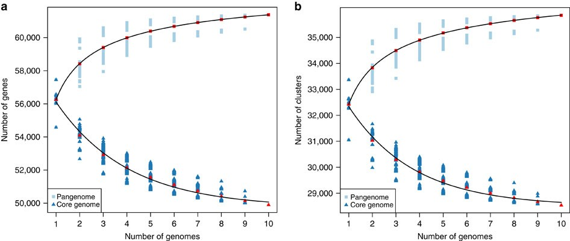
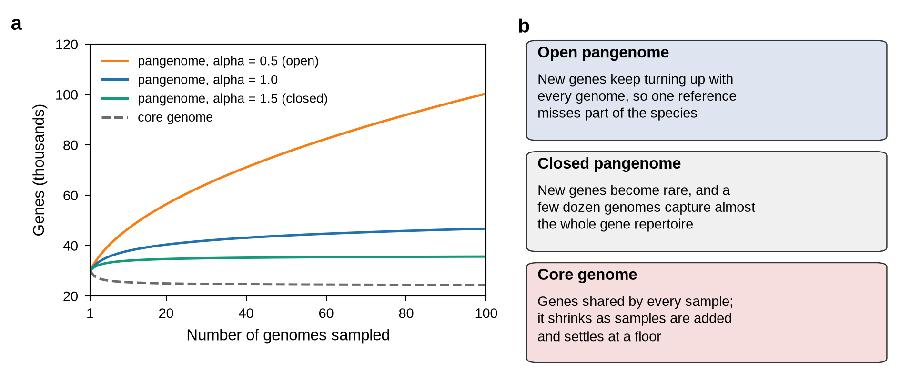

# 第 29 章 泛基因组、细胞器向核转移与水平基因转移

**地位：种内基因含量变异（泛基因组），已验证；细胞器 DNA 持续向细胞核转移，已验证；原核生物中的水平基因转移，已验证；水平基因转移作为植物和动物基因的来源，部分验证；附属基因主要是适应性的还是中性的，有争议；人类和缓步动物基因组中存在大量水平转移的说法，被否定。** 一个基因组并不包含一个物种的全部基因。基因在个体之间有无不同，从细胞器进入细胞核，有时还跨越物种界限。本章讨论三个相关的说法：用泛基因组描述一个物种比用一个参考基因组更好；细胞器基因组不断把 DNA 送入细胞核；基因跨越物种界限的频率高到足以产生影响。

本仓库相关条目：[endosymbiosis-organelle-origin](../../skills/genomics-theory-mining/theories/endosymbiosis-organelle-origin/THEORY.md)、[organelle-plastid-muller-ratchet](../../skills/genomics-theory-mining/theories/organelle-plastid-muller-ratchet/THEORY.md)、[c-value-junk-dna](../../skills/genomics-theory-mining/theories/c-value-junk-dna/THEORY.md)。

## 29.1 内容与历史

**泛基因组。** Tettelin 等测序了无乳链球菌（*Streptococcus agalactiae*）的六个菌株，用泛基因组来描述这个物种：所有分离株共有的核心基因组约占任一基因组的 80%，另加由部分共享和菌株特有基因组成的可有可无基因组。外推表明，即使测序几百个基因组之后，仍会不断出现新基因 [1]。Baumdicker、Hess 和 Pfaffelhuber 把从无限基因库获得基因和沿谱系丢失基因形式化为无限多基因模型，用它可以区分基因含量多样性中的中性部分和适应性部分 [2]。这一概念随后扩展到植物，人们发现单个参考基因组不能代表物种内部的多样性 [3]。

**细胞器向核转移。** 叶绿体起源于蓝细菌。把拟南芥基因组与蓝细菌基因组比较，结果提示约 4,500 个核基因（约占总数 18%）来自质体的蓝细菌祖先 [4]。内共生理论预测，细菌基因经由细胞器的祖先进入真核谱系，并且是在与内共生事件相联系的若干阶段中进入的 [5]。

**水平基因转移。** 细菌的遗传多样性有相当一部分来自亲缘关系很远的生物 [6]。Doolittle 认为，如果横向转移的规模并非微不足道，生命的历史就不能恰当地用一棵树来表示 [7]。水平转移是细菌和古菌公认的适应机制，原核生物与真核生物之间、多细胞真核生物之间的例子也已为人所知 [8]。

## 29.2 预测

- **泛基因组大于单个基因组。** 对一个物种的多个个体进行组装，应当发现参考基因组中没有的基因，而且每增加一个基因组，基因总数都应上升（图 29.1 和图 29.2）[1, 9]。
- **附属基因性质不同。** 如果附属基因部分是适应性的，它们应富集于防御等条件性有用的功能 [3, 10]；如果主要是中性的，它们的更替应随有效群体大小而变 [11]。
- **持续的细胞器转移。** 细胞器 DNA 向细胞核的转移应能在实验室中测到，并应留下在种内有变异的年轻插入 [12, 13, 14]。
- **带有特征的水平转移。** 被转移的基因在系统发育中应嵌套在供体谱系内，在物理上与宿主 DNA 相连，并且在受体的近缘种中不存在 [15, 16]。

## 29.3 支持证据

- **细菌泛基因组。** 无乳链球菌拥有巨大的基因库 [1]。在不同细菌物种之间，基因组流动性与核心基因组的同义多样性（有效群体大小的一个度量）相关，而与基因组大小、系统发育或重组率无关 [11]。
- **植物泛基因组。** 甘蓝（*Brassica oleracea*）约 20% 的基因受有无变异影响，其中包括与抗病、开花时间和硫代葡萄糖苷代谢有关的基因（图 29.1）[9]。由 54 个二穗短柄草（*Brachypodium distachyon*）株系构建的泛基因组，基因数接近任一单个基因组的两倍；只在部分株系中存在的基因富集于防御和发育功能，进化更快，并且更靠近转座子 [10]。玉米巢式关联作图群体的 26 个奠基系带有超过 103,000 个泛基因，其中约三分之一在所有基因型中都存在 [17]。由 725 份材料构建的番茄泛基因组揭示了参考基因组中没有的 4,873 个基因 [18]。
- **人类泛基因组。** 由 47 个定相二倍体组装构成的人类泛基因组草图，相对于参考基因组 GRCh38 增加了 1.19 亿个碱基对的多态常染色质序列和 1,115 个基因重复 [19]。
- **测得的质体转移。** 在烟草中，大约每 16,000 粒花粉中有一次质体 DNA 转移到细胞核 [12]。雄性种系中的转移频率高得多：转质体父本的 146,000 个后代中有 13 次转移，而 273,000 个转质体胚珠中只有一次不典型的转移 [13]。
- **年轻的细胞器插入。** 核内线粒体 DNA 的拷贝数从果蝇中的没有或很少，到人类、水稻和拟南芥中的 500 多个不等 [20]。在玉米中，它在不同自交系之间差异极大，甚至在同一自交系的不同来源之间也有差异 [14]。在 66,083 个人类基因组中，超过 99% 的人至少带有 1,637 个核内线粒体片段中的一个；在评估过的片段中，超过 90% 是在人类与猿类分开之后插入的；新的种系插入大约每 10⁴ 次出生出现一次 [21]。在 85 个真核生物基因组中，核内线粒体 DNA 的数量与基因组大小强相关，提示插入可能受双链断裂频率的限制 [22]；不过更早对 13 个物种的调查没有发现明显的相关 [20]。
- **真核生物中的水平转移。** 从短片段到几乎整个细菌基因组的沃尔巴克氏体（Wolbachia）DNA，存在于四种昆虫和四种线虫的基因组中，其中一部分会转录 [23]。蕨类从角苔获得了光受体 neochrome；两者大约在 1.79 亿年前分开，远晚于这两个植物谱系的分化 [15]。寄生植物独脚金（*Striga hermonthica*）带有一个与其宿主高粱的基因聚在一起的核基因 [24]。栽培甘薯含有农杆菌的 T-DNA，其中一个区域存在于所检测的全部 291 个栽培品种中，而在近缘野生种中不存在 [16]。开花植物之间经常交换标准的线粒体基因 [25]；无油樟（*Amborella*）的线粒体基因组含有相当于六个基因组的外来线粒体 DNA，来自绿藻、苔藓和其他被子植物 [26]。

## 29.4 反面证据与难点

- **污染。** 曾有报道称一个缓步动物基因组约六分之一的基因来自水平转移 [27]。独立测序没有找到支持：最多只有 1–2% 的基因是候选，先前的信号来自未被发现的污染 [28]。
- **注释错误。** 片段化组装、污染和错误组装带来的误差会在大量基因组中累积，若不校正，就会扭曲原核生物泛基因组 [29]。
- **人类的例子。** 人类基因组的初步分析曾被报道含有 100 多个在脊椎动物进化中从细菌获得的基因，这一说法随即被反复驳斥 [25]。人类与细菌独有共享的基因约有 40 个，基因丢失加上样本大小效应和速率差异，是更合理的解释 [30]。2015 年的一项研究报告了 145 个水平转移的人类基因；对其中把握最大的基因以及 2001 年基因组论文中的 17 个基因重新分析，几乎找不到转移的证据 [31]。
- **阶段性的而非持续的转移。** 对带有原核同源基因的真核基因家族做系统发育分析，结果提示细菌向真核生物的基因转移是阶段性的，与线粒体和质体的起源同时发生。零散的基因分布反映的是不同谱系中的丢失；持续的谱系特异转移虽然偶尔发生，但对长期的基因含量没有贡献 [5]。
- **基因树不一致不一定是转移。** 在葡萄线粒体 DNA 中，基因树之间的不一致并不比叶绿体基因之间更大，作者把它归因于建树的人为误差、性状太少和旁系同源，而不是泛滥的转移 [32]。
- **中性还是适应性的泛基因组。** 细菌附属基因的更替大体符合中性进化 [11]。在无限多基因模型下，原绿球藻（*Prochlorococcus*）的分布基因组符合中性，而聚球藻（*Synechococcus*）明显偏离中性 [2]。
- **新插入不稳定。** 新整合进烟草细胞核的质体 DNA 常常在体细胞中或减数分裂中再次被删除，因此整合与清除相互平衡 [33]。

## 29.5 地位与理由

**泛基因组变异：已验证。** 从细菌 [1] 到作物 [9, 10, 17] 和人类 [19]，每个取样充分的物种都有参考基因组中没有的基因。**持续的细胞器向核转移：已验证，** 已在烟草中直接测得 [12, 13]，并表现为玉米和人类中种内有变异的年轻插入 [14, 21]。**原核生物中的水平转移：已验证** [6, 8]。**植物和动物中的水平转移：部分验证，** 有记录充分的例子 [15, 16, 23, 26]，但对真核生物长期基因含量的贡献很小 [5]。**附属基因是适应性的还是中性的：有争议** [2, 10, 11]。**人类和缓步动物基因组中的大量转移：被否定，** 因为信号来自基因丢失、速率差异和污染 [25, 28, 30, 31]。

## 29.6 植物、作物与葡萄

- **作物泛基因组。** 抗病、开花和品质性状的基因常常属于可变基因 [9, 18]。在大麦中，20 个品种的泛基因组组装揭示了大的倒位，其中一个很可能是诱变育种的产物 [34]。
- **葡萄泛基因组。** 用 18 个新的定相端粒到端粒组装和 11 个已发表组装构建的葡萄图形泛基因组，结合 466 个品种的重测序，为 29 个性状定位了 148 个位点；纳入结构变异后，估计的遗传力平均提高 22.78% [35]。
- **克隆中的半合子。** 在高度杂合的霞多丽基因组中，每七个基因中就有一个因结构变异而处于半合子状态，这类变异在无性繁殖谱系中以隐性杂合的形式累积 [36]。在无性繁殖作物中，一株植物的两套单倍型本身就在基因含量上不同。
- **葡萄细胞器。** 葡萄线粒体基因组长 773,279 nt，叶绿体基因组的 42.4% 已并入其中；其中水平转移的唯一证据，是来自两种引起卷叶病的长线形病毒的片段 [32]。
- **作物中的转移。** 甘薯是一种天然转基因的粮食作物 [16]；从细胞核中清除质体插入的过程，也可能清除植物转基因 [33]。

## 29.7 用公开数据检验

- **数据。** 同一物种的多个基因组组装 [9, 17, 19, 35]；细菌分离株集合 [1]；同一个体的细胞器和核基因组组装 [21, 32]。
- **工具。** 用 Roary [37] 和 Panaroo [29] 做原核生物泛基因组聚类；用 minigraph [38] 和 vg [39] 构建泛基因组图；在判定任何水平转移之前先过滤污染 [28]。
- **分析。** (1) 建立基因有无表，画出泛基因组和核心基因组大小随基因组数目的变化（图 29.1 和图 29.2）[9]。(2) 拟合基因获得与丢失模型，区分中性更替和适应性更替 [2]。(3) 把细胞器基因组比对到核基因组组装上，找出细胞器来源的片段，并比较它们在种内的年龄和频率 [20, 21]。(4) 对每个水平转移候选，要求它在系统发育上嵌套于供体内、在物理上与宿主 DNA 相连、并在近缘种中缺失 [16, 31]。脚本 [`scripts/ch29_pangenome_figures.py`](../scripts/ch29_pangenome_figures.py) 展示开放和封闭模型下泛基因组大小如何增长（图 29.2）。
- **什么结果会推翻理论。** 在取样充分的物种中再增加基因组也不再出现新基因；细胞器插入全都古老且已固定；或者水平转移候选在过滤污染后全部消失。

## 29.8 未解决的问题

- 植物泛基因组变异有多少是适应性的，有多少来自漂变和转座子活动 [3, 10]？
- 为什么有些物种积累的细胞器插入比其他物种多得多 [20, 22]？
- 在寄生关系之外，植物之间的水平转移有多常见 [24, 25]？
- 无性繁殖作物的泛基因组参考应当如何表示每个品种的两套单倍型 [35, 36]？

## 29.9 常见错误

- 没有排除污染就把一个基因判定为水平转移 [28]。
- 一个基因在远缘物种中缺失，就当作转移，而实际上不同谱系中的丢失可以解释它的分布 [5, 30]。
- 不校正注释错误就解读泛基因组大小 [29]。
- 把核基因组组装中的细胞器插入当作稳定的基因；其中许多会再次被删除 [33]。

## 图

**图 29.1.** 描述核心基因组和泛基因组大小的模型。每增加一个基因组时，(a) 使用全部基因和 (b) 使用直系同源基因簇的结果。红点为平均值。泛基因组大小随每增加一个株系而增加，最多达到 61,379 个基因（35,853 个基因家族），外推得到的泛基因组预测值为 63,865±31 个基因（37,766±62 个基因家族）。核心基因组的大小随每增加一个株系而减小，降至 49,895 个基因（28,532 个基因家族），预测的核心基因组大小为 49,740±164 个基因（28,496±91 个基因家族）。± 表示标准误。原样转载自 Golicz AA, Bayer PE, Barker GC, et al. (2016) The pangenome of an agronomically important crop plant *Brassica oleracea*. *Nature Communications* 7:13390, Figure 2. https://doi.org/10.1038/ncomms13390。许可：CC BY 4.0（https://creativecommons.org/licenses/by/4.0/）。

**图 29.2.** (a) 逐个增加基因组时的泛基因组大小：第 k 个基因组带来 4,000 × k^(−α) 个新基因，α = 0.5（开放）、1.0 和 1.5（封闭），起点为 30,000 个基因；核心基因组缩小并趋近 24,000 个基因。数值仅作示意。(b) 模型说明了什么。用 [`scripts/ch29_pangenome_figures.py`](../scripts/ch29_pangenome_figures.py) 生成；计算是确定性的。

## 参考文献

1. Tettelin H, Masignani V, Cieslewicz MJ, et al. (2005) Genome analysis of multiple pathogenic isolates of Streptococcus agalactiae: Implications for the microbial “pan-genome”. *Proceedings of the National Academy of Sciences* 102:13950-13955. https://doi.org/10.1073/pnas.0506758102
2. Baumdicker F, Hess WR, Pfaffelhuber P (2012) The Infinitely Many Genes Model for the Distributed Genome of Bacteria. *Genome Biology and Evolution* 4:443-456. https://doi.org/10.1093/gbe/evs016
3. Bayer PE, Golicz AA, Scheben A, et al. (2020) Plant pan-genomes are the new reference. *Nature Plants* 6:914-920. https://doi.org/10.1038/s41477-020-0733-0
4. Martin W, Rujan T, Richly E, et al. (2002) Evolutionary analysis of Arabidopsis, cyanobacterial, and chloroplast genomes reveals plastid phylogeny and thousands of cyanobacterial genes in the nucleus. *Proceedings of the National Academy of Sciences* 99:12246-12251. https://doi.org/10.1073/pnas.182432999
5. Ku C, Nelson-Sathi S, Roettger M, et al. (2015) Endosymbiotic origin and differential loss of eukaryotic genes. *Nature* 524:427-432. https://doi.org/10.1038/nature14963
6. Ochman H, Lawrence JG, Groisman EA (2000) Lateral gene transfer and the nature of bacterial innovation. *Nature* 405:299-304. https://doi.org/10.1038/35012500
7. Doolittle WF (1999) Phylogenetic Classification and the Universal Tree. *Science* 284:2124-2128. https://doi.org/10.1126/science.284.5423.2124
8. Soucy SM, Huang J, Gogarten JP (2015) Horizontal gene transfer: building the web of life. *Nature Reviews Genetics* 16:472-482. https://doi.org/10.1038/nrg3962
9. Golicz AA, Bayer PE, Barker GC, et al. (2016) The pangenome of an agronomically important crop plant Brassica oleracea. *Nature Communications* 7:13390. https://doi.org/10.1038/ncomms13390
10. Gordon SP, Contreras-Moreira B, Woods DP, et al. (2017) Extensive gene content variation in the Brachypodium distachyon pan-genome correlates with population structure. *Nature Communications* 8:2184. https://doi.org/10.1038/s41467-017-02292-8
11. Andreani NA, Hesse E, Vos M (2017) Prokaryote genome fluidity is dependent on effective population size. *The ISME Journal* 11:1719-1721. https://doi.org/10.1038/ismej.2017.36
12. Huang CY, Ayliffe MA, Timmis JN (2003) Direct measurement of the transfer rate of chloroplast DNA into the nucleus. *Nature* 422:72-76. https://doi.org/10.1038/nature01435
13. Sheppard AE, Ayliffe MA, Blatch L, et al. (2008) Transfer of Plastid DNA to the Nucleus Is Elevated during Male Gametogenesis in Tobacco. *Plant Physiology* 148:328-336. https://doi.org/10.1104/pp.108.119107
14. Lough AN, Roark LM, Kato A, et al. (2008) Mitochondrial DNA Transfer to the Nucleus Generates Extensive Insertion Site Variation in Maize. *Genetics* 178:47-55. https://doi.org/10.1534/genetics.107.079624
15. Li FW, Villarreal JC, Kelly S, et al. (2014) Horizontal transfer of an adaptive chimeric photoreceptor from bryophytes to ferns. *Proceedings of the National Academy of Sciences* 111:6672-6677. https://doi.org/10.1073/pnas.1319929111
16. Kyndt T, Quispe D, Zhai H, et al. (2015) The genome of cultivated sweet potato contains Agrobacterium T-DNAs with expressed genes: An example of a naturally transgenic food crop. *Proceedings of the National Academy of Sciences* 112:5844-5849. https://doi.org/10.1073/pnas.1419685112
17. Hufford MB, Seetharam AS, Woodhouse MR, et al. (2021) De novo assembly, annotation, and comparative analysis of 26 diverse maize genomes. *Science* 373:655-662. https://doi.org/10.1126/science.abg5289
18. Gao L, Gonda I, Sun H, et al. (2019) The tomato pan-genome uncovers new genes and a rare allele regulating fruit flavor. *Nature Genetics* 51:1044-1051. https://doi.org/10.1038/s41588-019-0410-2
19. Liao WW, Asri M, Ebler J, et al. (2023) A draft human pangenome reference. *Nature* 617:312-324. https://doi.org/10.1038/s41586-023-05896-x
20. Richly E, Leister D (2004) NUMTs in Sequenced Eukaryotic Genomes. *Molecular Biology and Evolution* 21:1081-1084. https://doi.org/10.1093/molbev/msh110
21. Wei W, Schon KR, Elgar G, et al. (2022) Nuclear-embedded mitochondrial DNA sequences in 66,083 human genomes. *Nature* 611:105-114. https://doi.org/10.1038/s41586-022-05288-7
22. Hazkani-Covo E, Zeller RM, Martin W (2010) Molecular Poltergeists: Mitochondrial DNA Copies (numts) in Sequenced Nuclear Genomes. *PLoS Genetics* 6:e1000834. https://doi.org/10.1371/journal.pgen.1000834
23. Dunning Hotopp JC, Clark ME, Oliveira DCSG, et al. (2007) Widespread Lateral Gene Transfer from Intracellular Bacteria to Multicellular Eukaryotes. *Science* 317:1753-1756. https://doi.org/10.1126/science.1142490
24. Yoshida S, Maruyama S, Nozaki H, et al. (2010) Horizontal Gene Transfer by the Parasitic Plant Striga hermonthica. *Science* 328:1128. https://doi.org/10.1126/science.1187145
25. Bergthorsson U, Adams KL, Thomason B, et al. (2003) Widespread horizontal transfer of mitochondrial genes in flowering plants. *Nature* 424:197-201. https://doi.org/10.1038/nature01743
26. Rice DW, Alverson AJ, Richardson AO, et al. (2013) Horizontal Transfer of Entire Genomes via Mitochondrial Fusion in the Angiosperm Amborella. *Science* 342:1468-1473. https://doi.org/10.1126/science.1246275
27. Boothby TC, Tenlen JR, Smith FW, et al. (2015) Evidence for extensive horizontal gene transfer from the draft genome of a tardigrade. *Proceedings of the National Academy of Sciences* 112:15976-15981. https://doi.org/10.1073/pnas.1510461112
28. Koutsovoulos G, Kumar S, Laetsch DR, et al. (2016) No evidence for extensive horizontal gene transfer in the genome of the tardigrade Hypsibius dujardini. *Proceedings of the National Academy of Sciences* 113:5053-5058. https://doi.org/10.1073/pnas.1600338113
29. Tonkin-Hill G, MacAlasdair N, Ruis C, et al. (2020) Producing polished prokaryotic pangenomes with the Panaroo pipeline. *Genome Biology* 21:180. https://doi.org/10.1186/s13059-020-02090-4
30. Salzberg SL, White O, Peterson J, et al. (2001) Microbial Genes in the Human Genome: Lateral Transfer or Gene Loss? *Science* 292:1903-1906. https://doi.org/10.1126/science.1061036
31. Salzberg SL (2017) Horizontal gene transfer is not a hallmark of the human genome. *Genome Biology* 18:85. https://doi.org/10.1186/s13059-017-1214-2
32. Goremykin VV, Salamini F, Velasco R, et al. (2008) Mitochondrial DNA of Vitis vinifera and the Issue of Rampant Horizontal Gene Transfer. *Molecular Biology and Evolution* 26:99-110. https://doi.org/10.1093/molbev/msn226
33. Sheppard AE, Timmis JN (2009) Instability of Plastid DNA in the Nuclear Genome. *PLoS Genetics* 5:e1000323. https://doi.org/10.1371/journal.pgen.1000323
34. Jayakodi M, Padmarasu S, Haberer G, et al. (2020) The barley pan-genome reveals the hidden legacy of mutation breeding. *Nature* 588:284-289. https://doi.org/10.1038/s41586-020-2947-8
35. Liu Z, Wang N, Su Y, et al. (2024) Grapevine pangenome facilitates trait genetics and genomic breeding. *Nature Genetics* 56:2804-2814. https://doi.org/10.1038/s41588-024-01967-5
36. Zhou Y, Minio A, Massonnet M, et al. (2019) The population genetics of structural variants in grapevine domestication. *Nature Plants* 5:965-979. https://doi.org/10.1038/s41477-019-0507-8
37. Page AJ, Cummins CA, Hunt M, et al. (2015) Roary: rapid large-scale prokaryote pan genome analysis. *Bioinformatics* 31:3691-3693. https://doi.org/10.1093/bioinformatics/btv421
38. Li H, Feng X, Chu C (2020) The design and construction of reference pangenome graphs with minigraph. *Genome Biology* 21:265. https://doi.org/10.1186/s13059-020-02168-z
39. Garrison E, Sirén J, Novak AM, et al. (2018) Variation graph toolkit improves read mapping by representing genetic variation in the reference. *Nature Biotechnology* 36:875-879. https://doi.org/10.1038/nbt.4227
