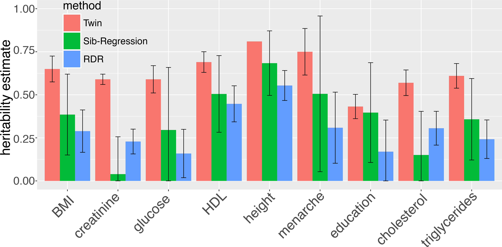
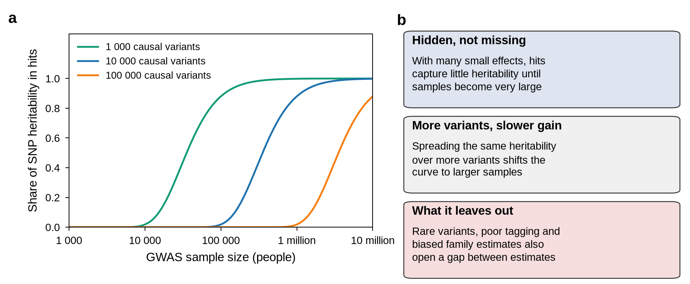

# Chapter 30. Missing heritability and the omnigenic model

**Status: The gap between genome-wide significant hits and family-based heritability, Verified; most of that gap is hidden in many variants of small effect, Verified (largely closed for human height); rare variants and inflated family estimates as the remaining gap, Partly verified; the omnigenic model of core and peripheral genes, Contested.** Twin and family studies estimated high heritability for many human traits, but the first genome-wide association studies (GWAS) found variants that explained only a small part of it. This gap was called missing heritability. The omnigenic model proposes why associations are spread across most of the genome: regulatory networks are so interconnected that almost every gene expressed in a relevant cell type affects a small set of core genes.

Related notes in this repository: [infinitesimal-polygenic](../../skills/genomics-theory-mining/theories/infinitesimal-polygenic/THEORY.md), [rockman-qtn-versus-polygenes](../../skills/genomics-theory-mining/theories/rockman-qtn-versus-polygenes/THEORY.md), [berg-coop-polygenic-adaptation](../../skills/genomics-theory-mining/theories/berg-coop-polygenic-adaptation/THEORY.md), [lande-1975-mutation-maintained-va](../../skills/genomics-theory-mining/theories/lande-1975-mutation-maintained-va/THEORY.md).

## 30.1 Statement and history

Fisher interpreted the correlation between relatives under Mendelian inheritance, introduced the variance as the measure of variability and ascribed fractions of the total variance to its causes [1]. Heritability, introduced by Wright and Fisher as an estimable population parameter, remains key to the response to selection and to the prediction of disease risk [2]. The infinitesimal model, in which a trait is the sum of very many small effects, has a long history in quantitative genetics and can be justified as the limit of a Mendelian model with many loci [3].

When the first GWAS appeared, the genetic components expected for common traits and diseases were not found [4]. Hundreds of associated variants explained only a small proportion of familial clustering, and the remaining, missing heritability became a question in its own right [5]. For height, by 2010 about 40 variants had been identified that together explained about 5% of variation, against a twin heritability of about 80% [6].

Two families of explanation followed. Either GWAS lacked the power to find many weak effects and missed rare variants, or family studies overestimated heritability through genetic interactions, shared environment or violated assumptions [6]. In 2017 Boyle, Li and Pritchard proposed the omnigenic model: association signals are spread across most of the genome, including near many genes without an obvious link to disease, because all genes expressed in disease-relevant cells can affect the functions of core genes, and most heritability comes from genes outside core pathways [7]. Liu, Li and Pritchard then gave a formal model in which weak trans-eQTL effects of peripheral genes act through the expression of core genes [8].

## 30.2 What the theory predicts

- **Heritability hidden, not missing.** If most heritability lies in many small effects, all SNPs fitted together should explain much more variance than significant hits, and hits should capture more heritability as samples grow (Figure 30.2) [9, 10].
- **Rare variants.** If causal variants are rarer than array SNPs, whole-genome sequence data should recover heritability missed by arrays [11, 12].
- **Inflated denominators.** If family estimates are inflated by interactions or shared environment, methods that avoid those biases should give lower heritability (Figure 30.1) [13, 14].
- **Omnigenic architecture.** If the omnigenic model holds, association signals should cover most of the genome, and most heritability should come from genes outside core pathways [7, 8].

## 30.3 Evidence for

- **All SNPs together.** Fitting 294,831 SNPs in 3,925 unrelated people explained 45% of the variance in height; most of the heritability was not missing but had not been detected because individual effects were too small to pass stringent tests [9]. The approach was made available in the GCTA software [15]. For six diseases, phenotype correlation–genotype correlation regression estimated that common variants explain 41–68% of heritability (mean 60%) [16].
- **Height as a test case.** In 253,288 people, 697 significant variants explained one-fifth of the heritability of height, while all common variants together captured 60%, pointing to thousands of causal variants [10]. In 5.4 million people, 12,111 independent significant SNPs accounted for nearly all common SNP heritability of height; they cluster in 7,209 segments covering about 21% of the genome [17].
- **Polygenicity, not confounding.** LD Score regression showed that polygenicity accounts for most of the inflation of test statistics in many large GWAS [18]. For schizophrenia, at least 71% of 1-Mb regions harbour at least one risk variant [19]. In 28 traits in the UK Biobank, on average 6% of SNPs had nonzero effects, together explaining 22% of phenotypic variance [20].
- **Rare variants.** Whole-genome sequence data on 25,465 unrelated people gave heritability of 0.68 for height and 0.30 for body mass index, with enrichment for low-frequency variants in low linkage disequilibrium; rare variants are a major source of the still-missing heritability [11].
- **Biased family estimates.** Relatedness disequilibrium regression in 54,888 Icelanders with both parents genotyped, which avoids most environmental bias, estimated heritability at 55.4% for height and 17.0% for educational attainment, suggesting that some other estimates are inflated by environmental effects (Figure 30.1) [14]. Alleles that parents do not transmit still affect the child; for educational attainment, the effect of the nontransmitted polygenic score was 29.9% of that of the transmitted score [21].
- **A cross with full power.** In a large yeast cross, detected loci explained nearly the entire additive contribution to heritable variation for 46 traits [22].
- **Selection flattens architectures.** Negative selection purges large-effect mutations in critical regions and leaves common associations spread over thousands of less critical regions; heritability is spread about four times more evenly among common than among low-frequency SNPs [23]. Signatures of negative selection appear in 23 of 28 traits [20], in line with models in which variants affecting a trait also affect fitness [12, 24].

## 30.4 Evidence against, and difficulties

- **Interactions and the denominator.** Estimates of total heritability assume no epistasis; under interaction models total heritability may be much smaller, and 80% of the missing heritability for Crohn’s disease could be due to interactions if the disease involves three pathways [13]. Against this, additive variance typically accounts for over half, and often close to 100%, of genetic variance [25]; in twin data on 17,804 traits, 69% of traits fit a model with additive genetic variation only [26]. In the yeast cross, gene–gene interactions contributed from near zero to about 50% of heritability, depending on the trait [22].
- **SNP heritability has its own biases.** SNP-based estimates can be highly sensitive to uneven linkage disequilibrium among SNPs, with bias up or down depending on the architecture [27]. Restricted maximum likelihood underestimates the heritability due to common variants in case–control designs [16].
- **Core genes are hard to find.** The omnigenic model assumes a relatively small number of core genes for each disease; it may underestimate biological complexity, and the search for core genes should not guide experimental design [28]. The genes with the most critical biological effects often differ from those with the strongest common-variant associations [23].
- **Large-effect candidate genes did not replicate.** Eighteen historical candidate genes for depression, each studied ten or more times, showed no clear association in samples of 62,138 to 443,264 people, and were no more associated with depression than other genes [29].
- **Transferability.** The 12,111 height SNPs explain about 40% of phenotypic variance in people of European ancestry but only about 10–20% in other ancestries [17], and the omnigenic model has been used to explain why polygenic scores transfer poorly between populations [30].

## 30.5 Status and reasoning

**The gap: verified.** Early GWAS hits explained a small share of family-based heritability [5, 6]. **Hidden in many small effects: verified,** because all SNPs together explain far more variance than hits [9, 16], polygenicity rather than confounding inflates test statistics [18], and for height the gap with common SNP heritability has closed [10, 17]. **Rare variants and biased family estimates as the remaining gap: partly verified** [11, 14, 21]; interactions are possible but the data point to mainly additive variance [13, 25, 26]. **Omnigenic model: contested.** Highly spread associations are well established [19, 20], but the specific split into a few core and many peripheral genes is debated [8, 23, 28].

## 30.6 Plants, crops and grapevine

- **Architectures differ.** In *Arabidopsis*, a GWAS of 107 phenotypes found many common alleles of major effect, unlike human GWAS, although population structure made true associations hard to separate from false ones [31]. In maize, nearly a million plants of 5,000 recombinant inbred lines showed no single large-effect locus for flowering time but numerous small-effect loci, and a simple additive model predicted flowering time accurately [32]. In 517 rice landraces, loci found for 14 agronomic traits explained about 36% of phenotypic variance on average [33].
- **Genomic prediction.** Breeders do not need to find each locus. In simulations, estimating the effects of about 50,000 marker haplotypes together with Bayesian methods predicted genetic values with an accuracy of 0.85, against 0.32 when only the biggest effects were included [34].
- **Grapevine.** In a panel of 279 grapevine cultivars phenotyped for 127 traits, denser markers increased the share of genetic variance explained by SNPs, 489 reliable loci were found, and prediction accuracy exceeded 0.42 for half of the response variables [35]. Across populations, genomic prediction of cross means reached an average predictive ability of 0.6, and within crosses 0.26 [36]. Including structural variants from a grapevine pangenome raised estimated heritability by 22.78% on average [37]; in a heterozygous clonal crop, part of the hidden heritability may lie in variants that SNP arrays do not tag.

## 30.7 How to test it with public data

- **Data.** GWAS summary statistics for height and other traits [10, 17]; individual-level data from biobanks and family cohorts [11, 14]; public plant panels [31, 33, 35].
- **Tools.** PLINK for association and quality control [38]; GCTA for SNP heritability [15]; LD-weighted kinship [27]; LD Score regression [18]; genomic prediction models [34].
- **Analysis.** (1) Compare the variance explained by significant hits with SNP heritability from all SNPs [9]. (2) Check that test statistic inflation is due to polygenicity, not stratification [18]. (3) Compare heritability from array SNPs, sequence data and within-family designs [11, 14]. (4) Partition heritability among gene sets to test whether a few core genes carry a large share [7, 23]. The script [`scripts/ch30_missing_heritability_figures.py`](../scripts/ch30_missing_heritability_figures.py) shows how the share of heritability in significant hits depends on sample size and the number of causal variants (Figure 30.2).
- **What would refute it.** Very large GWAS whose hits stop gaining heritability far below SNP heritability, or within-family designs that confirm high twin estimates while sequence data add nothing.

## 30.8 Open questions

- How much of the remaining gap comes from rare variants, and how much from inflated family estimates [6, 11]?
- Can core genes be identified, and do they carry a measurable share of heritability [8, 28]?
- Why do selfing plants such as *Arabidopsis* show more large-effect loci than outcrossing maize [31, 32]?
- How much of the heritability of grapevine traits lies in structural variants and hemizygous regions [35, 37]?

## 30.9 Common mistakes

- Forgetting that heritability is a population parameter that compares the importance of genes and environment within a given population [2].
- Reading the variance explained by significant hits as the total genetic contribution [9].
- Trusting small candidate-gene studies with large effects [29].
- Assuming that a polygenic score built in one ancestry predicts equally well in another [17, 30].

## Figures

**Figure 30.1.** Comparison of heritability estimates from RDR and Sib-Regression in Iceland to Swedish twin studies. The error bars give 95% confidence intervals for the estimates. The estimates are taken from Young et al. 2018. The RDR and Sib-Regression estimates are from Icelandic samples, and the Swedish twin estimates are taken from various publications utilising the Swedish twin registry. Reference numbers in the original caption are replaced by author names or removed. Reproduced unchanged from Young AI (2019) Solving the missing heritability problem. *PLOS Genetics* 15:e1008222, Figure 1. https://doi.org/10.1371/journal.pgen.1008222. Licence: CC BY 4.0 (https://creativecommons.org/licenses/by/4.0/).

**Figure 30.2.** (a) Share of SNP heritability (h² = 0.5) carried by genome-wide significant variants as GWAS sample size grows, when heritability is spread over 1,000, 10,000 or 100,000 independent causal variants with exponentially distributed contributions; a variant counts as found when its expected test statistic reaches the threshold for P = 5 × 10⁻⁸. The values are illustrative. (b) What the model shows. Made with [`scripts/ch30_missing_heritability_figures.py`](../scripts/ch30_missing_heritability_figures.py); the calculation is deterministic.

## References

1. Fisher RA (1919) The correlation between relatives on the supposition of Mendelian inheritance. *Transactions of the Royal Society of Edinburgh* 52:399-433. https://doi.org/10.1017/S0080456800012163
2. Visscher PM, Hill WG, Wray NR (2008) Heritability in the genomics era — concepts and misconceptions. *Nature Reviews Genetics* 9:255-266. https://doi.org/10.1038/nrg2322
3. Barton NH, Etheridge AM, Véber A (2017) The infinitesimal model: Definition, derivation, and implications. *Theoretical Population Biology* 118:50-73. https://doi.org/10.1016/j.tpb.2017.06.001
4. Maher B (2008) Personal genomes: The case of the missing heritability. *Nature* 456:18-21. https://doi.org/10.1038/456018a
5. Manolio TA, Collins FS, Cox NJ, et al. (2009) Finding the missing heritability of complex diseases. *Nature* 461:747-753. https://doi.org/10.1038/nature08494
6. Young AI (2019) Solving the missing heritability problem. *PLOS Genetics* 15:e1008222. https://doi.org/10.1371/journal.pgen.1008222
7. Boyle EA, Li YI, Pritchard JK (2017) An Expanded View of Complex Traits: From Polygenic to Omnigenic. *Cell* 169:1177-1186. https://doi.org/10.1016/j.cell.2017.05.038
8. Liu X, Li YI, Pritchard JK (2019) Trans Effects on Gene Expression Can Drive Omnigenic Inheritance. *Cell* 177:1022-1034.e6. https://doi.org/10.1016/j.cell.2019.04.014
9. Yang J, Benyamin B, McEvoy BP, et al. (2010) Common SNPs explain a large proportion of the heritability for human height. *Nature Genetics* 42:565-569. https://doi.org/10.1038/ng.608
10. Wood AR, Esko T, Yang J, et al. (2014) Defining the role of common variation in the genomic and biological architecture of adult human height. *Nature Genetics* 46:1173-1186. https://doi.org/10.1038/ng.3097
11. Wainschtein P, Jain D, Zheng Z, et al. (2022) Assessing the contribution of rare variants to complex trait heritability from whole-genome sequence data. *Nature Genetics* 54:263-273. https://doi.org/10.1038/s41588-021-00997-7
12. Eyre-Walker A (2010) Genetic architecture of a complex trait and its implications for fitness and genome-wide association studies. *Proceedings of the National Academy of Sciences* 107:1752-1756. https://doi.org/10.1073/pnas.0906182107
13. Zuk O, Hechter E, Sunyaev SR, et al. (2012) The mystery of missing heritability: Genetic interactions create phantom heritability. *Proceedings of the National Academy of Sciences* 109:1193-1198. https://doi.org/10.1073/pnas.1119675109
14. Young AI, Frigge ML, Gudbjartsson DF, et al. (2018) Relatedness disequilibrium regression estimates heritability without environmental bias. *Nature Genetics* 50:1304-1310. https://doi.org/10.1038/s41588-018-0178-9
15. Yang J, Lee SH, Goddard ME, et al. (2011) GCTA: A Tool for Genome-wide Complex Trait Analysis. *The American Journal of Human Genetics* 88:76-82. https://doi.org/10.1016/j.ajhg.2010.11.011
16. Golan D, Lander ES, Rosset S (2014) Measuring missing heritability: Inferring the contribution of common variants. *Proceedings of the National Academy of Sciences* 111:E5272-E5281. https://doi.org/10.1073/pnas.1419064111
17. Yengo L, Vedantam S, Marouli E, et al. (2022) A saturated map of common genetic variants associated with human height. *Nature* 610:704-712. https://doi.org/10.1038/s41586-022-05275-y
18. Bulik-Sullivan BK, Loh PR, Finucane HK, et al. (2015) LD Score regression distinguishes confounding from polygenicity in genome-wide association studies. *Nature Genetics* 47:291-295. https://doi.org/10.1038/ng.3211
19. Loh PR, Bhatia G, Gusev A, et al. (2015) Contrasting genetic architectures of schizophrenia and other complex diseases using fast variance-components analysis. *Nature Genetics* 47:1385-1392. https://doi.org/10.1038/ng.3431
20. Zeng J, de Vlaming R, Wu Y, et al. (2018) Signatures of negative selection in the genetic architecture of human complex traits. *Nature Genetics* 50:746-753. https://doi.org/10.1038/s41588-018-0101-4
21. Kong A, Thorleifsson G, Frigge ML, et al. (2018) The nature of nurture: Effects of parental genotypes. *Science* 359:424-428. https://doi.org/10.1126/science.aan6877
22. Bloom JS, Ehrenreich IM, Loo WT, et al. (2013) Finding the sources of missing heritability in a yeast cross. *Nature* 494:234-237. https://doi.org/10.1038/nature11867
23. O'Connor LJ, Schoech AP, Hormozdiari F, et al. (2019) Extreme Polygenicity of Complex Traits Is Explained by Negative Selection. *The American Journal of Human Genetics* 105:456-476. https://doi.org/10.1016/j.ajhg.2019.07.003
24. Simons YB, Bullaughey K, Hudson RR, et al. (2018) A population genetic interpretation of GWAS findings for human quantitative traits. *PLOS Biology* 16:e2002985. https://doi.org/10.1371/journal.pbio.2002985
25. Hill WG, Goddard ME, Visscher PM (2008) Data and Theory Point to Mainly Additive Genetic Variance for Complex Traits. *PLoS Genetics* 4:e1000008. https://doi.org/10.1371/journal.pgen.1000008
26. Polderman TJC, Benyamin B, de Leeuw CA, et al. (2015) Meta-analysis of the heritability of human traits based on fifty years of twin studies. *Nature Genetics* 47:702-709. https://doi.org/10.1038/ng.3285
27. Speed D, Hemani G, Johnson M, et al. (2012) Improved Heritability Estimation from Genome-wide SNPs. *The American Journal of Human Genetics* 91:1011-1021. https://doi.org/10.1016/j.ajhg.2012.10.010
28. Wray NR, Wijmenga C, Sullivan PF, et al. (2018) Common Disease Is More Complex Than Implied by the Core Gene Omnigenic Model. *Cell* 173:1573-1580. https://doi.org/10.1016/j.cell.2018.05.051
29. Border R, Johnson EC, Evans LM, et al. (2019) No Support for Historical Candidate Gene or Candidate Gene-by-Interaction Hypotheses for Major Depression Across Multiple Large Samples. *American Journal of Psychiatry* 176:376-387. https://doi.org/10.1176/appi.ajp.2018.18070881
30. Mathieson I (2021) The omnigenic model and polygenic prediction of complex traits. *The American Journal of Human Genetics* 108:1558-1563. https://doi.org/10.1016/j.ajhg.2021.07.003
31. Atwell S, Huang YS, Vilhjálmsson BJ, et al. (2010) Genome-wide association study of 107 phenotypes in Arabidopsis thaliana inbred lines. *Nature* 465:627-631. https://doi.org/10.1038/nature08800
32. Buckler ES, Holland JB, Bradbury PJ, et al. (2009) The Genetic Architecture of Maize Flowering Time. *Science* 325:714-718. https://doi.org/10.1126/science.1174276
33. Huang X, Wei X, Sang T, et al. (2010) Genome-wide association studies of 14 agronomic traits in rice landraces. *Nature Genetics* 42:961-967. https://doi.org/10.1038/ng.695
34. Meuwissen THE, Hayes BJ, Goddard ME (2001) Prediction of Total Genetic Value Using Genome-Wide Dense Marker Maps. *Genetics* 157:1819-1829. https://doi.org/10.1093/genetics/157.4.1819
35. Flutre T, Le Cunff L, Fodor A, et al. (2022) A genome-wide association and prediction study in grapevine deciphers the genetic architecture of multiple traits and identifies genes under many new QTLs. *G3 Genes|Genomes|Genetics* 12:jkac103. https://doi.org/10.1093/g3journal/jkac103
36. Brault C, Segura V, This P, et al. (2022) Across-population genomic prediction in grapevine opens up promising prospects for breeding. *Horticulture Research* 9:uhac041. https://doi.org/10.1093/hr/uhac041
37. Liu Z, Wang N, Su Y, et al. (2024) Grapevine pangenome facilitates trait genetics and genomic breeding. *Nature Genetics* 56:2804-2814. https://doi.org/10.1038/s41588-024-01967-5
38. Chang CC, Chow CC, Tellier LC, et al. (2015) Second-generation PLINK: rising to the challenge of larger and richer datasets. *GigaScience* 4:7. https://doi.org/10.1186/s13742-015-0047-8
