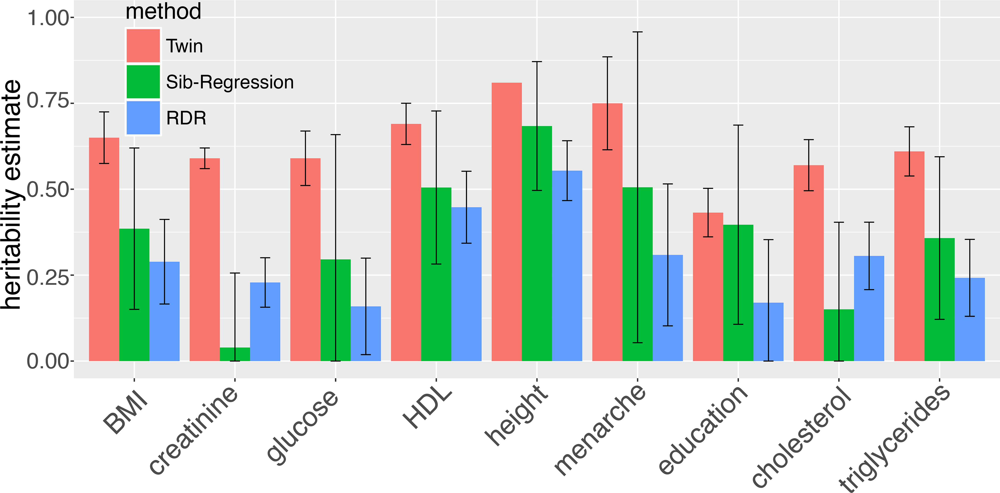
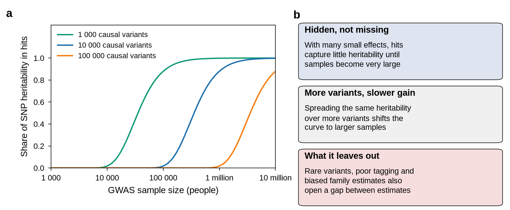

# 第 30 章 遗失遗传力与全基因模型

**地位：全基因组显著位点与基于家系的遗传力之间存在差距，已验证；这一差距大部分隐藏在许多小效应变异中，已验证（对人类身高已基本弥合）；稀有变异和被高估的家系估计构成剩余差距，部分验证；核心基因与外周基因的全基因模型，有争议。** 双生子和家系研究估计许多人类性状有很高的遗传力，但最初的全基因组关联研究（GWAS）找到的变异只能解释其中一小部分。这一差距被称为遗失遗传力。全基因模型试图解释为什么关联散布在基因组的大部分区域：调控网络高度互联，在相关细胞类型中表达的几乎每个基因都会影响一小组核心基因。

本仓库相关条目：[infinitesimal-polygenic](../../theories/infinitesimal-polygenic/THEORY.md)、[rockman-qtn-versus-polygenes](../../theories/rockman-qtn-versus-polygenes/THEORY.md)、[berg-coop-polygenic-adaptation](../../theories/berg-coop-polygenic-adaptation/THEORY.md)、[lande-1975-mutation-maintained-va](../../theories/lande-1975-mutation-maintained-va/THEORY.md)、[missing-heritability-omnigenic](../../theories/missing-heritability-omnigenic/THEORY.md)。

## 30.1 内容与历史

Fisher 在孟德尔遗传的框架下解释亲属之间的相关，引入方差作为变异性的度量，并把总方差分解给各个原因 [1]。遗传力由 Wright 和 Fisher 作为一个可估计的群体参数提出，至今仍是理解选择响应和预测疾病风险的关键 [2]。无穷小模型认为一个性状是极多个小效应之和，它在数量遗传学中有很长的历史，可以作为多位点孟德尔模型的极限得到论证 [3]。

最初的 GWAS 出现时，人们预期常见性状和疾病应有的遗传成分并没有找到 [4]。数百个关联变异只能解释家族聚集的一小部分，剩下的遗失遗传力本身成了一个问题 [5]。以身高为例，到 2010 年已鉴定出约 40 个变异，合计解释约 5% 的变异，而双生子遗传力约为 80% [6]。

随后出现两类解释。一类认为 GWAS 缺乏统计功效，找不到许多弱效应，也漏掉了稀有变异；另一类认为家系研究因基因互作、共享环境或假设不成立而高估了遗传力 [6]。2017 年，Boyle、Li 和 Pritchard 提出全基因模型：关联信号散布在基因组的大部分区域，包括许多与疾病没有明显联系的基因附近，因为在与疾病相关的细胞中表达的所有基因都能影响核心基因的功能，而大部分遗传力来自核心通路之外的基因 [7]。Liu、Li 和 Pritchard 随后给出一个形式化模型：外周基因的弱反式 eQTL 效应通过核心基因的表达起作用 [8]。

## 30.2 预测

- **遗传力是隐藏的，而不是遗失的。** 如果大部分遗传力在许多小效应中，那么同时拟合所有 SNP 解释的方差应远多于显著位点，并且随着样本增大，显著位点捕获的遗传力应增加（图 30.2）[9, 10]。
- **稀有变异。** 如果致因变异比芯片 SNP 更稀有，全基因组测序数据应能找回芯片漏掉的遗传力 [11, 12]。
- **分母被高估。** 如果家系估计因互作或共享环境而偏高，避开这些偏差的方法应给出较低的遗传力（图 30.1）[13, 14]。
- **全基因结构。** 如果全基因模型成立，关联信号应覆盖基因组的大部分，而大部分遗传力应来自核心通路之外的基因 [7, 8]。

## 30.3 支持证据

- **所有 SNP 一起。** 在 3,925 名无亲缘关系的人中拟合 294,831 个 SNP，解释了身高 45% 的方差；大部分遗传力并没有遗失，只是单个效应太小，通不过严格的检验，因而没有被发现 [9]。这一方法实现在 GCTA 软件中 [15]。对六种疾病，表型相关–基因型相关回归估计常见变异解释 41–68% 的遗传力（平均 60%）[16]。
- **以身高为检验。** 在 253,288 人中，697 个显著变异解释了身高遗传力的五分之一，而所有常见变异合起来捕获了 60%，提示存在数千个致因变异 [10]。在 540 万人中，12,111 个独立的显著 SNP 几乎解释了身高的全部常见 SNP 遗传力；它们聚集在 7,209 个区段中，覆盖基因组的约 21% [17]。
- **是多基因性，而不是混杂。** LD Score 回归表明，在许多大型 GWAS 中，检验统计量的膨胀大部分来自多基因性 [18]。对精神分裂症，至少 71% 的 1 Mb 区域带有至少一个风险变异 [19]。在 UK Biobank 的 28 个性状中，平均 6% 的 SNP 有非零效应，合计解释 22% 的表型方差 [20]。
- **稀有变异。** 25,465 名无亲缘关系者的全基因组测序数据给出身高遗传力 0.68、体重指数遗传力 0.30，并富集于处在低连锁不平衡中的低频变异；稀有变异是仍然遗失的遗传力的一个主要来源 [11]。
- **有偏的家系估计。** 在 54,888 名父母双方都有基因型的冰岛人中，亲缘不平衡回归避开了大部分环境偏差，估计身高遗传力为 55.4%，受教育程度为 17.0%，提示另一些估计被环境效应抬高（图 30.1）[14]。父母未传递的等位基因仍会影响子女；对受教育程度，未传递多基因分数的效应是已传递分数效应的 29.9% [21]。
- **功效充足的杂交。** 在一个大型酵母杂交群体中，检测到的位点几乎解释了 46 个性状可遗传变异中的全部加性部分 [22]。
- **选择使遗传结构变平。** 负选择清除关键区域中的大效应突变，留下散布在数千个较不关键区域中的常见关联；遗传力在常见 SNP 中的分布比在低频 SNP 中均匀约四倍 [23]。28 个性状中有 23 个出现负选择的特征 [20]，这与影响性状的变异同时影响适合度的模型一致 [12, 24]。

## 30.4 反面证据与难点

- **互作与分母。** 总遗传力的估计假设没有上位性；在互作模型下，总遗传力可能小得多，如果克罗恩病涉及三条通路，其遗失遗传力的 80% 可能来自互作 [13]。与此相对，加性方差通常占遗传方差的一半以上，并且常常接近 100% [25]；在 17,804 个性状的双生子数据中，69% 的性状符合只有加性遗传变异的模型 [26]。在酵母杂交中，基因间互作对遗传力的贡献因性状而异，从接近零到约 50% [22]。
- **SNP 遗传力有自己的偏差。** 基于 SNP 的估计可能对 SNP 之间不均匀的连锁不平衡高度敏感，偏差方向取决于遗传结构 [27]。在病例–对照设计中，限制性最大似然会低估常见变异带来的遗传力 [16]。
- **核心基因难以找到。** 全基因模型假设每种疾病的核心基因数目相对较少；它可能低估了生物学的复杂性，寻找核心基因不应主导实验设计 [28]。生物学效应最关键的基因，常常不同于常见变异关联最强的基因 [23]。
- **大效应候选基因没有重复出来。** 十八个历史上的抑郁症候选基因，每个都被研究过十次以上，在 62,138 到 443,264 人的样本中没有表现出明确的关联，与抑郁症的关联也不比其他基因更强 [29]。
- **可迁移性。** 这 12,111 个身高 SNP 在欧洲血统人群中解释约 40% 的表型方差，而在其他血统中只解释约 10–20% [17]；全基因模型也被用来解释为什么多基因分数在群体之间迁移效果差 [30]。

## 30.5 地位与理由

**差距：已验证。** 早期 GWAS 位点只解释基于家系的遗传力的一小部分 [5, 6]。**隐藏在许多小效应中：已验证，** 因为所有 SNP 一起解释的方差远多于显著位点 [9, 16]，检验统计量的膨胀来自多基因性而不是混杂 [18]，而且对身高来说，与常见 SNP 遗传力的差距已经弥合 [10, 17]。**稀有变异和有偏的家系估计构成剩余差距：部分验证** [11, 14, 21]；互作是可能的，但数据显示遗传方差主要是加性的 [13, 25, 26]。**全基因模型：有争议。** 高度分散的关联已得到充分确立 [19, 20]，但少数核心基因与大量外周基因的具体划分仍有争论 [8, 23, 28]。

## 30.6 植物、作物与葡萄

- **遗传结构各不相同。** 在拟南芥中，对 107 个表型的 GWAS 找到许多大效应的常见等位基因，这与人类 GWAS 不同，不过群体结构使真关联难以与假关联分开 [31]。在玉米中，5,000 个重组自交系的近百万株植物显示，开花期没有单个大效应位点，而是有众多小效应位点，一个简单的加性模型就能准确预测开花期 [32]。在 517 个水稻地方品种中，为 14 个农艺性状找到的位点平均解释约 36% 的表型方差 [33]。
- **基因组预测。** 育种者不需要找到每一个位点。在模拟中，用贝叶斯方法同时估计约 50,000 个标记单倍型的效应，预测遗传值的准确度为 0.85，而只纳入最大效应时为 0.32 [34]。
- **葡萄。** 在为 127 个性状测定表型的 279 个葡萄品种组成的群体中，更密的标记提高了 SNP 解释的遗传方差比例，找到 489 个可靠位点，一半响应变量的预测准确度超过 0.42 [35]。在多个群体中，对杂交组合均值的基因组预测平均预测能力达到 0.6，在组合内部为 0.26 [36]。纳入葡萄泛基因组中的结构变异，使估计的遗传力平均提高 22.78% [37]；在杂合的无性繁殖作物中，隐藏遗传力的一部分可能位于 SNP 芯片无法标记的变异中。

## 30.7 用公开数据检验

- **数据。** 身高和其他性状的 GWAS 汇总统计量 [10, 17]；来自生物样本库和家系队列的个体水平数据 [11, 14]；公开的植物群体 [31, 33, 35]。
- **工具。** 用 PLINK 做关联分析和质量控制 [38]；用 GCTA 估计 SNP 遗传力 [15]；连锁不平衡加权的亲缘关系 [27]；LD Score 回归 [18]；基因组预测模型 [34]。
- **分析。** (1) 比较显著位点解释的方差与所有 SNP 给出的 SNP 遗传力 [9]。(2) 检查检验统计量的膨胀来自多基因性而不是分层 [18]。(3) 比较芯片 SNP、测序数据和家系内设计给出的遗传力 [11, 14]。(4) 在基因集之间划分遗传力，检验少数核心基因是否承担很大份额 [7, 23]。脚本 [`scripts/ch30_missing_heritability_figures.py`](../scripts/ch30_missing_heritability_figures.py) 展示显著位点中的遗传力份额如何取决于样本大小和致因变异的数目（图 30.2）。
- **什么结果会推翻理论。** 非常大的 GWAS 中，显著位点的遗传力远低于 SNP 遗传力时就不再增加；或者家系内设计证实了很高的双生子估计，而测序数据没有增加任何东西。

## 30.8 未解决的问题

- 剩余差距有多少来自稀有变异，有多少来自被高估的家系估计 [6, 11]？
- 核心基因能否被识别出来，它们是否承担可测的遗传力份额 [8, 28]？
- 为什么拟南芥这样的自交植物比异交的玉米表现出更多大效应位点 [31, 32]？
- 葡萄性状的遗传力有多少位于结构变异和半合子区域 [35, 37]？

## 30.9 常见错误

- 忘记遗传力是一个群体参数，它比较的是在给定群体内基因和环境的重要性 [2]。
- 把显著位点解释的方差当作全部遗传贡献 [9]。
- 相信效应很大的小型候选基因研究 [29]。
- 以为在一个血统中构建的多基因分数在另一个血统中同样有效 [17, 30]。

## 图

**图 30.1.** 冰岛 RDR 和同胞回归（Sib-Regression）给出的遗传力估计与瑞典双生子研究的比较。误差线给出估计的 95% 置信区间。估计值取自 Young 等 2018 年的研究。RDR 和同胞回归的估计来自冰岛样本，瑞典双生子的估计取自利用瑞典双生子登记库的多篇论文。原图注中的参考文献编号已替换为作者名或删去。原样转载自 Young AI (2019) Solving the missing heritability problem. *PLOS Genetics* 15:e1008222, Figure 1. https://doi.org/10.1371/journal.pgen.1008222。许可：CC BY 4.0（https://creativecommons.org/licenses/by/4.0/）。

**图 30.2.** (a) 随 GWAS 样本增大，全基因组显著变异承担的 SNP 遗传力（h² = 0.5）份额；遗传力分布在 1,000、10,000 或 100,000 个独立致因变异上，各变异的贡献服从指数分布；一个变异的期望检验统计量达到 P = 5 × 10⁻⁸ 的阈值时，记为被找到。数值仅作示意。(b) 模型说明了什么。用 [`scripts/ch30_missing_heritability_figures.py`](../scripts/ch30_missing_heritability_figures.py) 生成；计算是确定性的。

## 参考文献

1. Fisher RA (1919) The correlation between relatives on the supposition of Mendelian inheritance. *Transactions of the Royal Society of Edinburgh* 52:399-433. https://doi.org/10.1017/S0080456800012163
2. Visscher PM, Hill WG, Wray NR (2008) Heritability in the genomics era — concepts and misconceptions. *Nature Reviews Genetics* 9:255-266. https://doi.org/10.1038/nrg2322
3. Barton NH, Etheridge AM, Véber A (2017) The infinitesimal model: Definition, derivation, and implications. *Theoretical Population Biology* 118:50-73. https://doi.org/10.1016/j.tpb.2017.06.001
4. Maher B (2008) Personal genomes: The case of the missing heritability. *Nature* 456:18-21. https://doi.org/10.1038/456018a
5. Manolio TA, Collins FS, Cox NJ, et al. (2009) Finding the missing heritability of complex diseases. *Nature* 461:747-753. https://doi.org/10.1038/nature08494
6. Young AI (2019) Solving the missing heritability problem. *PLOS Genetics* 15:e1008222. https://doi.org/10.1371/journal.pgen.1008222
7. Boyle EA, Li YI, Pritchard JK (2017) An Expanded View of Complex Traits: From Polygenic to Omnigenic. *Cell* 169:1177-1186. https://doi.org/10.1016/j.cell.2017.05.038
8. Liu X, Li YI, Pritchard JK (2019) Trans Effects on Gene Expression Can Drive Omnigenic Inheritance. *Cell* 177:1022-1034.e6. https://doi.org/10.1016/j.cell.2019.04.014
9. Yang J, Benyamin B, McEvoy BP, et al. (2010) Common SNPs explain a large proportion of the heritability for human height. *Nature Genetics* 42:565-569. https://doi.org/10.1038/ng.608
10. Wood AR, Esko T, Yang J, et al. (2014) Defining the role of common variation in the genomic and biological architecture of adult human height. *Nature Genetics* 46:1173-1186. https://doi.org/10.1038/ng.3097
11. Wainschtein P, Jain D, Zheng Z, et al. (2022) Assessing the contribution of rare variants to complex trait heritability from whole-genome sequence data. *Nature Genetics* 54:263-273. https://doi.org/10.1038/s41588-021-00997-7
12. Eyre-Walker A (2010) Genetic architecture of a complex trait and its implications for fitness and genome-wide association studies. *Proceedings of the National Academy of Sciences* 107:1752-1756. https://doi.org/10.1073/pnas.0906182107
13. Zuk O, Hechter E, Sunyaev SR, et al. (2012) The mystery of missing heritability: Genetic interactions create phantom heritability. *Proceedings of the National Academy of Sciences* 109:1193-1198. https://doi.org/10.1073/pnas.1119675109
14. Young AI, Frigge ML, Gudbjartsson DF, et al. (2018) Relatedness disequilibrium regression estimates heritability without environmental bias. *Nature Genetics* 50:1304-1310. https://doi.org/10.1038/s41588-018-0178-9
15. Yang J, Lee SH, Goddard ME, et al. (2011) GCTA: A Tool for Genome-wide Complex Trait Analysis. *The American Journal of Human Genetics* 88:76-82. https://doi.org/10.1016/j.ajhg.2010.11.011
16. Golan D, Lander ES, Rosset S (2014) Measuring missing heritability: Inferring the contribution of common variants. *Proceedings of the National Academy of Sciences* 111:E5272-E5281. https://doi.org/10.1073/pnas.1419064111
17. Yengo L, Vedantam S, Marouli E, et al. (2022) A saturated map of common genetic variants associated with human height. *Nature* 610:704-712. https://doi.org/10.1038/s41586-022-05275-y
18. Bulik-Sullivan BK, Loh PR, Finucane HK, et al. (2015) LD Score regression distinguishes confounding from polygenicity in genome-wide association studies. *Nature Genetics* 47:291-295. https://doi.org/10.1038/ng.3211
19. Loh PR, Bhatia G, Gusev A, et al. (2015) Contrasting genetic architectures of schizophrenia and other complex diseases using fast variance-components analysis. *Nature Genetics* 47:1385-1392. https://doi.org/10.1038/ng.3431
20. Zeng J, de Vlaming R, Wu Y, et al. (2018) Signatures of negative selection in the genetic architecture of human complex traits. *Nature Genetics* 50:746-753. https://doi.org/10.1038/s41588-018-0101-4
21. Kong A, Thorleifsson G, Frigge ML, et al. (2018) The nature of nurture: Effects of parental genotypes. *Science* 359:424-428. https://doi.org/10.1126/science.aan6877
22. Bloom JS, Ehrenreich IM, Loo WT, et al. (2013) Finding the sources of missing heritability in a yeast cross. *Nature* 494:234-237. https://doi.org/10.1038/nature11867
23. O'Connor LJ, Schoech AP, Hormozdiari F, et al. (2019) Extreme Polygenicity of Complex Traits Is Explained by Negative Selection. *The American Journal of Human Genetics* 105:456-476. https://doi.org/10.1016/j.ajhg.2019.07.003
24. Simons YB, Bullaughey K, Hudson RR, et al. (2018) A population genetic interpretation of GWAS findings for human quantitative traits. *PLOS Biology* 16:e2002985. https://doi.org/10.1371/journal.pbio.2002985
25. Hill WG, Goddard ME, Visscher PM (2008) Data and Theory Point to Mainly Additive Genetic Variance for Complex Traits. *PLoS Genetics* 4:e1000008. https://doi.org/10.1371/journal.pgen.1000008
26. Polderman TJC, Benyamin B, de Leeuw CA, et al. (2015) Meta-analysis of the heritability of human traits based on fifty years of twin studies. *Nature Genetics* 47:702-709. https://doi.org/10.1038/ng.3285
27. Speed D, Hemani G, Johnson M, et al. (2012) Improved Heritability Estimation from Genome-wide SNPs. *The American Journal of Human Genetics* 91:1011-1021. https://doi.org/10.1016/j.ajhg.2012.10.010
28. Wray NR, Wijmenga C, Sullivan PF, et al. (2018) Common Disease Is More Complex Than Implied by the Core Gene Omnigenic Model. *Cell* 173:1573-1580. https://doi.org/10.1016/j.cell.2018.05.051
29. Border R, Johnson EC, Evans LM, et al. (2019) No Support for Historical Candidate Gene or Candidate Gene-by-Interaction Hypotheses for Major Depression Across Multiple Large Samples. *American Journal of Psychiatry* 176:376-387. https://doi.org/10.1176/appi.ajp.2018.18070881
30. Mathieson I (2021) The omnigenic model and polygenic prediction of complex traits. *The American Journal of Human Genetics* 108:1558-1563. https://doi.org/10.1016/j.ajhg.2021.07.003
31. Atwell S, Huang YS, Vilhjálmsson BJ, et al. (2010) Genome-wide association study of 107 phenotypes in Arabidopsis thaliana inbred lines. *Nature* 465:627-631. https://doi.org/10.1038/nature08800
32. Buckler ES, Holland JB, Bradbury PJ, et al. (2009) The Genetic Architecture of Maize Flowering Time. *Science* 325:714-718. https://doi.org/10.1126/science.1174276
33. Huang X, Wei X, Sang T, et al. (2010) Genome-wide association studies of 14 agronomic traits in rice landraces. *Nature Genetics* 42:961-967. https://doi.org/10.1038/ng.695
34. Meuwissen THE, Hayes BJ, Goddard ME (2001) Prediction of Total Genetic Value Using Genome-Wide Dense Marker Maps. *Genetics* 157:1819-1829. https://doi.org/10.1093/genetics/157.4.1819
35. Flutre T, Le Cunff L, Fodor A, et al. (2022) A genome-wide association and prediction study in grapevine deciphers the genetic architecture of multiple traits and identifies genes under many new QTLs. *G3 Genes|Genomes|Genetics* 12:jkac103. https://doi.org/10.1093/g3journal/jkac103
36. Brault C, Segura V, This P, et al. (2022) Across-population genomic prediction in grapevine opens up promising prospects for breeding. *Horticulture Research* 9:uhac041. https://doi.org/10.1093/hr/uhac041
37. Liu Z, Wang N, Su Y, et al. (2024) Grapevine pangenome facilitates trait genetics and genomic breeding. *Nature Genetics* 56:2804-2814. https://doi.org/10.1038/s41588-024-01967-5
38. Chang CC, Chow CC, Tellier LC, et al. (2015) Second-generation PLINK: rising to the challenge of larger and richer datasets. *GigaScience* 4:7. https://doi.org/10.1186/s13742-015-0047-8
