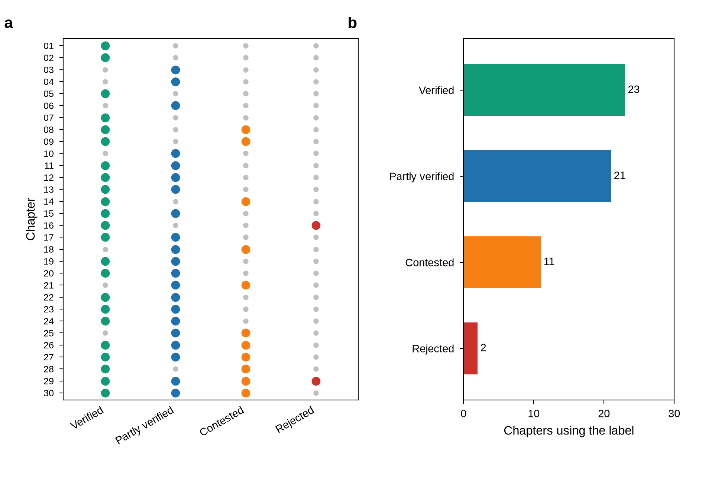

# Appendix A. Rejected claims and common pitfalls

This appendix gathers what the book has learned about claims that failed and about mistakes that recur across chapters. It also gives a short glossary of terms and symbols and an index of all figures. Each entry points to the chapter where the evidence is discussed in full.

Related notes in this repository: [c-value-junk-dna](../../skills/genomics-theory-mining/theories/c-value-junk-dna/THEORY.md), [molecular-clock](../../skills/genomics-theory-mining/theories/molecular-clock/THEORY.md), [island-model](../../skills/genomics-theory-mining/theories/island-model/THEORY.md).

## A.1 How the status labels are used

Every chapter ends its evidence with a status. **Verified** means the core predictions hold repeatedly across data types. **Partly verified** means the qualitative predictions hold, but the quantitative part or the scope is still disputed. **Contested** means the evidence conflicts. **Rejected** means the core predictions have been refuted by data. Most theories in the book are not one claim but several, so most chapters give more than one label, each attached to a named part of the theory (Figure A.1). A label applies to the claim as stated in the chapter; a rejected strong form can sit beside a verified weak form of the same idea.

## A.2 Rejected claims

| Claim | Why it was rejected | Chapter |
|---|---|---|
| About 80% of the human genome is functional, because biochemical activity was assigned to it [1]. | The fraction under purifying selection is less than 10%, and biochemical activity is not the same as function [2, 3]; biochemically active regions cover a much larger part of the genome than conserved regions, so activity alone cannot define function [4]. | [16](16-junk-dna-encode.md) |
| One strict molecular clock holds across lineages. | The strict clock and the clock-free unrooted tree are two biologically unrealistic extremes; real data lie between them and are analysed with relaxed clocks [5]. | [6](06-molecular-clock.md) |
| Genome size measures organismal complexity. | Genome size varies more than 200,000-fold among eukaryotes and bears no relationship to organismal complexity [6]; the variation is not explained by gene number [7]. | [15](15-c-value-enigma.md) |
| The human genome contains over 100 genes acquired from bacteria during vertebrate evolution. | The claim was rebutted immediately and repeatedly [8]; gene loss, sample size and rate variation explain the shared genes [9], and later candidates found little or no support [10]. | [29](29-pangenomes-organelle-transfer-hgt.md) |
| About one-sixth of the genes of the tardigrade *Hypsibius dujardini* came by horizontal transfer [11]. | Independent sequencing found that at most 1–2% of genes are candidates and that the earlier signal came from contamination [12]. | [29](29-pangenomes-organelle-transfer-hgt.md) |
| Historical candidate genes have large effects on major depression. | Eighteen much-studied candidate genes showed no clear association in samples of 62,138 to 443,264 people [13]; first association studies often overestimate effects [14]. | [30](30-missing-heritability-omnigenic.md) |

## A.3 Claims kept only in a narrower form

Several famous claims survive, but only after their scope was reduced. The neutral theory holds for constraint and the rarity of advantageous mutations, but the share of adaptive substitutions varies widely among species and is disputed ([Chapter 3](03-neutral-theory.md)). Molecular dating works, but with relaxed clocks and stated rates ([Chapter 6](06-molecular-clock.md)). Isolation by distance is verified, while the shifting balance remains contested ([Chapter 14](14-population-structure.md)). Recent polyploids diversify less, but whether polyploidy is a long-run dead end is contested ([Chapter 21](21-polyploidy-dead-end.md)). Epialleles are inherited in plants, but lasting environmental memory is contested ([Chapter 28](28-transgenerational-epigenetic-inheritance.md)). Highly polygenic architecture is verified, but the split into core and peripheral genes is contested ([Chapter 30](30-missing-heritability-omnigenic.md)).

## A.4 Common pitfalls across chapters

- **Effective size is not census size.** A crop grown on millions of hectares can have a small long-term effective size ([Chapters 3](03-neutral-theory.md), [4](04-nearly-neutral-theory.md) and [8](08-linked-selection.md)). Effective size estimated from diversity also depends on the mutation rate used to obtain it ([Chapter 18](18-drift-barrier-mutational-hazard.md)).
- **Outliers need a null model.** Empirical outliers are not proof of selection without a simulated neutral distribution ([Chapter 9](09-hard-soft-sweeps.md)), and departures from Hardy–Weinberg proportions in clonal or structured samples are expected ([Chapter 2](02-hardy-weinberg.md)).
- **Clusters and FST are summaries, not histories.** FST is a good measure of structure but rarely gives an accurate number of migrants [15]; clustering bar plots can mislead when drift is strong or the model does not fit [16] ([Chapter 14](14-population-structure.md)).
- **Species are not independent points.** Correlations between effective size and genome attributes lose significance once phylogeny is controlled [17] ([Chapters 15](15-c-value-enigma.md) and [18](18-drift-barrier-mutational-hazard.md)).
- **Activity is not function.** Biochemical activity, a few co-opted transposons or one large-effect insertion do not show that most DNA is functional [2, 4] ([Chapters 16](16-junk-dna-encode.md) and [17](17-selfish-dna-transposable-elements.md)).
- **Contamination and loss mimic transfer.** Foreign-looking genes must survive contamination filtering and tests of differential loss [9, 12] ([Chapter 29](29-pangenomes-organelle-transfer-hgt.md)).
- **Small first studies overestimate.** The first association study often reports a stronger effect than later ones [14] ([Chapter 30](30-missing-heritability-omnigenic.md)).
- **Heritability depends on the estimator.** Family designs can be inflated by shared environment or interactions [18, 19], and variance explained by significant hits is not the whole genetic contribution ([Chapter 30](30-missing-heritability-omnigenic.md)).
- **Clonal crops are special.** Clone-to-clone differences are not segregation ([Chapter 1](01-mendelian-inheritance.md)); somatic variants among clones are not population polymorphisms ([Chapter 6](06-molecular-clock.md)); clonal crops are not frozen genomes ([Chapter 11](11-muller-ratchet-sex.md)); in Chardonnay one gene in seven is hemizygous because of structural variants [20] ([Chapter 29](29-pangenomes-organelle-transfer-hgt.md)); and methylation contexts differ in how well they track clonal lineage ([Chapter 28](28-transgenerational-epigenetic-inheritance.md)).

## A.5 Glossary of terms and symbols

| Term or symbol | Meaning | Main chapters |
|---|---|---|
| *N*, *N*e | Census size; effective population size, the size of an ideal population with the same amount of drift | 3, 4, 18, 24 |
| *μ*, *u* | Mutation rate per site or per locus and generation | 5, 6, 18 |
| *s*, *h* | Selection coefficient; dominance coefficient of an allele | 10, 26 |
| *θ*, *π* | Population mutation rate 4*N*e*μ*; nucleotide diversity, the mean number of differences per site between two sequences | 5, 8 |
| *ρ*, *r*² | Population recombination rate 4*N*e*c*; squared correlation between alleles at two loci (linkage disequilibrium) | 7 |
| *F*ST | Share of genetic variance found between populations | 2, 14 |
| *D* (ABBA–BABA) | Statistic that tests for an excess of shared derived alleles between non-sister lineages | 12 |
| dN/dS | Ratio of non-synonymous to synonymous substitution rates | 4, 11, 24 |
| DFE | Distribution of fitness effects of new mutations | 3, 4, 13 |
| BGS | Background selection, loss of linked neutral diversity caused by selection against deleterious mutations | 8, 9 |
| C-value | Amount of DNA in an unreplicated haploid nucleus | 15 |
| TE | Transposable element | 16, 17 |
| WGD | Whole-genome duplication | 19, 20, 21, 22 |
| gBGC | GC-biased gene conversion | 23, 24 |
| DMI | Dobzhansky–Muller incompatibility between alleles at different loci | 27 |
| Epiallele | Heritable variant in a chromatin state, usually DNA methylation, without a change in sequence | 28 |
| Core and accessory genome | Genes present in all members of a species; genes present only in some | 29 |
| NUMT, NUPT | Nuclear insertion of mitochondrial or plastid DNA | 29 |
| *h*², SNP heritability | Narrow-sense heritability, the share of phenotypic variance due to additive genetic effects; the share captured by measured SNPs | 30 |
| GWAS | Genome-wide association study | 30 |

## A.6 Figure index

The book has 30 reproduced figures, each published under CC BY 4.0 and credited in its caption, and 34 figures drawn for the book with scripts in `book/scripts/`, plus Figure A.1 below.

| Chapter | Figure | Kind | File |
|---|---|---|---|
| [1](01-mendelian-inheritance.md) | 1.1 | Reproduced (Massonnet 2020, Fig. 6) | [massonnet2020_fig6.png](../figures/ch01/published/massonnet2020_fig6.png) |
| [1](01-mendelian-inheritance.md) | 1.2 | Drawn for the book | [fig01_2_mendel_exceptions_schematic.png](../figures/ch01/fig01_2_mendel_exceptions_schematic.png) |
| [1](01-mendelian-inheritance.md) | 1.3 | Drawn for the book | [fig01_3_segregation_power_sim.png](../figures/ch01/fig01_3_segregation_power_sim.png) |
| [2](02-hardy-weinberg.md) | 2.1 | Reproduced (Stoeckel 2014, Fig. 1) | [stoeckel2014_fig1.png](../figures/ch02/published/stoeckel2014_fig1.png) |
| [2](02-hardy-weinberg.md) | 2.2 | Drawn for the book | [fig02_2_heterozygosity_departures_sim.png](../figures/ch02/fig02_2_heterozygosity_departures_sim.png) |
| [2](02-hardy-weinberg.md) | 2.3 | Drawn for the book | [fig02_3_reading_departures_schematic.png](../figures/ch02/fig02_3_reading_departures_schematic.png) |
| [3](03-neutral-theory.md) | 3.1 | Reproduced (Williamson 2014, Fig. 1) | [williamson2014_fig1.png](../figures/ch03/published/williamson2014_fig1.png) |
| [3](03-neutral-theory.md) | 3.2 | Drawn for the book | [fig03_2_neutral_rate_sim.png](../figures/ch03/fig03_2_neutral_rate_sim.png) |
| [3](03-neutral-theory.md) | 3.3 | Drawn for the book | [fig03_3_mk_test_schematic.png](../figures/ch03/fig03_3_mk_test_schematic.png) |
| [4](04-nearly-neutral-theory.md) | 4.1 | Reproduced (Galtier 2016, Fig. 3) | [galtier2016_fig3.png](../figures/ch04/published/galtier2016_fig3.png) |
| [4](04-nearly-neutral-theory.md) | 4.2 | Drawn for the book | [fig04_2_fixation_and_dfe.png](../figures/ch04/fig04_2_fixation_and_dfe.png) |
| [5](05-coalescent.md) | 5.1 | Reproduced (Chikhi 2018, Fig. 1) | [chikhi2018_fig1.jpg](../figures/ch05/published/chikhi2018_fig1.jpg) |
| [5](05-coalescent.md) | 5.2 | Drawn for the book | [fig05_2_coalescent_times_sfs_sim.png](../figures/ch05/fig05_2_coalescent_times_sfs_sim.png) |
| [5](05-coalescent.md) | 5.3 | Drawn for the book | [fig05_3_coalescent_assumptions_schematic.png](../figures/ch05/fig05_3_coalescent_assumptions_schematic.png) |
| [6](06-molecular-clock.md) | 6.1 | Reproduced (Wang 2019, Fig. 1) | [wang2019_fig1.png](../figures/ch06/published/wang2019_fig1.png) |
| [6](06-molecular-clock.md) | 6.2 | Drawn for the book | [fig06_2_clock_models.png](../figures/ch06/fig06_2_clock_models.png) |
| [7](07-recombination-ld.md) | 7.1 | Reproduced (Chan 2012, Fig. 5) | [chan2012_fig5.png](../figures/ch07/published/chan2012_fig5.png) |
| [7](07-recombination-ld.md) | 7.2 | Drawn for the book | [fig07_2_ld_decay.png](../figures/ch07/fig07_2_ld_decay.png) |
| [8](08-linked-selection.md) | 8.1 | Reproduced (Corbett-Detig 2015, Fig. 1) | [corbettdetig2015_fig1.png](../figures/ch08/published/corbettdetig2015_fig1.png) |
| [8](08-linked-selection.md) | 8.2 | Drawn for the book | [fig08_2_background_selection.png](../figures/ch08/fig08_2_background_selection.png) |
| [9](09-hard-soft-sweeps.md) | 9.1 | Reproduced (Garud 2015, Fig. 4) | [garud2015_fig4.png](../figures/ch09/published/garud2015_fig4.png) |
| [9](09-hard-soft-sweeps.md) | 9.2 | Drawn for the book | [fig09_2_soft_sweep_probability.png](../figures/ch09/fig09_2_soft_sweep_probability.png) |
| [10](10-genetic-load-domestication.md) | 10.1 | Reproduced (Kim 2021, Fig. 4) | [kim2021_fig4.png](../figures/ch10/published/kim2021_fig4.png) |
| [10](10-genetic-load-domestication.md) | 10.2 | Drawn for the book | [fig10_2_load_bottleneck.png](../figures/ch10/fig10_2_load_bottleneck.png) |
| [11](11-muller-ratchet-sex.md) | 11.1 | Reproduced (Lovell 2017, Fig. 4) | [lovell2017_fig4.png](../figures/ch11/published/lovell2017_fig4.png) |
| [11](11-muller-ratchet-sex.md) | 11.2 | Drawn for the book | [fig11_2_muller_ratchet.png](../figures/ch11/fig11_2_muller_ratchet.png) |
| [12](12-introgression-hybrid-speciation.md) | 12.1 | Reproduced (Calfee 2021, Fig. 2) | [calfee2021_fig2.png](../figures/ch12/published/calfee2021_fig2.png) |
| [12](12-introgression-hybrid-speciation.md) | 12.2 | Drawn for the book | [fig12_2_d_statistic.png](../figures/ch12/fig12_2_d_statistic.png) |
| [13](13-fisher-fundamental-theorem-geometric-model.md) | 13.1 | Reproduced (Simon 2018, Fig. 2) | [simon2018_fig2.jpg](../figures/ch13/published/simon2018_fig2.jpg) |
| [13](13-fisher-fundamental-theorem-geometric-model.md) | 13.2 | Drawn for the book | [fig13_2_fisher_geometric_model.png](../figures/ch13/fig13_2_fisher_geometric_model.png) |
| [14](14-population-structure.md) | 14.1 | Reproduced (1001 Genomes Consortium 2016, Fig. 3) | [genomes2016_fig3.jpg](../figures/ch14/published/genomes2016_fig3.jpg) |
| [14](14-population-structure.md) | 14.2 | Drawn for the book | [fig14_2_isolation_by_distance.png](../figures/ch14/fig14_2_isolation_by_distance.png) |
| [15](15-c-value-enigma.md) | 15.1 | Reproduced (Bilinski 2018, Fig. 1) | [bilinski2018_fig1.png](../figures/ch15/published/bilinski2018_fig1.png) |
| [15](15-c-value-enigma.md) | 15.2 | Drawn for the book | [fig15_2_genome_size_balance.png](../figures/ch15/fig15_2_genome_size_balance.png) |
| [16](16-junk-dna-encode.md) | 16.1 | Reproduced (Rands 2014, Fig. 3) | [rands2014_fig3.png](../figures/ch16/published/rands2014_fig3.png) |
| [16](16-junk-dna-encode.md) | 16.2 | Drawn for the book | [fig16_2_mutational_load_limit.png](../figures/ch16/fig16_2_mutational_load_limit.png) |
| [17](17-selfish-dna-transposable-elements.md) | 17.1 | Reproduced (Carrier 2012, Fig. 3) | [carrier2012_fig3.png](../figures/ch17/published/carrier2012_fig3.png) |
| [17](17-selfish-dna-transposable-elements.md) | 17.2 | Drawn for the book | [fig17_2_element_invasion.png](../figures/ch17/fig17_2_element_invasion.png) |
| [18](18-drift-barrier-mutational-hazard.md) | 18.1 | Reproduced (Bergeron 2023, Fig. 3) | [bergeron2023_fig3.png](../figures/ch18/published/bergeron2023_fig3.png) |
| [18](18-drift-barrier-mutational-hazard.md) | 18.2 | Drawn for the book | [fig18_2_drift_barrier.png](../figures/ch18/fig18_2_drift_barrier.png) |
| [19](19-gene-duplication-ohno-subfunctionalization.md) | 19.1 | Reproduced (Qiao 2019, Fig. 3) | [qiao2019_fig3.png](../figures/ch19/published/qiao2019_fig3.png) |
| [19](19-gene-duplication-ohno-subfunctionalization.md) | 19.2 | Drawn for the book | [fig19_2_subfunctionalization.png](../figures/ch19/fig19_2_subfunctionalization.png) |
| [20](20-gene-balance-dosage.md) | 20.1 | Reproduced (Cheng 2012, Fig. 3) | [cheng2012_fig3.png](../figures/ch20/published/cheng2012_fig3.png) |
| [20](20-gene-balance-dosage.md) | 20.2 | Drawn for the book | [fig20_2_reciprocal_retention.png](../figures/ch20/fig20_2_reciprocal_retention.png) |
| [21](21-polyploidy-dead-end.md) | 21.1 | Reproduced (One Thousand Plant Transcriptomes Initiative 2019, Fig. 4) | [onekp2019_fig4.png](../figures/ch21/published/onekp2019_fig4.png) |
| [21](21-polyploidy-dead-end.md) | 21.2 | Drawn for the book | [fig21_2_lineage_survival.png](../figures/ch21/fig21_2_lineage_survival.png) |
| [22](22-biased-fractionation-subgenome-dominance.md) | 22.1 | Reproduced (Woodhouse 2010, Fig. 2) | [woodhouse2010_fig2.png](../figures/ch22/published/woodhouse2010_fig2.png) |
| [22](22-biased-fractionation-subgenome-dominance.md) | 22.2 | Drawn for the book | [fig22_2_biased_fractionation.png](../figures/ch22/fig22_2_biased_fractionation.png) |
| [23](23-gc-biased-gene-conversion.md) | 23.1 | Reproduced (Clément 2017, Fig. 4) | [clement2017_fig4.png](../figures/ch23/published/clement2017_fig4.png) |
| [23](23-gc-biased-gene-conversion.md) | 23.2 | Drawn for the book | [fig23_2_gc_equilibrium.png](../figures/ch23/fig23_2_gc_equilibrium.png) |
| [24](24-codon-usage-bias.md) | 24.1 | Reproduced (Clément 2017, Fig. 3) | [clement2017_fig3.png](../figures/ch24/published/clement2017_fig3.png) |
| [24](24-codon-usage-bias.md) | 24.2 | Drawn for the book | [fig24_2_codon_selection.png](../figures/ch24/fig24_2_codon_selection.png) |
| [25](25-centromere-drive.md) | 25.1 | Reproduced (Maheshwari 2015, Fig. 3) | [maheshwari2015_fig3.png](../figures/ch25/published/maheshwari2015_fig3.png) |
| [25](25-centromere-drive.md) | 25.2 | Drawn for the book | [fig25_2_centromere_drive.png](../figures/ch25/fig25_2_centromere_drive.png) |
| [26](26-sex-chromosomes-y-degeneration-haldane.md) | 26.1 | Reproduced (Muyle 2012, Fig. 1) | [muyle2012_fig1.png](../figures/ch26/published/muyle2012_fig1.png) |
| [26](26-sex-chromosomes-y-degeneration-haldane.md) | 26.2 | Drawn for the book | [fig26_2_haldane_dominance.png](../figures/ch26/fig26_2_haldane_dominance.png) |
| [27](27-dobzhansky-muller-incompatibilities.md) | 27.1 | Reproduced (Zuellig 2018, Fig. 7) | [zuellig2018_fig7.png](../figures/ch27/published/zuellig2018_fig7.png) |
| [27](27-dobzhansky-muller-incompatibilities.md) | 27.2 | Drawn for the book | [fig27_2_dmi_snowball.png](../figures/ch27/fig27_2_dmi_snowball.png) |
| [28](28-transgenerational-epigenetic-inheritance.md) | 28.1 | Reproduced (Hagmann 2015, Fig. 2) | [hagmann2015_fig2.png](../figures/ch28/published/hagmann2015_fig2.png) |
| [28](28-transgenerational-epigenetic-inheritance.md) | 28.2 | Drawn for the book | [fig28_2_epiallele_decay.png](../figures/ch28/fig28_2_epiallele_decay.png) |
| [29](29-pangenomes-organelle-transfer-hgt.md) | 29.1 | Reproduced (Golicz 2016, Fig. 2) | [golicz2016_fig2.png](../figures/ch29/published/golicz2016_fig2.png) |
| [29](29-pangenomes-organelle-transfer-hgt.md) | 29.2 | Drawn for the book | [fig29_2_pangenome_growth.png](../figures/ch29/fig29_2_pangenome_growth.png) |
| [30](30-missing-heritability-omnigenic.md) | 30.1 | Reproduced (Young 2019, Fig. 1) | [young2019_fig1.png](../figures/ch30/published/young2019_fig1.png) |
| [30](30-missing-heritability-omnigenic.md) | 30.2 | Drawn for the book | [fig30_2_gwas_capture.png](../figures/ch30/fig30_2_gwas_capture.png) |

## Figures

**Figure A.1.** (a) Status labels used by each chapter, read from the status table of the book. Large coloured dots mark labels a chapter uses for at least one part of its theory. (b) Number of chapters that use each label. Made with [`scripts/appA_status_figures.py`](../scripts/appA_status_figures.py), which reads `book/STATUS.md`; the result is deterministic for a given table.

## References

1. The ENCODE Project Consortium (2012) An integrated encyclopedia of DNA elements in the human genome. *Nature* 489:57-74. https://doi.org/10.1038/nature11247
2. Graur D, Zheng Y, Price N, et al. (2013) On the immortality of television sets: “function” in the human genome according to the evolution-free gospel of ENCODE. *Genome Biology and Evolution* 5:578-590. https://doi.org/10.1093/gbe/evt028
3. Doolittle WF (2013) Is junk DNA bunk? A critique of ENCODE. *Proceedings of the National Academy of Sciences* 110:5294-5300. https://doi.org/10.1073/pnas.1221376110
4. Kellis M, Wold B, Snyder MP, et al. (2014) Defining functional DNA elements in the human genome. *Proceedings of the National Academy of Sciences* 111:6131-6138. https://doi.org/10.1073/pnas.1318948111
5. Drummond AJ, Ho SYW, Phillips MJ, et al. (2006) Relaxed Phylogenetics and Dating with Confidence. *PLoS Biology* 4:e88. https://doi.org/10.1371/journal.pbio.0040088
6. Gregory TR (2001) Coincidence, coevolution, or causation? DNA content, cell size, and the C-value enigma. *Biological Reviews of the Cambridge Philosophical Society* 76:65-101. https://doi.org/10.1017/S1464793100005595
7. Elliott TA, Gregory TR (2015) What’s in a genome? The C-value enigma and the evolution of eukaryotic genome content. *Philosophical Transactions of the Royal Society B: Biological Sciences* 370:20140331. https://doi.org/10.1098/rstb.2014.0331
8. Bergthorsson U, Adams KL, Thomason B, et al. (2003) Widespread horizontal transfer of mitochondrial genes in flowering plants. *Nature* 424:197-201. https://doi.org/10.1038/nature01743
9. Salzberg SL, White O, Peterson J, et al. (2001) Microbial Genes in the Human Genome: Lateral Transfer or Gene Loss? *Science* 292:1903-1906. https://doi.org/10.1126/science.1061036
10. Salzberg SL (2017) Horizontal gene transfer is not a hallmark of the human genome. *Genome Biology* 18:85. https://doi.org/10.1186/s13059-017-1214-2
11. Boothby TC, Tenlen JR, Smith FW, et al. (2015) Evidence for extensive horizontal gene transfer from the draft genome of a tardigrade. *Proceedings of the National Academy of Sciences* 112:15976-15981. https://doi.org/10.1073/pnas.1510461112
12. Koutsovoulos G, Kumar S, Laetsch DR, et al. (2016) No evidence for extensive horizontal gene transfer in the genome of the tardigrade Hypsibius dujardini. *Proceedings of the National Academy of Sciences* 113:5053-5058. https://doi.org/10.1073/pnas.1600338113
13. Border R, Johnson EC, Evans LM, et al. (2019) No Support for Historical Candidate Gene or Candidate Gene-by-Interaction Hypotheses for Major Depression Across Multiple Large Samples. *American Journal of Psychiatry* 176:376-387. https://doi.org/10.1176/appi.ajp.2018.18070881
14. Ioannidis JPA, Ntzani EE, Trikalinos TA, et al. (2001) Replication validity of genetic association studies. *Nature Genetics* 29:306-309. https://doi.org/10.1038/ng749
15. Whitlock MC, McCauley DE (1999) Indirect measures of gene flow and migration: FST≠1/(4Nm+1). *Heredity* 82:117-125. https://doi.org/10.1038/sj.hdy.6884960
16. Lawson DJ, van Dorp L, Falush D (2018) A tutorial on how not to over-interpret STRUCTURE and ADMIXTURE bar plots. *Nature Communications* 9:3258. https://doi.org/10.1038/s41467-018-05257-7
17. Whitney KD, Garland T (2010) Did Genetic Drift Drive Increases in Genome Complexity? *PLoS Genetics* 6:e1001080. https://doi.org/10.1371/journal.pgen.1001080
18. Young AI, Frigge ML, Gudbjartsson DF, et al. (2018) Relatedness disequilibrium regression estimates heritability without environmental bias. *Nature Genetics* 50:1304-1310. https://doi.org/10.1038/s41588-018-0178-9
19. Zuk O, Hechter E, Sunyaev SR, et al. (2012) The mystery of missing heritability: Genetic interactions create phantom heritability. *Proceedings of the National Academy of Sciences* 109:1193-1198. https://doi.org/10.1073/pnas.1119675109
20. Zhou Y, Minio A, Massonnet M, et al. (2019) The population genetics of structural variants in grapevine domestication. *Nature Plants* 5:965-979. https://doi.org/10.1038/s41477-019-0507-8
