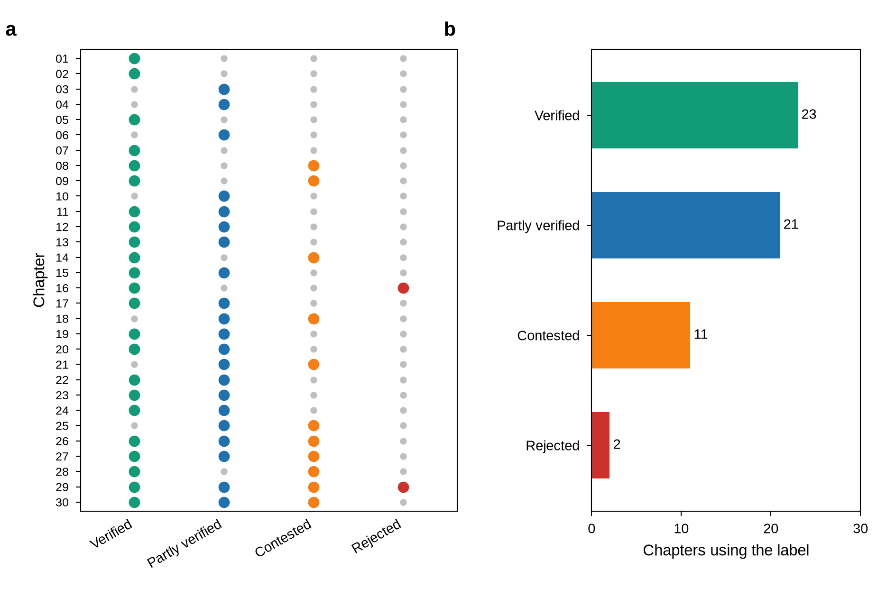

# 附录 A 被否定的说法与常见误区

本附录汇总全书关于失败的说法和跨章节反复出现的错误的结论，并给出一份简短的术语与符号表和全部图的索引。每一条都指向详细讨论证据的那一章。

本仓库相关条目：[c-value-junk-dna](../../theories/c-value-junk-dna/THEORY.md)、[molecular-clock](../../theories/molecular-clock/THEORY.md)、[island-model](../../theories/island-model/THEORY.md)。

## A.1 地位标签的用法

每一章在讨论证据之后都给出地位。**已验证**表示核心预测在多种数据中反复成立。**部分验证**表示定性预测成立，但定量部分或适用范围仍有争议。**有争议**表示证据相互矛盾。**被否定**表示核心预测已被数据推翻。书中大多数理论不是一个说法，而是几个说法，因此大多数章节给出不止一个标签，每个标签对应理论中有名称的一部分（图 A.1）。标签针对的是章中所表述的那个说法；同一个想法被否定的强形式，可以和已验证的弱形式并存。

## A.2 被否定的说法

| 说法 | 为什么被否定 | 章 |
|---|---|---|
| 人类基因组约 80% 有功能，因为其中被测到了生化活性 [1]。 | 受纯化选择的比例不到 10%，而生化活性不等于功能 [2, 3]；有生化活性的区域覆盖的基因组比保守区域大得多，因此单凭活性无法定义功能 [4]。 | [16](16-junk-dna-encode.zh.md) |
| 各谱系共用一个严格的分子钟。 | 严格分子钟和不设分子钟的无根树是两个在生物学上都不现实的极端；真实数据处在两者之间，要用宽松分子钟来分析 [5]。 | [6](06-molecular-clock.zh.md) |
| 基因组大小衡量生物的复杂程度。 | 真核生物的基因组大小相差 20 万倍以上，与生物的复杂程度没有关系 [6]；这种变异也不能用基因数目解释 [7]。 | [15](15-c-value-enigma.zh.md) |
| 人类基因组含有 100 多个在脊椎动物进化中从细菌获得的基因。 | 这一说法随即被反复驳斥 [8]；基因丢失、样本大小和速率差异可以解释这些共享基因 [9]，后来的候选基因也几乎得不到支持 [10]。 | [29](29-pangenomes-organelle-transfer-hgt.zh.md) |
| 缓步动物 *Hypsibius dujardini* 约六分之一的基因来自水平转移 [11]。 | 独立测序发现最多只有 1–2% 的基因是候选，先前的信号来自污染 [12]。 | [29](29-pangenomes-organelle-transfer-hgt.zh.md) |
| 历史上的候选基因对重度抑郁症有大效应。 | 十八个被大量研究的候选基因在 62,138 到 443,264 人的样本中没有表现出明确的关联 [13]；最早的关联研究常常高估效应 [14]。 | [30](30-missing-heritability-omnigenic.zh.md) |

## A.3 只以较窄形式保留的说法

一些著名的说法保留了下来，但适用范围缩小了。中性理论在功能约束和有利突变稀少这两点上成立，但适应性替换所占比例在物种之间差异很大，且有争议（[第 3 章](03-neutral-theory.zh.md)）。分子定年可行，但要用宽松分子钟并说明所用速率（[第 6 章](06-molecular-clock.zh.md)）。距离隔离已验证，而转移平衡理论仍有争议（[第 14 章](14-population-structure.zh.md)）。新近的多倍体分化较少，但多倍化在长期上是否是进化死胡同仍有争议（[第 21 章](21-polyploidy-dead-end.zh.md)）。植物中的表观等位基因可以遗传，但持久的环境记忆有争议（[第 28 章](28-transgenerational-epigenetic-inheritance.zh.md)）。高度多基因的遗传结构已验证，但核心基因与外周基因的划分有争议（[第 30 章](30-missing-heritability-omnigenic.zh.md)）。

## A.4 跨章节的常见误区

- **有效群体大小不等于普查数量。** 种植在数百万公顷上的作物，长期有效群体大小可以很小（[第 3](03-neutral-theory.zh.md)、[4](04-nearly-neutral-theory.zh.md) 和 [8 章](08-linked-selection.zh.md)）。由多样性估计的有效群体大小还取决于估计时所用的突变率（[第 18 章](18-drift-barrier-mutational-hazard.zh.md)）。
- **离群值需要零模型。** 没有模拟的中性分布，经验离群值不能证明选择（[第 9 章](09-hard-soft-sweeps.zh.md)）；在克隆或有结构的样本中，偏离哈迪–温伯格比例是预期之中的（[第 2 章](02-hardy-weinberg.zh.md)）。
- **聚类和 FST 是概括，不是历史。** FST 是衡量结构的好指标，但很少能准确给出迁移个体数 [15]；漂变强或模型不合适时，聚类条形图可能误导 [16]（[第 14 章](14-population-structure.zh.md)）。
- **物种不是独立的数据点。** 控制系统发育之后，有效群体大小与基因组属性之间的相关就不再显著 [17]（[第 15](15-c-value-enigma.zh.md) 和 [18 章](18-drift-barrier-mutational-hazard.zh.md)）。
- **活性不等于功能。** 生化活性、少数被征用的转座子或一个大效应插入，都不能说明大部分 DNA 有功能 [2, 4]（[第 16](16-junk-dna-encode.zh.md) 和 [17 章](17-selfish-dna-transposable-elements.zh.md)）。
- **污染和丢失会冒充转移。** 看起来外来的基因必须经得住污染过滤和差异丢失的检验 [9, 12]（[第 29 章](29-pangenomes-organelle-transfer-hgt.zh.md)）。
- **小型的首个研究会高估。** 首个关联研究报告的效应常常比后来的研究强 [14]（[第 30 章](30-missing-heritability-omnigenic.zh.md)）。
- **遗传力取决于估计方法。** 家系设计可能因共享环境或互作而偏高 [18, 19]，显著位点解释的方差也不是全部遗传贡献（[第 30 章](30-missing-heritability-omnigenic.zh.md)）。
- **无性繁殖作物有其特殊性。** 克隆之间的差异不是分离（[第 1 章](01-mendelian-inheritance.zh.md)）；克隆之间的体细胞变异不是群体多态（[第 6 章](06-molecular-clock.zh.md)）；无性繁殖作物不是冻结的基因组（[第 11 章](11-muller-ratchet-sex.zh.md)）；在霞多丽中，每七个基因就有一个因结构变异而处于半合子状态 [20]（[第 29 章](29-pangenomes-organelle-transfer-hgt.zh.md)）；不同的甲基化序列背景追踪克隆谱系的能力也不同（[第 28 章](28-transgenerational-epigenetic-inheritance.zh.md)）。

## A.5 术语与符号表

| 术语或符号 | 含义 | 主要章节 |
|---|---|---|
| *N*、*N*e | 普查数量；有效群体大小，即漂变程度相同的理想群体的大小 | 3、4、18、24 |
| *μ*、*u* | 每个位点或每个基因座每代的突变率 | 5、6、18 |
| *s*、*h* | 选择系数；等位基因的显性系数 | 10、26 |
| *θ*、*π* | 群体突变率 4*N*e*μ*；核苷酸多样性，即两条序列之间每个位点的平均差异数 | 5、8 |
| *ρ*、*r*² | 群体重组率 4*N*e*c*；两个位点等位基因之间相关系数的平方（连锁不平衡） | 7 |
| *F*ST | 遗传方差中群体之间部分所占的比例 | 2、14 |
| *D*（ABBA–BABA） | 检验非姐妹谱系之间共享衍生等位基因是否过多的统计量 | 12 |
| dN/dS | 非同义替换速率与同义替换速率之比 | 4、11、24 |
| DFE | 新突变的适合度效应分布 | 3、4、13 |
| BGS | 背景选择，即针对有害突变的选择造成的连锁中性多样性的丧失 | 8、9 |
| C 值 | 未复制的单倍体细胞核中的 DNA 量 | 15 |
| TE | 转座元件 | 16、17 |
| WGD | 全基因组加倍 | 19、20、21、22 |
| gBGC | GC 偏向的基因转换 | 23、24 |
| DMI | 不同位点等位基因之间的 Dobzhansky–Muller 不亲和 | 27 |
| 表观等位基因 | 染色质状态（通常是 DNA 甲基化）的可遗传变异，序列不变 | 28 |
| 核心基因组与附属基因组 | 一个物种所有成员都有的基因；只有部分成员有的基因 | 29 |
| NUMT、NUPT | 线粒体或质体 DNA 在细胞核中的插入 | 29 |
| *h*²、SNP 遗传力 | 狭义遗传力，即加性遗传效应造成的表型方差比例；被测定的 SNP 捕获的部分 | 30 |
| GWAS | 全基因组关联研究 | 30 |

## A.6 图索引

全书有 30 幅转载图，每幅都以 CC BY 4.0 发表并在图注中注明出处；另有 34 幅为本书绘制的图，脚本在 `book/scripts/` 中；此外还有下面的图 A.1。

| 章 | 图 | 类型 | 文件 |
|---|---|---|---|
| [1](01-mendelian-inheritance.zh.md) | 1.1 | 转载（Massonnet 2020, Fig. 6） | [massonnet2020_fig6.png](../figures/ch01/published/massonnet2020_fig6.png) |
| [1](01-mendelian-inheritance.zh.md) | 1.2 | 本书绘制 | [fig01_2_mendel_exceptions_schematic.png](../figures/ch01/fig01_2_mendel_exceptions_schematic.png) |
| [1](01-mendelian-inheritance.zh.md) | 1.3 | 本书绘制 | [fig01_3_segregation_power_sim.png](../figures/ch01/fig01_3_segregation_power_sim.png) |
| [2](02-hardy-weinberg.zh.md) | 2.1 | 转载（Stoeckel 2014, Fig. 1） | [stoeckel2014_fig1.png](../figures/ch02/published/stoeckel2014_fig1.png) |
| [2](02-hardy-weinberg.zh.md) | 2.2 | 本书绘制 | [fig02_2_heterozygosity_departures_sim.png](../figures/ch02/fig02_2_heterozygosity_departures_sim.png) |
| [2](02-hardy-weinberg.zh.md) | 2.3 | 本书绘制 | [fig02_3_reading_departures_schematic.png](../figures/ch02/fig02_3_reading_departures_schematic.png) |
| [3](03-neutral-theory.zh.md) | 3.1 | 转载（Williamson 2014, Fig. 1） | [williamson2014_fig1.png](../figures/ch03/published/williamson2014_fig1.png) |
| [3](03-neutral-theory.zh.md) | 3.2 | 本书绘制 | [fig03_2_neutral_rate_sim.png](../figures/ch03/fig03_2_neutral_rate_sim.png) |
| [3](03-neutral-theory.zh.md) | 3.3 | 本书绘制 | [fig03_3_mk_test_schematic.png](../figures/ch03/fig03_3_mk_test_schematic.png) |
| [4](04-nearly-neutral-theory.zh.md) | 4.1 | 转载（Galtier 2016, Fig. 3） | [galtier2016_fig3.png](../figures/ch04/published/galtier2016_fig3.png) |
| [4](04-nearly-neutral-theory.zh.md) | 4.2 | 本书绘制 | [fig04_2_fixation_and_dfe.png](../figures/ch04/fig04_2_fixation_and_dfe.png) |
| [5](05-coalescent.zh.md) | 5.1 | 转载（Chikhi 2018, Fig. 1） | [chikhi2018_fig1.jpg](../figures/ch05/published/chikhi2018_fig1.jpg) |
| [5](05-coalescent.zh.md) | 5.2 | 本书绘制 | [fig05_2_coalescent_times_sfs_sim.png](../figures/ch05/fig05_2_coalescent_times_sfs_sim.png) |
| [5](05-coalescent.zh.md) | 5.3 | 本书绘制 | [fig05_3_coalescent_assumptions_schematic.png](../figures/ch05/fig05_3_coalescent_assumptions_schematic.png) |
| [6](06-molecular-clock.zh.md) | 6.1 | 转载（Wang 2019, Fig. 1） | [wang2019_fig1.png](../figures/ch06/published/wang2019_fig1.png) |
| [6](06-molecular-clock.zh.md) | 6.2 | 本书绘制 | [fig06_2_clock_models.png](../figures/ch06/fig06_2_clock_models.png) |
| [7](07-recombination-ld.zh.md) | 7.1 | 转载（Chan 2012, Fig. 5） | [chan2012_fig5.png](../figures/ch07/published/chan2012_fig5.png) |
| [7](07-recombination-ld.zh.md) | 7.2 | 本书绘制 | [fig07_2_ld_decay.png](../figures/ch07/fig07_2_ld_decay.png) |
| [8](08-linked-selection.zh.md) | 8.1 | 转载（Corbett-Detig 2015, Fig. 1） | [corbettdetig2015_fig1.png](../figures/ch08/published/corbettdetig2015_fig1.png) |
| [8](08-linked-selection.zh.md) | 8.2 | 本书绘制 | [fig08_2_background_selection.png](../figures/ch08/fig08_2_background_selection.png) |
| [9](09-hard-soft-sweeps.zh.md) | 9.1 | 转载（Garud 2015, Fig. 4） | [garud2015_fig4.png](../figures/ch09/published/garud2015_fig4.png) |
| [9](09-hard-soft-sweeps.zh.md) | 9.2 | 本书绘制 | [fig09_2_soft_sweep_probability.png](../figures/ch09/fig09_2_soft_sweep_probability.png) |
| [10](10-genetic-load-domestication.zh.md) | 10.1 | 转载（Kim 2021, Fig. 4） | [kim2021_fig4.png](../figures/ch10/published/kim2021_fig4.png) |
| [10](10-genetic-load-domestication.zh.md) | 10.2 | 本书绘制 | [fig10_2_load_bottleneck.png](../figures/ch10/fig10_2_load_bottleneck.png) |
| [11](11-muller-ratchet-sex.zh.md) | 11.1 | 转载（Lovell 2017, Fig. 4） | [lovell2017_fig4.png](../figures/ch11/published/lovell2017_fig4.png) |
| [11](11-muller-ratchet-sex.zh.md) | 11.2 | 本书绘制 | [fig11_2_muller_ratchet.png](../figures/ch11/fig11_2_muller_ratchet.png) |
| [12](12-introgression-hybrid-speciation.zh.md) | 12.1 | 转载（Calfee 2021, Fig. 2） | [calfee2021_fig2.png](../figures/ch12/published/calfee2021_fig2.png) |
| [12](12-introgression-hybrid-speciation.zh.md) | 12.2 | 本书绘制 | [fig12_2_d_statistic.png](../figures/ch12/fig12_2_d_statistic.png) |
| [13](13-fisher-fundamental-theorem-geometric-model.zh.md) | 13.1 | 转载（Simon 2018, Fig. 2） | [simon2018_fig2.jpg](../figures/ch13/published/simon2018_fig2.jpg) |
| [13](13-fisher-fundamental-theorem-geometric-model.zh.md) | 13.2 | 本书绘制 | [fig13_2_fisher_geometric_model.png](../figures/ch13/fig13_2_fisher_geometric_model.png) |
| [14](14-population-structure.zh.md) | 14.1 | 转载（1001 Genomes Consortium 2016, Fig. 3） | [genomes2016_fig3.jpg](../figures/ch14/published/genomes2016_fig3.jpg) |
| [14](14-population-structure.zh.md) | 14.2 | 本书绘制 | [fig14_2_isolation_by_distance.png](../figures/ch14/fig14_2_isolation_by_distance.png) |
| [15](15-c-value-enigma.zh.md) | 15.1 | 转载（Bilinski 2018, Fig. 1） | [bilinski2018_fig1.png](../figures/ch15/published/bilinski2018_fig1.png) |
| [15](15-c-value-enigma.zh.md) | 15.2 | 本书绘制 | [fig15_2_genome_size_balance.png](../figures/ch15/fig15_2_genome_size_balance.png) |
| [16](16-junk-dna-encode.zh.md) | 16.1 | 转载（Rands 2014, Fig. 3） | [rands2014_fig3.png](../figures/ch16/published/rands2014_fig3.png) |
| [16](16-junk-dna-encode.zh.md) | 16.2 | 本书绘制 | [fig16_2_mutational_load_limit.png](../figures/ch16/fig16_2_mutational_load_limit.png) |
| [17](17-selfish-dna-transposable-elements.zh.md) | 17.1 | 转载（Carrier 2012, Fig. 3） | [carrier2012_fig3.png](../figures/ch17/published/carrier2012_fig3.png) |
| [17](17-selfish-dna-transposable-elements.zh.md) | 17.2 | 本书绘制 | [fig17_2_element_invasion.png](../figures/ch17/fig17_2_element_invasion.png) |
| [18](18-drift-barrier-mutational-hazard.zh.md) | 18.1 | 转载（Bergeron 2023, Fig. 3） | [bergeron2023_fig3.png](../figures/ch18/published/bergeron2023_fig3.png) |
| [18](18-drift-barrier-mutational-hazard.zh.md) | 18.2 | 本书绘制 | [fig18_2_drift_barrier.png](../figures/ch18/fig18_2_drift_barrier.png) |
| [19](19-gene-duplication-ohno-subfunctionalization.zh.md) | 19.1 | 转载（Qiao 2019, Fig. 3） | [qiao2019_fig3.png](../figures/ch19/published/qiao2019_fig3.png) |
| [19](19-gene-duplication-ohno-subfunctionalization.zh.md) | 19.2 | 本书绘制 | [fig19_2_subfunctionalization.png](../figures/ch19/fig19_2_subfunctionalization.png) |
| [20](20-gene-balance-dosage.zh.md) | 20.1 | 转载（Cheng 2012, Fig. 3） | [cheng2012_fig3.png](../figures/ch20/published/cheng2012_fig3.png) |
| [20](20-gene-balance-dosage.zh.md) | 20.2 | 本书绘制 | [fig20_2_reciprocal_retention.png](../figures/ch20/fig20_2_reciprocal_retention.png) |
| [21](21-polyploidy-dead-end.zh.md) | 21.1 | 转载（One Thousand Plant Transcriptomes Initiative 2019, Fig. 4） | [onekp2019_fig4.png](../figures/ch21/published/onekp2019_fig4.png) |
| [21](21-polyploidy-dead-end.zh.md) | 21.2 | 本书绘制 | [fig21_2_lineage_survival.png](../figures/ch21/fig21_2_lineage_survival.png) |
| [22](22-biased-fractionation-subgenome-dominance.zh.md) | 22.1 | 转载（Woodhouse 2010, Fig. 2） | [woodhouse2010_fig2.png](../figures/ch22/published/woodhouse2010_fig2.png) |
| [22](22-biased-fractionation-subgenome-dominance.zh.md) | 22.2 | 本书绘制 | [fig22_2_biased_fractionation.png](../figures/ch22/fig22_2_biased_fractionation.png) |
| [23](23-gc-biased-gene-conversion.zh.md) | 23.1 | 转载（Clément 2017, Fig. 4） | [clement2017_fig4.png](../figures/ch23/published/clement2017_fig4.png) |
| [23](23-gc-biased-gene-conversion.zh.md) | 23.2 | 本书绘制 | [fig23_2_gc_equilibrium.png](../figures/ch23/fig23_2_gc_equilibrium.png) |
| [24](24-codon-usage-bias.zh.md) | 24.1 | 转载（Clément 2017, Fig. 3） | [clement2017_fig3.png](../figures/ch24/published/clement2017_fig3.png) |
| [24](24-codon-usage-bias.zh.md) | 24.2 | 本书绘制 | [fig24_2_codon_selection.png](../figures/ch24/fig24_2_codon_selection.png) |
| [25](25-centromere-drive.zh.md) | 25.1 | 转载（Maheshwari 2015, Fig. 3） | [maheshwari2015_fig3.png](../figures/ch25/published/maheshwari2015_fig3.png) |
| [25](25-centromere-drive.zh.md) | 25.2 | 本书绘制 | [fig25_2_centromere_drive.png](../figures/ch25/fig25_2_centromere_drive.png) |
| [26](26-sex-chromosomes-y-degeneration-haldane.zh.md) | 26.1 | 转载（Muyle 2012, Fig. 1） | [muyle2012_fig1.png](../figures/ch26/published/muyle2012_fig1.png) |
| [26](26-sex-chromosomes-y-degeneration-haldane.zh.md) | 26.2 | 本书绘制 | [fig26_2_haldane_dominance.png](../figures/ch26/fig26_2_haldane_dominance.png) |
| [27](27-dobzhansky-muller-incompatibilities.zh.md) | 27.1 | 转载（Zuellig 2018, Fig. 7） | [zuellig2018_fig7.png](../figures/ch27/published/zuellig2018_fig7.png) |
| [27](27-dobzhansky-muller-incompatibilities.zh.md) | 27.2 | 本书绘制 | [fig27_2_dmi_snowball.png](../figures/ch27/fig27_2_dmi_snowball.png) |
| [28](28-transgenerational-epigenetic-inheritance.zh.md) | 28.1 | 转载（Hagmann 2015, Fig. 2） | [hagmann2015_fig2.png](../figures/ch28/published/hagmann2015_fig2.png) |
| [28](28-transgenerational-epigenetic-inheritance.zh.md) | 28.2 | 本书绘制 | [fig28_2_epiallele_decay.png](../figures/ch28/fig28_2_epiallele_decay.png) |
| [29](29-pangenomes-organelle-transfer-hgt.zh.md) | 29.1 | 转载（Golicz 2016, Fig. 2） | [golicz2016_fig2.png](../figures/ch29/published/golicz2016_fig2.png) |
| [29](29-pangenomes-organelle-transfer-hgt.zh.md) | 29.2 | 本书绘制 | [fig29_2_pangenome_growth.png](../figures/ch29/fig29_2_pangenome_growth.png) |
| [30](30-missing-heritability-omnigenic.zh.md) | 30.1 | 转载（Young 2019, Fig. 1） | [young2019_fig1.png](../figures/ch30/published/young2019_fig1.png) |
| [30](30-missing-heritability-omnigenic.zh.md) | 30.2 | 本书绘制 | [fig30_2_gwas_capture.png](../figures/ch30/fig30_2_gwas_capture.png) |

## 图

**图 A.1.** (a) 各章使用的地位标签，读自本书的地位总表。大的彩色圆点表示该章至少对理论的一部分使用了这个标签。(b) 使用每个标签的章数。用 [`scripts/appA_status_figures.py`](../scripts/appA_status_figures.py) 生成，它读取 `book/STATUS.md`；对给定的表，结果是确定性的。

## 参考文献

1. The ENCODE Project Consortium (2012) An integrated encyclopedia of DNA elements in the human genome. *Nature* 489:57-74. https://doi.org/10.1038/nature11247
2. Graur D, Zheng Y, Price N, et al. (2013) On the immortality of television sets: “function” in the human genome according to the evolution-free gospel of ENCODE. *Genome Biology and Evolution* 5:578-590. https://doi.org/10.1093/gbe/evt028
3. Doolittle WF (2013) Is junk DNA bunk? A critique of ENCODE. *Proceedings of the National Academy of Sciences* 110:5294-5300. https://doi.org/10.1073/pnas.1221376110
4. Kellis M, Wold B, Snyder MP, et al. (2014) Defining functional DNA elements in the human genome. *Proceedings of the National Academy of Sciences* 111:6131-6138. https://doi.org/10.1073/pnas.1318948111
5. Drummond AJ, Ho SYW, Phillips MJ, et al. (2006) Relaxed Phylogenetics and Dating with Confidence. *PLoS Biology* 4:e88. https://doi.org/10.1371/journal.pbio.0040088
6. Gregory TR (2001) Coincidence, coevolution, or causation? DNA content, cell size, and the C-value enigma. *Biological Reviews of the Cambridge Philosophical Society* 76:65-101. https://doi.org/10.1017/S1464793100005595
7. Elliott TA, Gregory TR (2015) What’s in a genome? The C-value enigma and the evolution of eukaryotic genome content. *Philosophical Transactions of the Royal Society B: Biological Sciences* 370:20140331. https://doi.org/10.1098/rstb.2014.0331
8. Bergthorsson U, Adams KL, Thomason B, et al. (2003) Widespread horizontal transfer of mitochondrial genes in flowering plants. *Nature* 424:197-201. https://doi.org/10.1038/nature01743
9. Salzberg SL, White O, Peterson J, et al. (2001) Microbial Genes in the Human Genome: Lateral Transfer or Gene Loss? *Science* 292:1903-1906. https://doi.org/10.1126/science.1061036
10. Salzberg SL (2017) Horizontal gene transfer is not a hallmark of the human genome. *Genome Biology* 18:85. https://doi.org/10.1186/s13059-017-1214-2
11. Boothby TC, Tenlen JR, Smith FW, et al. (2015) Evidence for extensive horizontal gene transfer from the draft genome of a tardigrade. *Proceedings of the National Academy of Sciences* 112:15976-15981. https://doi.org/10.1073/pnas.1510461112
12. Koutsovoulos G, Kumar S, Laetsch DR, et al. (2016) No evidence for extensive horizontal gene transfer in the genome of the tardigrade Hypsibius dujardini. *Proceedings of the National Academy of Sciences* 113:5053-5058. https://doi.org/10.1073/pnas.1600338113
13. Border R, Johnson EC, Evans LM, et al. (2019) No Support for Historical Candidate Gene or Candidate Gene-by-Interaction Hypotheses for Major Depression Across Multiple Large Samples. *American Journal of Psychiatry* 176:376-387. https://doi.org/10.1176/appi.ajp.2018.18070881
14. Ioannidis JPA, Ntzani EE, Trikalinos TA, et al. (2001) Replication validity of genetic association studies. *Nature Genetics* 29:306-309. https://doi.org/10.1038/ng749
15. Whitlock MC, McCauley DE (1999) Indirect measures of gene flow and migration: FST≠1/(4Nm+1). *Heredity* 82:117-125. https://doi.org/10.1038/sj.hdy.6884960
16. Lawson DJ, van Dorp L, Falush D (2018) A tutorial on how not to over-interpret STRUCTURE and ADMIXTURE bar plots. *Nature Communications* 9:3258. https://doi.org/10.1038/s41467-018-05257-7
17. Whitney KD, Garland T (2010) Did Genetic Drift Drive Increases in Genome Complexity? *PLoS Genetics* 6:e1001080. https://doi.org/10.1371/journal.pgen.1001080
18. Young AI, Frigge ML, Gudbjartsson DF, et al. (2018) Relatedness disequilibrium regression estimates heritability without environmental bias. *Nature Genetics* 50:1304-1310. https://doi.org/10.1038/s41588-018-0178-9
19. Zuk O, Hechter E, Sunyaev SR, et al. (2012) The mystery of missing heritability: Genetic interactions create phantom heritability. *Proceedings of the National Academy of Sciences* 109:1193-1198. https://doi.org/10.1073/pnas.1119675109
20. Zhou Y, Minio A, Massonnet M, et al. (2019) The population genetics of structural variants in grapevine domestication. *Nature Plants* 5:965-979. https://doi.org/10.1038/s41477-019-0507-8
